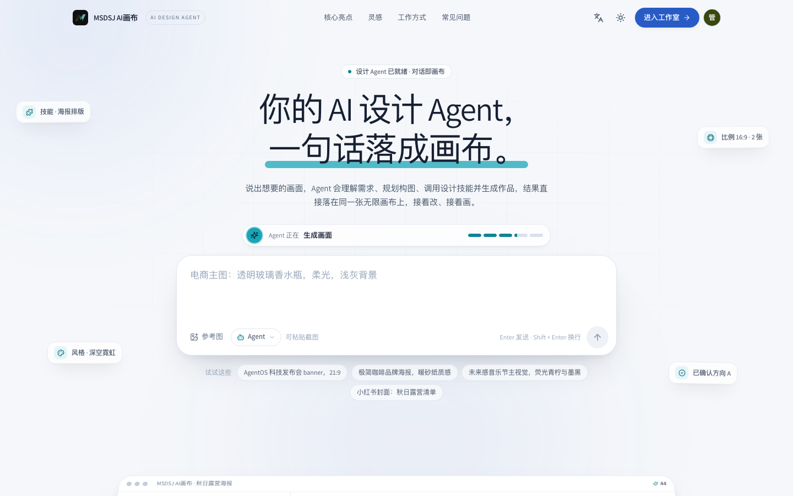
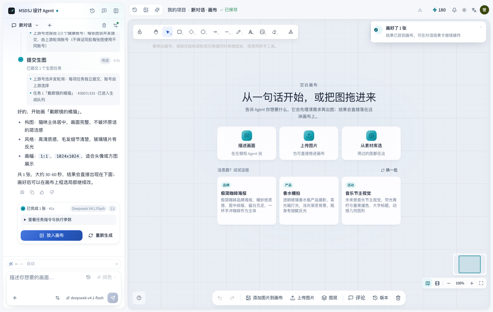

<div align="center">

# Canvas Studio

### 让 AI 设计 Agent 与无限画布在同一个工作区协作

用自然语言描述画面，让 Agent 理解需求、生成创作方案，并把结果放到画布上继续整理与编辑。

[开始使用](#快速开始) · [产品能力](#产品能力) · [部署方式](#部署方式) · [问题反馈](#问题反馈)

</div>

<p align="center">
  
</p>

<p align="center"><sub>在首页用一句话描述画面，Agent 会梳理需求，并把结果落到同一张无限画布上。</sub></p>

---

## Canvas Studio 是什么

Canvas Studio 是一个开源的 AI 图像创作工作区。它把 AI 对话、图像生成、素材管理和无限画布放进同一个创作流程：你可以从一句描述开始，也可以上传已有图片或从灵感素材出发；生成结果会进入画布，便于继续组合、标注和迭代，而不是停留在一次性的聊天回复里。

项目由三个服务组成：React 前端负责交互与画布，FastAPI 后端负责账户、项目、素材和任务等业务能力，独立的 AI Gateway 负责连接兼容的模型服务。模型服务由部署者自行配置，因此可以按自己的环境选择上游提供方。

## 产品预览

### 工作区：AI 对话与无限画布

<p align="center">
  
</p>

左侧对话面板负责理解需求、确认方案和提交生成任务；右侧无限画布用于查看、组织和继续编辑结果。图中生成任务已完成，对话中可直接点击「放入画布」。

### 生成结果

<p align="center">
  
</p>

上图是一次生成的插画结果示例。实际风格、分辨率与可用性取决于部署时配置的模型服务。

### 画布中的示例作品

<p align="center">
  
  
</p>

这两张是应用首页画布预览使用的示例素材，用于展示作品在画布中的呈现方式，并非固定的生成结果。

### 灵感素材

<p align="center">
  
  
  
  
</p>

灵感画廊展示不同方向的视觉示例，点击后可以将对应提示词带入输入框，作为创作起点。

## 产品能力

- **自然语言创作**：通过对话描述画面需求，并在工作区中继续迭代创作。
- **无限画布**：将生成图像、上传图片和创作素材放在同一空间中浏览与组织。
- **图像生成与编辑**：通过 AI Gateway 调用配置好的图像模型；支持在画布工作流中继续处理图像，包括对局部区域添加标注后提交编辑。
- **上传与素材管理**：将已有图片带入创作流程，并在项目中管理相关素材。
- **项目与任务管理**：围绕项目组织创作内容，并查看生成任务状态。
- **可配置模型接入**：通过管理配置或环境变量连接 OpenAI 兼容的文本与图像服务；具体可用能力取决于所配置的上游服务。

## 技术架构

```text
浏览器
  │
  ▼
React 19 / TypeScript / Vite
  │ 业务 API
  ▼
FastAPI Backend ─────── 数据库与文件存储
  │ 模型请求
  ▼
FastAPI AI Gateway
  │ OpenAI 兼容接口
  ▼
已配置的文本 / 图像模型服务
```

| 模块 | 技术与职责 |
|---|---|
| `frontend/` | React 19、TypeScript、Vite；页面、对话交互与画布工作区 |
| `backend/` | FastAPI；业务 API、数据库、文件存储与任务调度 |
| `gateway/` | FastAPI；模型请求转发与上游服务接入 |
| `deploy/` | Docker Compose 配置及本地启动相关脚本 |

前端还使用 TanStack Router、TanStack Query、Zustand、Excalidraw、Tailwind CSS 和 lucide-react 等库。依赖及版本以各模块的清单文件为准。

## 快速开始

### 环境要求

- Node.js 与 npm
- Python 3.11 或更新版本
- 可选：Docker Compose
- 需要使用 AI 生图或文本能力时：一个可访问的兼容模型服务及其凭据

### 本地启动

1. 克隆仓库，并在根目录准备本地环境配置。先阅读根目录及 `backend/`、`gateway/` 中的 `.env.example`，按需创建对应 `.env` 文件。所有密钥和管理员凭据都使用独立的强随机值；不要提交 `.env`。

2. 安装 Python 与前端依赖：

```bash
python3 -m venv backend/.venv
backend/.venv/bin/pip install -r backend/requirements.txt

python3 -m venv gateway/.venv
gateway/.venv/bin/pip install -r gateway/requirements.txt

cd frontend && npm install
```

3. 初始化后端数据目录与数据库：

```bash
cd ..
mkdir -p backend/data/storage
cd backend && .venv/bin/python -m app.migrations.run
```

4. 按照 [启动与运行指南](启动与运行指南.md) 启动 Gateway、Backend 和 Frontend。默认开发端口为：

| 服务 | 地址 |
|---|---|
| 前端 | `http://localhost:27180` |
| 后端 | `http://localhost:27181` |
| AI Gateway | `http://localhost:27182` |

也可以在仓库根目录使用 `./启动.command`（macOS）或 `./deploy/scripts/start-local.sh`。不同脚本的监听地址、依赖安装和运行方式有所区别，首次运行前请查看脚本说明及运行指南。

> 页面可以在没有模型服务时启动，但 AI 对话或图像生成需要正确配置并可访问的模型服务。请勿把真实 API Key、管理员密码或生产密钥填入公开 issue、截图或提交记录。

## 部署方式

仓库提供 Docker Compose 部署配置。部署前检查 `deploy/.env.example`，在 `deploy/` 下创建本地 `.env`，并为必需的秘密和模型服务变量填写独立配置：

```bash
cd deploy
cp .env.example .env
# 编辑 .env，替换所有 replace-with-... 占位值并按需配置模型服务
```

然后根据目标环境选择对应的 Compose 文件。启动命令、服务暴露端口、持久化目录和反向代理要求请以 `deploy/` 下的配置及 [部署说明](deploy/README.md) 为准。生产环境不要使用示例凭据，并应限制管理界面与服务端口的网络访问。

## 开发与检查

前端检查：

```bash
cd frontend
npm run typecheck
npm run lint
npm run build
```

后端与 Gateway 测试（需要已安装各自依赖）：

```bash
cd backend && .venv/bin/python -m pytest tests/ -q
cd ../gateway && .venv/bin/python -m pytest tests/ -q
```

## 配置与安全

- `.env.example` 仅提供配置项模板，不是可直接投入生产的配置。
- 不要提交 `.env`、API Key、浏览器认证状态、日志、数据库或包含个人运行数据的截图与报告。
- 使用生产环境前，为签名密钥、内部服务令牌和管理员账户设置独立强凭据，并确认服务只对预期网络开放。
- 如果密钥曾经进入 Git 历史或推送到远端，应立即在对应服务撤销并轮换；仅删除当前文件不能清除历史记录中的凭据。
- 上游模型服务可能有独立的费用、数据保留和使用条款，请在接入前自行确认。

## 图片与许可

README 中的产品截图与示例图引用自仓库现有文件。它们的来源和再分发许可需要在公开发布前逐项确认；如无法确认许可，请替换为你拥有权利或已获授权的素材。第三方依赖、字体、图标与图片分别遵循各自适用的许可。

## 问题反馈

遇到问题时，请在 GitHub Issues 中提供复现步骤、相关模块和脱敏后的错误信息。提交前移除 API Key、访问令牌、服务地址中的私有域名、账户信息及个人数据。功能建议和代码贡献也欢迎通过 Issue 或 Pull Request 交流。
