# canvas-studio 系统架构设计 + 任务分解

> 版本：v1.1 · 2026-10-16 · 架构师：高见远
> 输入：`docs/01-prd.md`（G1 通过） + `docs/01b-ui-design.md` + `docs/00-team-workflow.md` + 主理人增量约束（Demo 模式 / 异常场景兼容 B1–B3）
> 目标：给出三组件（frontend / backend / gateway）独立可部署的完整设计，并把实现工作切分为可按顺序派发的批次任务。
> 语言：简体中文。全文结构化（表格 / Mermaid / Schema）。
> 变更：v1.1 纳入 Demo 演示模式、生成中暂停/恢复、刷新续接、幂等防浪费、VPN 高延迟适配（见 §1.8）。

---

## 目录

- [Part A · 系统设计](#part-a--系统设计)
  - [1. 实现方案 + 框架选型](#1-实现方案--框架选型)
  - [2. 文件列表及相对路径](#2-文件列表及相对路径)
  - [3. 数据模型](#3-数据模型)
  - [4. API 契约](#4-api-契约)
  - [5. 关键流程时序图](#5-关键流程时序图)
- [Part B · 任务分解](#part-b--任务分解)
  - [6. 任务列表](#6-任务列表)
  - [7. 依赖包清单](#7-依赖包清单)
  - [8. 共享知识 + 待明确事项](#8-共享知识--待明确事项)
  - [9. P0 需求追溯表](#9-p0-需求追溯表)
  - [10. 任务依赖图](#10-任务依赖图)

---

# Part A · 系统设计

## 1. 实现方案 + 框架选型

### 1.1 三组件职责边界

| 组件 | 端口(dev/prod) | 技术栈 | 职责边界（唯一真源） |
|------|--------------|--------|-------------------|
| **frontend** | 5173 / 80(nginx) | React 19 + TS + Vite 6 + Tailwind 4 + Zustand + i18next + Excalidraw + TanStack Router/Query | UI 渲染、交互、本地画布状态、i18n/主题、任务续接与幂等键持久化、调用 backend `/api/*`。**不直接访问上游、不持有任何上游 Key** |
| **backend** | 8000 | FastAPI + SQLAlchemy 2.0(async) + aiosqlite + PyJWT + passlib(bcrypt) + aiosmtplib + APScheduler | 业务中台唯一真源：认证/用户、项目/画布/资产、**额度账本（唯一写入方）**、**生成任务状态机（唯一真源，持久化）**、对话与生成编排、幂等去重、暂停/恢复/孤儿回收、管理后台、系统配置表、审计。对外暴露 REST + SSE |
| **gateway** | 8100 | FastAPI + httpx(async) + Pillow | 集成出口（egress）：上游路由转发（sub2api/chatgpt2api）、号池管理接口代理、上游错误码归一、连通性测试（区分 VPN/代理不通 与 上游故障）、SSE 透传、**代理/超时/重试/自适应退避**、**Demo 演示降级（本地占位图/模拟对话）**。**只被 backend 内部调用**（`/gw/*`，内部令牌鉴权） |
| **上游 sub2api** | 8080 | Go（二开外，仅配置对接） | OpenAI 兼容对话：`POST /v1/chat/completions` |
| **上游 chatgpt2api** | 3000 | FastAPI（二开外，仅配置对接） | 生图/编辑 + 号池管理：`/v1/images/*`、`/api/accounts*` |
| **存储** | — | SQLite 文件 + 本地静态目录 | `backend/data/canvas_studio.db` + `backend/data/storage/`（数据卷挂载） |

### 1.2 网络拓扑与数据流

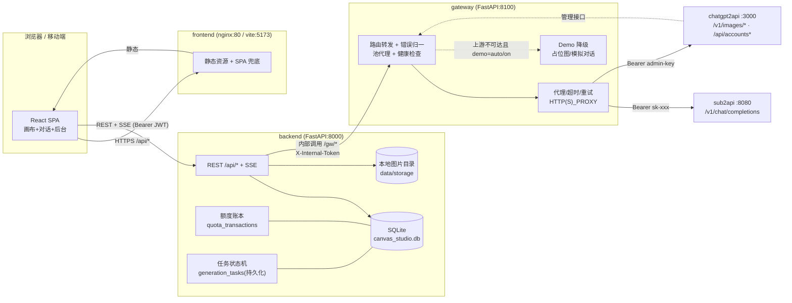

**关键决策（与 PRD §5.7 的偏差说明）：**
1. **额度账本 + 任务状态机单一写入方 = backend**。PRD 称"网关收敛额度预检/扣减"，但为避免 double-write 造成账实不符，本设计由 backend 独占 `quota_transactions`、`users.balance`、`generation_tasks`；gateway **不做**额度扣减与任务落库，仅转发、降级与探测。预扣/确认/回滚、暂停/恢复、孤儿回收全部发生在 backend（见 §5.2/§5.7/§5.8）。这是唯一一处对 PRD 的收敛性解释，工程上更安全、更可测。
2. **gateway 不被浏览器直接访问**，仅 backend→gateway 内网调用（`/gw/*` + `CS_GATEWAY_INTERNAL_TOKEN`）。若后续要外放，只需加一层 JWT 校验中间件，无需改契约。
3. **系统配置唯一真源 = backend `system_configs` 表**。配置变更时 backend 主动 `POST /gw/config` 把解析后的上游地址/Key/代理/Demo 开关推送给 gateway 内存缓存；gateway 启动时以环境变量为兜底。→ 实现"本地→线上切换只改配置、无需重新部署"。
4. **平台自身功能不依赖上游**：认证、画布、额度、资产、后台全部走本地 SQLite/文件，上游不可达只在 AI 调用处报 `UPSTREAM_ERROR`/`POOL_UNAVAILABLE` 并给出"前往系统配置"指引；`CS_DEMO_MODE=auto` 时网关自动降级为演示结果（§1.8）。

### 1.3 前端选型（确认沿用 jaaz 组合）

| 决策项 | 结论 | 理由 |
|--------|------|------|
| 框架 | **React 19 + TypeScript + Vite 6** | 与 jaaz 现状一致，零学习成本；构建快 |
| 样式 | **Tailwind CSS 4（`@tailwindcss/vite`）+ CSS 变量主题** | 设计规范 §2 以语义 token 为主，Tailwind 4 的 `@theme` 可直接映射 CSS 变量 |
| 组件库 | **Radix UI + shadcn 结构（来自 jaaz `components/ui`）+ Lucide 图标** | 无障碍达标、可完全自定义、与设计规范组件枚举一一对应 |
| 状态管理 | **Zustand 5**（+ immer 可选） | 全局 auth/quota/theme/canvas/chat 分片，轻量、无 Provider 地狱；chat slice 用 `persist` 中间件持久化"进行中任务"到 localStorage |
| 服务端状态 | **TanStack Query 5** | 列表/详情缓存、轮询（任务进度、号池刷新）天然契合，支持自适应退避轮询 |
| 路由 | **TanStack Router 1.x（文件式路由）** | **决定**：沿用 jaaz 范式（已有 `routes/` + `routeTree.gen.ts`），类型安全路由参数、`validateSearch` 承载 `?session=&task=`，优于 react-router 手写配置 |
| 画布 | **@excalidraw/excalidraw 0.18+** | 沿用 jaaz `CanvasExcali.tsx` 交互范式（拖拽/缩放/框选/层级），满足 P0-07/P0-09 |
| i18n | **i18next + react-i18next + browser-languagedetector** | 沿用 jaaz `i18n` 骨架，命名空间拆分 |
| 主题 | **next-themes 思路改造为自研 `ThemeProvider`（data-theme + localStorage）** | 设计规范要求 `:root` / `[data-theme="dark"]` 双变量集，无需 SSR 机制 |
| 实时 | 生成/对话进度用 **SSE（fetch + ReadableStream）**；不用 socket.io | 单向进度流足够，减少一个上游依赖；jaaz 的 socket.io 不移植 |

**从 jaaz 移植清单（工程师执行）：** `components/canvas/*`（CanvasExcali/CanvasHeader/CanvasExport/menu/pop-bar）、`stores/canvas.ts`、`hooks/use-theme|use-language|use-mobile|use-debounce`、`i18n/*` 骨架、`components/ui/*`（Radix shadcn 原语）、`lib/utils.ts`。**不移植**：electron/、socket.io 全套、comfyui/knowledge/agent_studio、tldraw、posthog。

### 1.4 后端选型

| 决策项 | 结论 | 理由 |
|--------|------|------|
| Web 框架 | **FastAPI** | 与约束一致；Pydantic v2 校验；原生 async |
| ORM/DB | **SQLAlchemy 2.0 async + aiosqlite**（**决定**，不用 SQLModel） | SQLModel async 支持不成熟；显式 `AsyncSession` + `selectinload` 可控；`create_all` 建表，无需 Alembic（首版），迁移用 `services/migrations` 简易脚本 |
| 密码哈希 | **passlib[bcrypt]** | 社区标准，`bcrypt` 自带盐 |
| JWT | **PyJWT**（HS256，access token 7d） | 轻量；含 `sub/user_id/role/token_version` |
| 邮件 | **aiosmtplib**；`CS_EMAIL_BACKEND=console`（默认，打印/落日志） \| `smtp` | 满足"零外部依赖启动"：开发态确认链接打印到控制台与 `data/mail.log` |
| 后台任务 | **FastAPI BackgroundTasks**（生成编排）+ **APScheduler(AsyncIOScheduler)**（号池定时刷新、**孤儿任务回收**、超时清理） | 单进程内定时，无需 Celery/Redis |
| 配置 | **pydantic-settings**（`CS_` 前缀 env） | 禁止硬编码，集中校验 |
| 静态文件 | **FastAPI StaticFiles** 挂载 `data/storage` → `/static/*` | 本地图片直出 |
| 幂等 | `generation_tasks` 上 `UNIQUE(user_id, idempotency_key)` + 请求头 `Idempotency-Key` | 杜绝重复创建/重复扣费/重复调上游（§1.8 B3） |

### 1.5 网关选型

| 决策项 | 结论 |
|--------|------|
| 框架 | **FastAPI + httpx(AsyncClient)** 独立服务，端口 **8100** |
| 鉴权 | 内部令牌 `X-Internal-Token == CS_GATEWAY_INTERNAL_TOKEN`，否则 401 `UNAUTHORIZED` |
| 上游配置 | 环境变量兜底 + backend `POST /gw/config` 运行时推送（内存缓存，含代理与 Demo 开关） |
| 转发 | 对话/生图透传；SSE 用 `StreamingResponse` 逐块转发 |
| 网络适配 | httpx `proxy=HTTP_PROXY/HTTPS_PROXY`；connect/read 超时分离；仅幂等安全请求重试（指数退避） |
| Demo 降级 | `CS_DEMO_MODE=auto\|on\|off`；auto 时上游不可达 → Pillow 占位图 / 模拟对话，响应标 `demo:true` |
| 错误归一 | 上游非 2xx / 超时 / 连接失败 → 统一错误码；health 区分 `PROXY_UNREACHABLE` 与 `UPSTREAM_ERROR` |
| 号池代理 | 原样代理 chatgpt2api `/api/accounts*`（5 种导入、刷新/re-login 进度轮询、update/delete/export/oauth） |

### 1.6 存储方案与数据表清单

- **数据库**：SQLite 文件 `backend/data/canvas_studio.db`（Docker 数据卷 `backend_data`）。
- **图片**：本地目录 `backend/data/storage/{user_id}/{yyyy}/{mm}/{uuid}.png`，缩略图 `…/thumb/{uuid}.jpg`；对外 URL `{CS_STORAGE_PUBLIC_BASE}/{相对路径}`。生产可切换对象存储（抽象为 `storage_service`，预留 `CS_STORAGE_BACKEND=local|s3`）。
- **数据表**（13 张）：`users`、`email_tokens`、`canvas_projects`、`canvases`、`assets`、`chat_sessions`、`chat_messages`、`generation_tasks`、`quota_transactions`、`system_configs`、`audit_logs`、`announcements`、`invite_codes`（详见 §3）。

### 1.7 端口规划

| 服务 | dev | prod(容器) | 说明 |
|------|-----|-----------|------|
| frontend | 5173 | 80 | nginx 托管 SPA，`/api` 反代 backend |
| backend | 8000 | 8000 | FastAPI/uvicorn |
| gateway | 8100 | 8100 | 仅内网 |
| chatgpt2api | 3000 | 3000 | 既有镜像 |
| sub2api | 8080 | 8080 | 既有镜像 |

### 1.8 异常场景兼容设计（约束 A + B，本版新增）

#### 1.8.1 Demo 演示模式（约束 A）

- **开关**：`CS_DEMO_MODE = auto | on | off`（默认 `auto`）。`auto` = 探测上游不可达（或池空）时对 AI 能力降级；`on` = 强制演示；`off` = 严格真实上游。
- **降级行为**（仅 gateway 层）：
  - 生图/编辑 → gateway 用 **Pillow** 本地生成占位图（尺寸随请求、图上绘制 prompt 文字与 "DEMO" 水印），存入 backend 静态目录，按正常生图结果结构返回；
  - 对话 → gateway 返回模拟回复（回显 prompt + 提示"演示模式"）；
  - 响应统一附 `demo: true`，backend 透传给前端，前端在结果卡标注"演示结果"。
- **平台功能不受影响**：认证/画布/额度/资产/后台全部本地化；上游不可达时仅 AI 能力报 `UPSTREAM_ERROR`/`POOL_UNAVAILABLE`，并在前端提供"前往 `/admin/config` 系统配置"引导（普通用户提示"请联系管理员"）。

#### 1.8.2 B1 · 生成中主动暂停

- **任务状态机**（`generation_tasks.status`）：`queued → running → (paused) → (cancelled) → succeeded | failed | timeout`。
  - 合法迁移：`queued→running|cancelled|timeout`；`running→paused|succeeded|failed|timeout|cancelled`；`paused→running（恢复）|cancelled（放弃）|timeout`。
- **暂停语义**：上游生图不可真正中断，故 `pause` 为**软暂停**——backend 标记 `paused` + 记 `paused_at`，前端停止轮询；若上游任务仍在跑，`resume` 时继续轮询同一 `upstream_task_id`；若上游已终止，`resume` 重新提交（生成新 upstream 任务，复用原预扣，不二次扣费）。
- **额度衔接**：任务进入 `paused`/`cancelled`/`failed`/`timeout` 且**未产生有效结果**时，按 §5.2 幂等**回滚预扣**（`refund`，`ref_id` 幂等）；仅 `succeeded` 才 `confirm`。**未完成绝不扣费**。
- **UI 按钮态**：进行中显示 [暂停]；`paused` 显示 [继续] [放弃]；`cancelled/failed/timeout` 显示 [重试]。

#### 1.8.3 B2 · 刷新页面状态恢复与续接

- **持久化**：任务状态**全部落 `generation_tasks`**（禁止仅内存）。进程重启后仍可查。
- **前端续接**：进行中任务 ID 写 **localStorage（`cs.activeTasks`）** + URL 查询参数（`/canvas/:id?session=xx&task=yy`）；应用挂载时读 URL/localStorage → 调 `GET /api/tasks/active` 与 `GET /api/generate/tasks/{id}` 恢复进度态；`ResumeGuard` 组件处理"任务已完成但已刷新"场景：重进时展示结果并 toast 提示，不丢结果。
- **后端**：`GET /api/tasks/active` 返回当前用户活跃任务（`queued|running|paused`）；对话会话刷新后拉历史消息 + 进行中生成状态，无缝接续。

#### 1.8.4 B3 · 高延迟 + 频繁刷新的幂等与防浪费

- **幂等键**：客户端为每次"新生成/编辑意图"生成 UUID `Idempotency-Key`（请求头，= PM `client_request_id`），localStorage 持久化以便刷新后**复用同一键**；`generation_tasks` 对 `(user_id, idempotency_key)` **唯一约束**。重复提交 → 直接返回已存在任务当前状态（200），**绝不重复创建/扣费/调上游**。**去重窗口** `CS_IDEMPOTENCY_WINDOW_SECONDS`（默认 300s）：窗口内命中即replay；超窗口或该键对应任务已终态失败/取消时，**前端生成新键**视为新任务（与 PM §11 "失败/取消后再发视为新任务"一致）。
- **前端去重**：相同 in-flight 请求共享 Promise；提交中禁用按钮；输入防抖。
- **并发上限**：每用户活跃生成任务数上限 `CS_MAX_ACTIVE_TASKS_PER_USER`（默认 2）；超限返回 `TASK_LIMIT_EXCEEDED`(429) + 文案"已有 N 个任务进行中，请稍候或先取消"。
- **孤儿回收**：`running` 且 `last_activity_at` 超 `CS_TASK_TIMEOUT_SECONDS`（默认 180s）无进展 → 自动转 `timeout` + 幂等回滚；APScheduler 周期清理超时任务与残留临时文件。
- **VPN 高延迟适配**：网关 connect/read 超时分离（`CS_GW_CONNECT_TIMEOUT`/`CS_GW_READ_TIMEOUT`）；仅幂等安全请求允许重试（指数退避 + 抖动）；前端轮询间隔自适应退避；health 探测区分"VPN/代理不通"(`PROXY_UNREACHABLE`) 与"上游故障"(`UPSTREAM_ERROR`)；httpx 支持 `HTTP_PROXY`/`HTTPS_PROXY`（适配服务器内部 VPN）。

---

## 2. 文件列表及相对路径

> 共 **约 197 个源文件**（frontend 125 / backend 48 / gateway 18 / deploy 8，含 v1.1 新增异常场景文件）。
> 来源列：`新建` = 全新文件；`移植` = 从 `jaaz-main` 移植改造（已标注源路径与改造点）。

### 2.1 frontend/（React + TS + Vite）

**项目配置与入口**

| 路径 | 职责 | 来源 |
|------|------|------|
| `frontend/package.json` | 依赖与脚本（dev/build/preview/lint） | 移植改造(jaaz `react/package.json`，去 electron/socket.io/tldraw/xyflow) |
| `frontend/vite.config.ts` | Vite + React + TanStackRouter 插件 + Tailwind 插件 + `/api` 代理到 8000 | 移植改造 |
| `frontend/tsconfig.json` / `tsconfig.node.json` | TS 配置 | 新建 |
| `frontend/index.html` | SPA 入口 HTML（含首屏主题防闪脚本） | 新建 |
| `frontend/eslint.config.js` | ESLint flat config | 移植改造 |
| `frontend/postcss.config.js` | PostCSS（Tailwind 4） | 新建 |
| `frontend/.env.example` | `VITE_API_BASE_URL` 等 | 新建 |
| `frontend/Dockerfile` | 多阶段构建 → nginx | 新建 |
| `frontend/nginx.conf` | 静态托管 + `/api` 反代 + SPA fallback | 新建 |
| `frontend/src/vite-env.d.ts` | 环境变量类型 | 新建 |

**应用入口 / 主题 / 路由**

| 路径 | 职责 | 来源 |
|------|------|------|
| `frontend/src/main.tsx` | 挂载 React、Provider 树（Query/Router/Theme/i18n/Toaster） | 移植改造 |
| `frontend/src/App.tsx` | App 壳（RouterProvider + ResumeGuard） | 移植改造 |
| `frontend/src/router.tsx` | TanStack Router 实例 + 全局 error/notFound + search schema(`session/task`) | 新建 |
| `frontend/src/routeTree.gen.ts` | 生成的路由树（构建产物，入仓） | 新建 |
| `frontend/src/index.css` | Tailwind 入口 + `@theme` 映射语义 token | 新建 |
| `frontend/src/styles/tokens.css` | 设计规范 §2/§3/§4 双主题 CSS 变量（`:root` / `[data-theme=dark]`） | 新建 |

**i18n（2 语言 × 10 命名空间 = 20 文件 + index）**

| 路径 | 职责 | 来源 |
|------|------|------|
| `frontend/src/i18n/index.ts` | i18next 初始化、语言检测、回退 zh-CN | 移植改造(jaaz `i18n/index.ts`) |
| `frontend/src/i18n/locales/{zh-CN,en}/common.json` | 通用（按钮/状态/分页/确认） | 移植改造 |
| `frontend/src/i18n/locales/{zh-CN,en}/auth.json` | 登录/注册/确认/重置 | 新建 |
| `frontend/src/i18n/locales/{zh-CN,en}/errors.json` | 错误码文案映射（含 TASK_*/RATE_LIMITED） | 新建 |
| `frontend/src/i18n/locales/{zh-CN,en}/workspace.json` | 工作台/顶栏/额度徽章 | 新建 |
| `frontend/src/i18n/locales/{zh-CN,en}/canvas.json` | 画布工具/导出 | 移植改造 |
| `frontend/src/i18n/locales/{zh-CN,en}/chat.json` | 对话面板/生成卡片/暂停恢复文案 | 移植改造 |
| `frontend/src/i18n/locales/{zh-CN,en}/assets.json` | 资产库 | 新建 |
| `frontend/src/i18n/locales/{zh-CN,en}/projects.json` | 项目 | 新建 |
| `frontend/src/i18n/locales/{zh-CN,en}/usage.json` | 额度中心 | 新建 |
| `frontend/src/i18n/locales/{zh-CN,en}/settings.json` | 账户设置 | 移植改造 |
| `frontend/src/i18n/locales/{zh-CN,en}/admin.json` | 管理后台 | 新建 |

**API 层 / 工具**

| 路径 | 职责 | 来源 |
|------|------|------|
| `frontend/src/lib/api/client.ts` | fetch 封装：注入 Bearer + `Idempotency-Key`、统一解包 `{code,data,message}`、错误抛 `ApiError`、in-flight 去重 | 新建 |
| `frontend/src/lib/api/auth.ts` | 注册/确认/登录/登出/忘记/重置 | 新建 |
| `frontend/src/lib/api/me.ts` | 个人资料、改密、登出全部设备 | 新建 |
| `frontend/src/lib/api/projects.ts` | 项目 CRUD | 新建 |
| `frontend/src/lib/api/canvases.ts` | 画布 CRUD/自动保存/分享/导出 | 新建 |
| `frontend/src/lib/api/assets.ts` | 资产列表/上传/删除 | 新建 |
| `frontend/src/lib/api/chat.ts` | 会话/消息/SSE | 新建 |
| `frontend/src/lib/api/generate.ts` | 生图/编辑任务、暂停/恢复/取消、进度轮询 | 新建 |
| `frontend/src/lib/api/tasks.ts` | 活跃任务列表/详情（刷新续接） | 新建 |
| `frontend/src/lib/api/quota.ts` | 余额/流水/单价 | 新建 |
| `frontend/src/lib/api/admin.ts` | 管理后台全部端点 | 新建 |
| `frontend/src/lib/api/announcements.ts` | 公告读取 | 新建 |
| `frontend/src/lib/errors.ts` | 错误码 → i18n key 映射表 | 新建 |
| `frontend/src/lib/sse.ts` | SSE 客户端封装（自动重连/取消/退避） | 新建 |
| `frontend/src/lib/task-persistence.ts` | 进行中任务 ID / 幂等键 localStorage 读写 | 新建 |
| `frontend/src/lib/utils.ts` | `cn()` 等（clsx+tailwind-merge） | 移植(jaaz) |
| `frontend/src/lib/events.ts` | 轻量事件总线（mitt） | 移植(jaaz) |

**Zustand stores**

| 路径 | 职责 | 来源 |
|------|------|------|
| `frontend/src/stores/auth.ts` | 当前用户、登录态、token 持久化 | 新建 |
| `frontend/src/stores/quota.ts` | 余额、阈值、单价、告警态 | 新建 |
| `frontend/src/stores/theme.ts` | 亮/暗/系统 + 持久化 | 新建 |
| `frontend/src/stores/canvas.ts` | 当前画布、选中元素、保存态 | 移植改造(jaaz `stores/canvas.ts`) |
| `frontend/src/stores/chat.ts` | 会话列表、消息流、进行中任务（persist 到 localStorage） | 新建 |
| `frontend/src/stores/ui.ts` | 模态/抽屉/移动端分段态 | 新建 |

**UI 原语（Radix shadcn，`components/ui/`，24 文件）**

| 路径 | 职责 | 来源 |
|------|------|------|
| `button.tsx` `input.tsx` `textarea.tsx` `label.tsx` `form-field.tsx` | 表单控件（含 error/helper） | 移植改造 |
| `dialog.tsx` `modal.tsx` `popover.tsx` `dropdown-menu.tsx` | 浮层 | 移植改造 |
| `select.tsx` `checkbox.tsx` `switch.tsx` `tabs.tsx` | 选择控件 | 移植改造 |
| `card.tsx` `badge.tsx` `table.tsx` `pagination.tsx` | 展示 | 移植改造 |
| `avatar.tsx` `tooltip.tsx` `separator.tsx` `scroll-area.tsx` | 基础 | 移植改造 |
| `toast.tsx`(sonner 封装) `skeleton.tsx` `spinner.tsx` `progress.tsx` `empty-state.tsx` | 反馈 | 移植/新建 |

**布局组件（`components/layout/`）**

| 路径 | 职责 | 来源 |
|------|------|------|
| `AppShell.tsx` | 登录后全局壳（顶栏 + 内容） | 新建 |
| `TopBar.tsx` | 全局顶栏（Logo/项目名/额度/通知/语言/主题/头像） | 新建 |
| `QuotaBadge.tsx` | 额度徽章（正常/预警/耗尽三态） | 新建 |
| `ThemeToggle.tsx` / `LocaleToggle.tsx` | 主题/语言切换 | 新建 |
| `UserMenu.tsx` / `NotificationBell.tsx` | 用户菜单 / 通知 | 新建 |
| `AnnouncementBanner.tsx` | 顶部公告条（可标记已读） | 新建 |
| `AdminShell.tsx` / `AdminSidebar.tsx` | 后台壳 + 左侧导航 | 新建 |
| `WorkspaceLeftbar.tsx` / `WorkspaceRightPanel.tsx` | 工作台三栏左右栏容器 | 新建 |
| `MobileSegmented.tsx` | 移动端"画布/对话"分段切换 | 新建 |
| `ProtectedRoute.tsx` / `AdminRoute.tsx` | 登录/管理员路由守卫 | 新建 |
| `MaintenanceGate.tsx` | 维护模式拦截页 | 新建 |
| `ResumeGuard.tsx` | App 挂载时续接进行中任务 + 展示已完成未读结果 | 新建 |
| `UnreadResultsBanner.tsx` | 未读结果提醒条（P0-31/P1-14，点击定位/加入画布） | 新建 |

**画布模块（`components/canvas/`）**

| 路径 | 职责 | 来源 |
|------|------|------|
| `CanvasExcali.tsx` | Excalidraw 画布核心（拖拽/缩放/框选/层级） | 移植改造(jaaz `components/canvas/CanvasExcali.tsx`) |
| `CanvasHeader.tsx` | 画布顶部工具栏（项目名/保存态/分享/导出） | 移植改造 |
| `CanvasExport.tsx` | 导出 PNG/JSON | 移植改造 |
| `CanvasMinimap.tsx` | 右下角缩略导航 | 新建 |
| `CanvasToolbar.tsx` | 添加图片/上传/删除/对齐工具 | 新建 |
| `ImageNode.tsx` | 图片节点渲染与菜单 | 新建 |
| `useCanvasAutosave.ts` | 防抖 2s 自动保存 + 保存态 | 新建 |
| `canvas-helpers.ts` | 元素增删/落图/坐标计算 | 新建 |
| `CanvasMagicGenerator.tsx` | 选中图→AI 编辑入口 | 移植改造(jaaz `pop-bar/CanvasMagicGenerator.tsx`) |
| `menu/CanvasToolMenu.tsx` `menu/CanvasViewMenu.tsx` `menu/CanvasMenuButton.tsx` `menu/index.tsx` | 画布工具/视图菜单 | 移植改造 |

**对话模块（`components/chat/`）**

| 路径 | 职责 | 来源 |
|------|------|------|
| `ChatPanel.tsx` | 右侧对话面板（会话头+消息流+输入区） | 移植改造(jaaz `components/chat/Chat.tsx`) |
| `ChatMessage.tsx` | 用户气泡 / AI 文本 | 移植改造 |
| `ChatTextarea.tsx` | 输入框（含发送/快捷键/额度拦截禁用） | 移植改造 |
| `SessionSelector.tsx` | 会话切换/重命名/删除 | 移植改造(jaaz `SessionSelector.tsx`) |
| `GenerationResultCard.tsx` | 生图结果卡（加入画布/再生成/暂停恢复/演示标注） | 新建 |
| `EditCompareCard.tsx` | 编辑对比卡（原图/新版本） | 新建 |
| `TaskControls.tsx` | 暂停/继续/放弃/重试按钮组 + 状态标签 | 新建 |
| `ActiveTasksPanel.tsx` | 进行中任务中心（P1-13：列表/进度/继续·放弃） | 新建 |
| `Markdown.tsx` | AI 文本 Markdown 渲染 | 移植改造(jaaz `Markdown.tsx`) |
| `Spinner.tsx` | 进行中状态（生成中/排队中/已暂停） | 移植改造 |
| `useChatStream.ts` | SSE 消息流 + 任务轮询（自适应退避） | 新建 |

**资产 / 项目 / 后台业务组件**

| 路径 | 职责 | 来源 |
|------|------|------|
| `components/assets/AssetGrid.tsx` | 资产网格（时间倒序/分页） | 新建 |
| `components/assets/AssetCard.tsx` | 资产卡（复用回画布/下载） | 新建 |
| `components/assets/AssetPreviewModal.tsx` | 大图预览 + 元信息 | 新建 |
| `components/projects/ProjectList.tsx` | 项目列表（新建/重命名/删除） | 新建 |
| `components/projects/ProjectCard.tsx` | 项目卡（缩略图） | 新建 |
| `components/projects/ProjectDialogs.tsx` | 新建/重命名/删除确认弹窗 | 新建 |
| `components/admin/MetricCard.tsx` | 指标卡 | 新建 |
| `components/admin/UserTable.tsx` | 用户表（搜索/筛选/分页/行操作） | 新建 |
| `components/admin/QuotaAssignDialog.tsx` | 额度分配弹窗（增加/扣减/设置+备注） | 新建 |
| `components/admin/PoolStatsCards.tsx` | 号池 4 指标卡 | 新建 |
| `components/admin/PoolTable.tsx` | 账号表（掩码/类型/状态徽章/额度/操作） | 新建 |
| `components/admin/PoolStatusBadge.tsx` | 状态徽章（normal/limited/abnormal/disabled 配色） | 新建 |
| `components/admin/PoolImportDialog.tsx` | 五方式批量导入弹窗 + 回执 | 新建 |
| `components/admin/PoolRefreshProgress.tsx` | 刷新/re-login 进度条（轮询） | 新建 |
| `components/admin/SystemConfigForm.tsx` | 系统配置表单（掩码+连通性测试+本地/线上切换+Demo/代理） | 新建 |
| `components/admin/InviteCodeTable.tsx` | 邀请码表（生成/禁用/统计） | 新建 |
| `components/admin/AnnouncementEditor.tsx` | 公告编辑（新建/发布/下线） | 新建 |
| `components/admin/AuditLogTable.tsx` | 审计日志查询表 | 新建 |

**页面路由（TanStack 文件路由，`routes/`）**

| 路径 | 对应用户页 | 来源 |
|------|-----------|------|
| `routes/__root.tsx` | 根布局（主题/i18n/Provider） | 移植改造(jaaz `routes/__root.tsx`) |
| `routes/index.tsx` | 重定向（登录态→workspace，否则 login） | 新建 |
| `routes/login.tsx` | PG-01 登录/注册 | 新建 |
| `routes/verify-email.tsx` | PG-02 邮箱确认 | 新建 |
| `routes/reset-password.tsx` | PG-03 忘记/重置密码 | 新建 |
| `routes/workspace.tsx` | PG-04 主工作台（默认画布） | 新建 |
| `routes/canvas.$id.tsx` | PG-04 指定画布（search: session/task） | 移植改造(jaaz `routes/canvas.$id.tsx`) |
| `routes/tasks.tsx` | 进行中任务中心页（P1-13） | 新建 |
| `routes/projects.tsx` | PG-05 我的项目 | 新建 |
| `routes/assets.tsx` | PG-06 资产库 | 新建 |
| `routes/usage.tsx` | PG-07 额度中心 | 新建 |
| `routes/settings.tsx` | PG-08 账户设置 | 新建 |
| `routes/admin.tsx` | 后台布局（守卫+侧栏） | 新建 |
| `routes/admin.index.tsx` | PG-09 概览 | 新建 |
| `routes/admin.users.tsx` | PG-10/11 用户管理+额度分配 | 新建 |
| `routes/admin.pool.tsx` | PG-12 号池管理 | 新建 |
| `routes/admin.config.tsx` | PG-13 系统配置 | 新建 |
| `routes/admin.invites.tsx` | PG-14 邀请码 | 新建 |
| `routes/admin.announcements.tsx` | PG-15 公告 | 新建 |
| `routes/admin.logs.tsx` | PG-16 操作日志 | 新建 |
| `routes/share.$token.tsx` | PG-17 只读分享页 | 新建 |
| `routes/$.tsx` | PG-18 404 | 新建 |

**Hooks / Types**

| 路径 | 职责 | 来源 |
|------|------|------|
| `hooks/use-auth.ts` | 读取 auth store + 守卫辅助 | 新建 |
| `hooks/use-quota.ts` | 拉取/刷新余额、告警判定 | 新建 |
| `hooks/use-theme.ts` | 主题读写 | 移植(jaaz `hooks/use-theme.ts`) |
| `hooks/use-language.ts` | 语言切换 | 移植(jaaz) |
| `hooks/use-mobile.ts` | 断点判定（md 以下） | 移植(jaaz) |
| `hooks/use-debounce.ts` | 防抖 | 移植(jaaz) |
| `hooks/use-polling.ts` | 轮询封装（自适应退避，用于任务/进度） | 新建 |
| `hooks/use-idempotency.ts` | 幂等键生成/复用（localStorage） | 新建 |
| `hooks/use-active-tasks.ts` | 活跃任务轮询 + 刷新续接 | 新建 |
| `hooks/use-toast.ts` | toast 触发 | 新建 |
| `types/models.ts` | 后端实体类型 | 新建 |
| `types/api.ts` | 请求/响应/错误码类型 | 新建 |
| `types/canvas.ts` | 画布元素类型 | 移植改造 |
| `types/admin.ts` | 后台类型（账号/日志/配置） | 新建 |

### 2.2 backend/（FastAPI）

| 路径 | 职责 | 来源 |
|------|------|------|
| `backend/pyproject.toml` / `backend/requirements.txt` | 依赖声明 | 新建 |
| `backend/.env.example` | `CS_*` + 上游变量样例 | 新建 |
| `backend/Dockerfile` | 后端镜像 | 新建 |
| `backend/app/__init__.py` | 包标记 | 新建 |
| `backend/app/main.py` | FastAPI 实例、CORS、路由挂载、StaticFiles、lifespan（建表/seed/调度器） | 新建 |
| `backend/app/config.py` | pydantic-settings 读取 `CS_*`（含 Demo/代理/超时/上限） | 新建 |
| `backend/app/database.py` | async engine + `AsyncSession` + `get_db` | 新建 |
| `backend/app/security.py` | JWT 签发/校验、密码哈希、token 生成 | 新建 |
| `backend/app/deps.py` | `get_current_user` / `require_admin` / 分页依赖 | 新建 |
| `backend/app/seed.py` | 初始化默认管理员 + 默认 system_configs | 新建 |
| `app/models/__init__.py` + `user.py` `project.py` `canvas.py` `asset.py` `chat.py` `generation.py` `quota.py` `system_config.py` `audit.py` `announcement.py` `invite.py` `email_token.py` | ORM 模型（13 表，generation_tasks 含任务状态机字段） | 新建 |
| `app/schemas/__init__.py` + `common.py`(envelope/分页) `auth.py` `user.py` `project.py` `canvas.py` `asset.py` `chat.py` `generate.py` `task.py` `quota.py` `config.py` `admin.py` | Pydantic 请求/响应模型 | 新建 |
| `app/routers/__init__.py` + `health.py` `auth.py` `me.py` `projects.py` `canvases.py` `assets.py` `chat.py` `generate.py` `tasks.py` `quota.py` `announcements.py` | 用户侧路由（`tasks.py` 承载暂停/恢复/活跃任务） | 新建 |
| `app/routers/admin/__init__.py` + `overview.py` `users.py` `pool.py` `config.py` `invites.py` `announcements.py` `logs.py` | 管理后台路由 | 新建 |
| `app/services/__init__.py` + `auth_service.py` `email_service.py` `quota_service.py` `project_service.py` `canvas_service.py` `asset_service.py` `chat_service.py` `generate_service.py` `task_service.py` `gateway_client.py` `config_service.py` `pool_service.py` `audit_service.py` `announcement_service.py` `invite_service.py` `storage_service.py` `scheduler.py` | 业务服务层（`task_service.py` 任务状态机/暂停恢复/孤儿回收/幂等） | 新建 |
| `app/utils/__init__.py` + `errors.py`(统一异常/错误码) `pagination.py` `logging.py` `ids.py` | 工具 | 新建 |
| `app/migrations/run.py` | 轻量建表/字段补丁脚本 | 新建 |
| `backend/tests/`（`conftest.py` `test_auth.py` `test_quota.py` `test_tasks.py` `test_gateway_client.py`） | 后端单测（供 QA 扩展） | 新建 |

### 2.3 gateway/（FastAPI）

| 路径 | 职责 | 来源 |
|------|------|------|
| `gateway/pyproject.toml` / `gateway/requirements.txt` | 依赖（新增 Pillow） | 新建 |
| `gateway/.env.example` | gateway 变量（含代理/Demo/超时） | 新建 |
| `gateway/Dockerfile` | 网关镜像 | 新建 |
| `gateway/app/__init__.py` | 包标记 | 新建 |
| `gateway/app/main.py` | FastAPI 实例、内部令牌中间件、路由挂载 | 新建 |
| `gateway/app/config.py` | 环境变量兜底配置（代理/超时/Demo/重试） | 新建 |
| `gateway/app/state.py` | 运行时上游配置缓存（被 `/gw/config` 刷新） | 新建 |
| `gateway/app/upstream.py` | httpx AsyncClient 工厂（代理、connect/read 超时分离、重试策略） | 新建 |
| `gateway/app/routers/health.py` | `/gw/health`、`/gw/upstream/health`（区分 VPN vs 上游） | 新建 |
| `gateway/app/routers/chat.py` | `/gw/chat/completions`（SSE 透传 / demo 模拟） | 新建 |
| `gateway/app/routers/images.py` | `/gw/images/generations`、`/gw/images/edits`（/demo 占位图） | 新建 |
| `gateway/app/routers/pool.py` | `/gw/pool/*`（accounts 全套代理） | 新建 |
| `gateway/app/routers/config.py` | `/gw/config`（接收 backend 推送）、`/gw/config/test` | 新建 |
| `gateway/app/services/chat_router.py` | 对话转发 + 归一 + 降级判定 | 新建 |
| `gateway/app/services/image_router.py` | 生图/编辑转发（含 b64↔文件、多图） | 新建 |
| `gateway/app/services/demo_service.py` | Demo 占位图（Pillow，绘 prompt 文字/水印）+ 模拟对话 | 新建 |
| `gateway/app/services/pool_proxy.py` | 号池管理接口代理 + 进度透传 | 新建 |
| `gateway/app/services/error_mapper.py` | 上游错误 → 统一错误码（含 PROXY_UNREACHABLE） | 新建 |
| `gateway/app/schemas/common.py` `chat.py` `image.py` `pool.py` | 请求/响应模型 | 新建 |
| `gateway/app/utils/errors.py` `streaming.py` `retry.py` | 异常 + SSE 工具 + 重试退避 | 新建 |

### 2.4 deploy/ 与根配置

| 路径 | 职责 | 来源 |
|------|------|------|
| `deploy/docker-compose.yml` | 一键起 5 服务（frontend/backend/gateway/chatgpt2api/sub2api 可选 profile） | 新建 |
| `deploy/docker-compose.dev.yml` | 本地开发（仅 frontend/backend/gateway + 卷） | 新建 |
| `deploy/.env.example` | 部署级环境变量（含代理/Demo） | 新建 |
| `deploy/nginx/default.conf` | 生产反代（可选，若不用 frontend 内置 nginx） | 新建 |
| `deploy/scripts/start-local.sh` | 本地一键启动（无 Docker 回退路径） | 新建 |
| `deploy/scripts/seed-admin.sh` | 初始化管理员 | 新建 |
| `deploy/README.md` | 部署说明（本地/线上切换、VPN 代理、Demo 模式） | 新建 |
| `.env.example`（仓库根） | 汇总配置入口（含 sub2api 线上切换开关与注释） | 新建 |

---

## 3. 数据模型

### 3.1 类图（实体 + 服务）

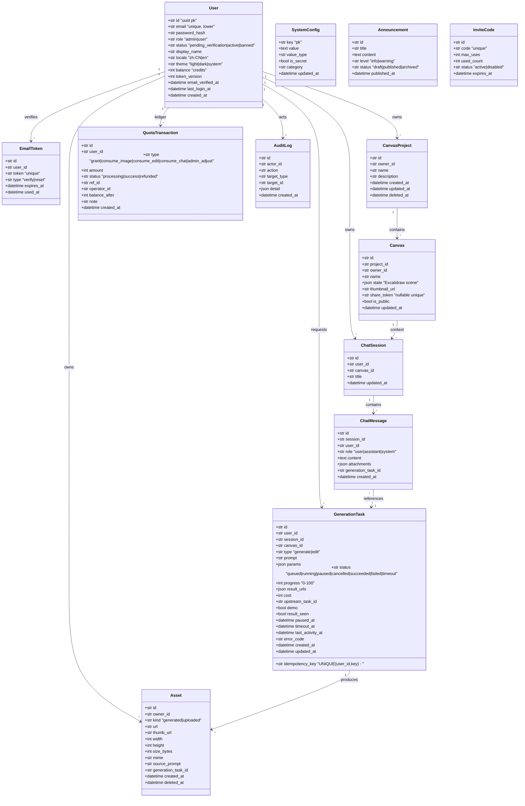

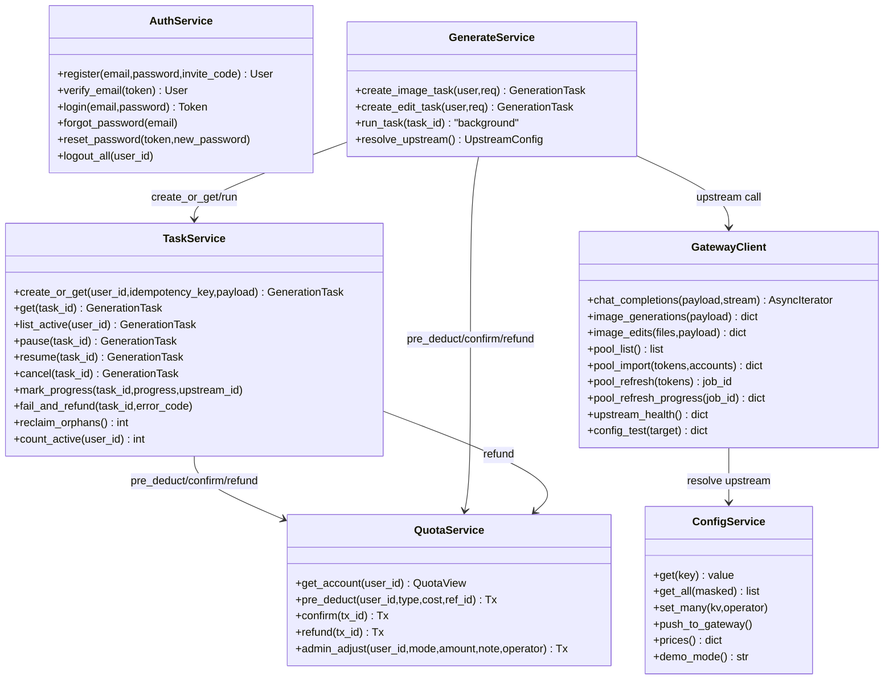

### 3.2 表结构详表（字段 / 类型 / 索引 / 外键）

> 约定：主键 `id` 为 `TEXT(36)` UUIDv4；时间统一 ISO-8601 UTC，存 `DATETIME`；`JSON` 字段以 SQLAlchemy `JSON` 类型存（SQLite 兼容）。

**users**

| 字段 | 类型 | 约束/索引 | 说明 |
|------|------|----------|------|
| id | TEXT(36) | PK | uuid |
| email | TEXT | UNIQUE, INDEX | 小写归一 |
| password_hash | TEXT | NOT NULL | bcrypt |
| role | TEXT | INDEX, default 'user' | admin/user |
| status | TEXT | INDEX, default 'pending_verification' | pending_verification/active/banned |
| display_name | TEXT | | 默认邮箱前缀 |
| locale | TEXT | default 'zh-CN' | zh-CN/en |
| theme | TEXT | default 'system' | light/dark/system |
| balance | INTEGER | default 0, CHECK(balance>=0) | 积分余额 |
| token_version | INTEGER | default 0 | 登出全部设备自增 |
| email_verified_at | DATETIME | | |
| last_login_at | DATETIME | | |
| banned_reason | TEXT | | |
| created_at / updated_at | DATETIME | | |

**email_tokens**

| 字段 | 类型 | 约束/索引 |
|------|------|----------|
| id | TEXT(36) | PK |
| user_id | TEXT(36) | FK→users.id, INDEX |
| token | TEXT | UNIQUE, INDEX |
| type | TEXT | INDEX（verify/reset） |
| expires_at | DATETIME | INDEX |
| used_at | DATETIME | |
| created_at | DATETIME | |

**canvas_projects**

| 字段 | 类型 | 约束/索引 |
|------|------|----------|
| id | TEXT(36) | PK |
| owner_id | TEXT(36) | FK→users.id, INDEX |
| name | TEXT | NOT NULL |
| description | TEXT | |
| created_at / updated_at / deleted_at | DATETIME | |

**canvases**

| 字段 | 类型 | 约束/索引 |
|------|------|----------|
| id | TEXT(36) | PK |
| project_id | TEXT(36) | FK→canvas_projects.id, INDEX |
| owner_id | TEXT(36) | FK→users.id, INDEX |
| name | TEXT | |
| state | JSON | Excalidraw scene（含图片元素数组） |
| thumbnail_url | TEXT | |
| share_token | TEXT | UNIQUE (nullable), INDEX |
| is_public | BOOL | default false |
| created_at / updated_at | DATETIME | |

> **决策**：画布元素不单独建表，内嵌于 `state` JSON（Excalidraw 原生场景格式）。图片元素 `{id,type,url,x,y,w,h,z,meta}` 存于 `state.elements`；`meta.asset_id` 关联资产库。理由：与 Excalidraw 持久化格式一致，避免双向同步复杂度；资产库仍独立成表。

**assets**

| 字段 | 类型 | 约束/索引 |
|------|------|----------|
| id | TEXT(36) | PK |
| owner_id | TEXT(36) | FK→users.id, INDEX |
| kind | TEXT | INDEX（generated/uploaded） |
| url | TEXT | NOT NULL |
| thumb_url | TEXT | |
| width / height | INTEGER | |
| size_bytes | INTEGER | |
| mime | TEXT | |
| source_prompt | TEXT | |
| is_demo | BOOL | default false（Demo 占位图标记） |
| generation_task_id | TEXT(36) | FK→generation_tasks.id (nullable) |
| created_at / deleted_at | DATETIME | INDEX(created_at) |

**chat_sessions**

| 字段 | 类型 | 约束/索引 |
|------|------|----------|
| id | TEXT(36) | PK |
| user_id | TEXT(36) | FK→users.id, INDEX |
| canvas_id | TEXT(36) | FK→canvases.id (nullable), INDEX |
| title | TEXT | |
| created_at / updated_at / deleted_at | DATETIME | |

**chat_messages**

| 字段 | 类型 | 约束/索引 |
|------|------|----------|
| id | TEXT(36) | PK |
| session_id | TEXT(36) | FK→chat_sessions.id, INDEX |
| user_id | TEXT(36) | FK→users.id |
| role | TEXT | user/assistant/system |
| content | TEXT | |
| attachments | JSON | 图片引用 |
| generation_task_id | TEXT(36) | FK (nullable) |
| created_at | DATETIME | INDEX |

**generation_tasks**（含 v1.1 任务状态机扩展）

| 字段 | 类型 | 约束/索引 | 说明 |
|------|------|----------|------|
| id | TEXT(36) | PK | uuid |
| user_id | TEXT(36) | FK→users.id, INDEX | |
| session_id | TEXT(36) | FK (nullable), INDEX | |
| canvas_id | TEXT(36) | FK (nullable) | |
| type | TEXT | generate/edit | |
| prompt | TEXT | | |
| params | JSON | | size/quality/n/model |
| status | TEXT | INDEX | **queued/running/paused/cancelled/succeeded/failed/timeout** |
| progress | INTEGER | default 0 | 0–100，进度反馈 |
| result_urls | JSON | | |
| cost | INTEGER | | 预扣积分 |
| upstream_task_id | TEXT | | 上游任务 id（恢复续接用） |
| demo | BOOL | default false | 是否 Demo 降级结果 |
| idempotency_key | TEXT | **UNIQUE(user_id, idempotency_key)** | 幂等去重键（= PM 的 `client_request_id`，客户端生成 UUID） |
| paused_at | DATETIME | | |
| timeout_at | DATETIME | | |
| last_activity_at | DATETIME | INDEX | 孤儿回收依据 |
| result_seen | BOOL | default false | 结果是否已被用户查看（P0-31/P1-14 未读提醒） |
| error_code | TEXT | | UPSTREAM_ERROR/POOL_UNAVAILABLE/… |
| error_message | TEXT | | |
| created_at / updated_at | DATETIME | INDEX(created_at) | |

> 活跃任务判定：`GET /api/tasks/active` 返回 `status IN (queued, running, paused)`（供 P0-30 恢复）。
> **并发上限统计（P0-28/Q18）仅计 `queued + running`，`paused` 不计入**（暂停不占用上游并发配额，避免阻塞新任务）。

**quota_transactions**

| 字段 | 类型 | 约束/索引 |
|------|------|----------|
| id | TEXT(36) | PK |
| user_id | TEXT(36) | FK→users.id, INDEX |
| type | TEXT | INDEX |
| amount | INTEGER | 正增负减 |
| status | TEXT | INDEX（processing/success/refunded） |
| ref_id | TEXT | INDEX（生成任务 id，幂等回滚键） |
| operator_id | TEXT(36) | FK (nullable，管理员调整) |
| balance_after | INTEGER | |
| note | TEXT | |
| created_at | DATETIME | INDEX |

> 唯一约束：`UNIQUE(ref_id, type)` 保证"同一 ref 只回滚一次"。

**system_configs**

| 字段 | 类型 | 约束/索引 |
|------|------|----------|
| key | TEXT | PK |
| value | TEXT | 存储值（secret 加密/掩码） |
| value_type | TEXT | string/int/bool/json/secret |
| is_secret | BOOL | |
| category | TEXT | integration/registration/quota/pool/email/demo/network |
| description | TEXT | |
| updated_at | DATETIME | |
| updated_by | TEXT(36) | |

**audit_logs**

| 字段 | 类型 | 约束/索引 |
|------|------|----------|
| id | TEXT(36) | PK |
| actor_id | TEXT(36) | FK→users.id, INDEX |
| actor_email | TEXT | |
| action | TEXT | INDEX（quota_adjust/ban/config_update/pool_import/task_pause…） |
| target_type | TEXT | |
| target_id | TEXT | INDEX |
| detail | JSON | |
| ip | TEXT | |
| created_at | DATETIME | INDEX |

**announcements**

| 字段 | 类型 | 约束/索引 |
|------|------|----------|
| id | TEXT(36) | PK |
| title | TEXT | |
| content | TEXT | |
| level | TEXT | info/warning |
| status | TEXT | INDEX（draft/published/archived） |
| published_at | DATETIME | |
| created_by | TEXT(36) | FK→users.id |
| created_at / updated_at | DATETIME | |

**invite_codes**

| 字段 | 类型 | 约束/索引 |
|------|------|----------|
| id | TEXT(36) | PK |
| code | TEXT | UNIQUE, INDEX |
| max_uses | INTEGER | default 1 |
| used_count | INTEGER | default 0 |
| status | TEXT | INDEX（active/disabled） |
| expires_at | DATETIME | |
| created_by | TEXT(36) | FK→users.id |
| created_at | DATETIME | |

---

## 4. API 契约

> **统一响应包裹**：`{ "code": "OK" | <ERROR_CODE>, "data": <T> | null, "message": <string> }`。
> 分页响应 `data`：`{ items: T[], total: int, page: int, size: int }`。
> 鉴权：除标注 `公开` 外均需 `Authorization: Bearer <jwt>`；`role=admin` 端点由 `require_admin` 二次校验。
> **幂等**：生成/编辑写操作支持请求头 `Idempotency-Key: <uuid>`（缺失则后端生成并回传 `data.idempotency_key`）。
> 错误码：`QUOTA_INSUFFICIENT`(402) / `UNAUTHORIZED`(401) / `FORBIDDEN`(403) / `UPSTREAM_ERROR`(502) / `POOL_UNAVAILABLE`(503) / `VALIDATION_ERROR`(422) / `TASK_NOT_FOUND`(404) / `TASK_STATE_CONFLICT`(409) / `TASK_LIMIT_EXCEEDED`(429) / `RATE_LIMITED`(429) / `PROXY_UNREACHABLE`(503)。

### 4.1 认证 `/api/auth/*`（公开）

| 方法 | 路径 | 鉴权 | 请求体 | 响应 data | 错误码 |
|------|------|------|--------|-----------|--------|
| POST | `/api/auth/register` | 公开 | `{email,password,display_name?,invite_code?}` | `{user_id,email,status}` | VALIDATION_ERROR / FORBIDDEN(注册关闭/邀请码无效) |
| POST | `/api/auth/verify-email` | 公开 | `{token}` | `{status:"active"}` | VALIDATION_ERROR(过期/无效) |
| POST | `/api/auth/resend-verification` | 公开 | `{email}` | `{}` | RATE_LIMITED(60s 限流) |
| POST | `/api/auth/login` | 公开 | `{email,password}` | `{access_token,token_type,user}` | UNAUTHORIZED / FORBIDDEN(未确认/封禁) |
| POST | `/api/auth/logout` | 用户 | — | `{}` | UNAUTHORIZED |
| POST | `/api/auth/forgot-password` | 公开 | `{email}` | `{}` | — (统一文案不泄露) |
| POST | `/api/auth/reset-password` | 公开 | `{token,new_password}` | `{}` | VALIDATION_ERROR |
| GET | `/api/auth/me` | 用户 | — | `User` | UNAUTHORIZED |

### 4.2 个人 `/api/me/*`（用户）

| 方法 | 路径 | 请求体 | 响应 data |
|------|------|--------|-----------|
| GET | `/api/me` | — | `User`（含 locale/theme） |
| PATCH | `/api/me` | `{display_name?,locale?,theme?}` | `User` |
| POST | `/api/me/change-password` | `{old_password,new_password}` | `{}` |
| POST | `/api/me/logout-all` | — | `{}`（递增 token_version） |
| GET | `/api/me/quota` | — | `{balance,threshold_pct,total_granted,prices:{image_standard,image_hd,edit,chat}}` |
| GET | `/api/me/quota/transactions` | `?page&size&type` | 分页 `QuotaTransaction` |

### 4.3 项目 / 画布 `/api/projects/* · /api/canvases/* · /api/share/*`

| 方法 | 路径 | 鉴权 | 请求体 | 响应 data |
|------|------|------|--------|-----------|
| GET | `/api/projects` | 用户 | `?page&size&q` | 分页 `CanvasProject`(含默认画布缩略图) |
| POST | `/api/projects` | 用户 | `{name,description?}` | `CanvasProject`（自动建默认画布） |
| GET | `/api/projects/{id}` | 用户 | — | `CanvasProject`+`canvases[]` |
| PATCH | `/api/projects/{id}` | 用户 | `{name?}` | `CanvasProject` |
| DELETE | `/api/projects/{id}` | 用户 | — | `{}`（软删） |
| GET | `/api/projects/{pid}/canvases` | 用户 | — | `Canvas[]` |
| POST | `/api/projects/{pid}/canvases` | 用户 | `{name}` | `Canvas` |
| GET | `/api/canvases/{id}` | 用户 | — | `Canvas`(含 state) |
| PATCH | `/api/canvases/{id}` | 用户 | `{name?,state?,thumbnail?}` | `{updated_at}`（自动保存） |
| DELETE | `/api/canvases/{id}` | 用户 | — | `{}` |
| POST | `/api/canvases/{id}/share` | 用户 | — | `{share_token,url}` |
| DELETE | `/api/canvases/{id}/share` | 用户 | — | `{}` |
| GET | `/api/canvases/{id}/export` | 用户 | `?format=png\|json` | 文件流 / JSON |
| GET | `/api/share/{token}` | 公开 | — | `Canvas`(只读，脱敏) |

越权访问他人资源 → FORBIDDEN(403) / 不存在 → 404。

### 4.4 资产 `/api/assets/*`

| 方法 | 路径 | 鉴权 | 请求体 | 响应 data |
|------|------|------|--------|-----------|
| GET | `/api/assets` | 用户 | `?page&size&kind&q` | 分页 `Asset` |
| POST | `/api/assets/upload` | 用户 | multipart `file` | `Asset`（png/jpg/webp ≤20MB，0 积分） |
| GET | `/api/assets/{id}` | 用户 | — | `Asset` |
| DELETE | `/api/assets/{id}` | 用户 | — | `{}`（仅移出资产库，不影响画布引用） |
| GET | `/api/assets/{id}/download` | 用户 | — | 文件流（Content-Disposition） |

### 4.5 对话 / 生成 / 任务 `/api/chat/* · /api/generate/* · /api/tasks/*`

| 方法 | 路径 | 鉴权 | 请求体 | 响应 |
|------|------|------|--------|------|
| GET | `/api/chat/sessions` | 用户 | `?canvas_id` | `ChatSession[]` |
| POST | `/api/chat/sessions` | 用户 | `{canvas_id?,title?}` | `ChatSession` |
| PATCH | `/api/chat/sessions/{id}` | 用户 | `{title?}` | `ChatSession` |
| DELETE | `/api/chat/sessions/{id}` | 用户 | — | `{}` |
| GET | `/api/chat/sessions/{id}/messages` | 用户 | `?page&size` | 分页 `ChatMessage` |
| POST | `/api/chat/messages` | 用户 | `{session_id,content,canvas_id?,image_refs?}` + `Idempotency-Key?` | **SSE**（经 gateway→sub2api；demo 时模拟） |
| POST | `/api/generate/image` | 用户 | `{prompt,model?,size?,quality?,n?,session_id?,canvas_id?}` + **`Idempotency-Key`** | `GenerationTask`（异步，含预扣） |
| POST | `/api/generate/edit` | 用户 | multipart `{prompt,base_asset_id|file,mask?,session_id?,canvas_id?}` + **`Idempotency-Key`** | `GenerationTask` |
| GET | `/api/generate/tasks` | 用户 | `?canvas_id&session_id&status&page&size` | 分页 `GenerationTask`（生成历史） |
| GET | `/api/generate/tasks/{id}` | 用户 | — | `GenerationTask`（详情/轮询；含 progress/demo） |
| GET | `/api/generate/tasks/{id}/stream` | 用户 | — | **SSE** 进度（queued/running/paused/succeeded/failed/timeout） |
| POST | `/api/generate/tasks/{id}/pause` | 用户 | — | `GenerationTask`（status=paused） |
| POST | `/api/generate/tasks/{id}/resume` | 用户 | — | `GenerationTask`（status=running） |
| POST | `/api/generate/tasks/{id}/cancel` | 用户 | — | `GenerationTask`（status=cancelled + 幂等回滚） |
| GET | `/api/tasks/active` | 用户 | — | `GenerationTask[]`（status∈queued/running/paused，刷新续接用 P0-30/P0-35） |
| GET | `/api/tasks/unread` | 用户 | — | `GenerationTask[]`（succeeded 且 `result_seen=false`，未读结果提醒 P0-31/P1-14） |
| POST | `/api/generate/tasks/{id}/seen` | 用户 | — | `GenerationTask`（标记结果已读，清除未读） |

**生成错误映射**：余额不足→`QUOTA_INSUFFICIENT`(402，不扣额)；上游超时/限流→`UPSTREAM_ERROR`(502，不扣额)；号池无可用→`POOL_UNAVAILABLE`(503，不扣额)；VPN/代理不通→`PROXY_UNREACHABLE`(503)；并发超限→`TASK_LIMIT_EXCEEDED`(429)；非法状态迁移→`TASK_STATE_CONFLICT`(409)；任务不存在→`TASK_NOT_FOUND`(404)。

### 4.6 额度 `/api/quota/*`

| 方法 | 路径 | 鉴权 | 响应 data |
|------|------|------|-----------|
| GET | `/api/quota/prices` | 用户 | `{image_standard,image_hd,edit,chat}` |
| GET | `/api/quota/transactions` | 用户 | 分页 `QuotaTransaction` |

### 4.7 管理后台 `/api/admin/*`（role=admin）

| 方法 | 路径 | 请求体 | 响应 data |
|------|------|--------|-----------|
| GET | `/api/admin/overview` | — | `{users_total,users_active,pool:{total,normal,limited,abnormal,disabled},quota_consumed_today}` |
| GET | `/api/admin/users` | `?q&role&status&page&size` | 分页 `User`(含 balance) |
| GET | `/api/admin/users/{id}` | — | `User`+最近流水 |
| POST | `/api/admin/users/{id}/quota` | `{mode:increase\|decrease\|set,amount,note}` | `{balance,tx}` |
| POST | `/api/admin/users/{id}/ban` | `{reason?}` | `User` |
| POST | `/api/admin/users/{id}/unban` | — | `User` |
| POST | `/api/admin/users/{id}/reset-password` | — | `{temp_password}`（并入审计） |
| POST | `/api/admin/users/{id}/resend-verification` | — | `{}` |
| GET | `/api/admin/pool/stats` | — | `{total,normal,limited,abnormal,disabled}` |
| GET | `/api/admin/pool/accounts` | `?status&q` | `{items:[{token_masked,type,status,quota,last_refresh}]}` |
| POST | `/api/admin/pool/accounts` | `{method:token\|session\|codex_auth\|account_json\|oauth,tokens?,accounts?}` | `{added,skipped,refreshed,errors}` |
| DELETE | `/api/admin/pool/accounts` | `{tokens}` | `{deleted}` |
| POST | `/api/admin/pool/accounts/refresh` | `{tokens?}` | `{job_id}` |
| GET | `/api/admin/pool/accounts/refresh/{job_id}` | — | `{status,done,total,...}` |
| POST | `/api/admin/pool/accounts/re-login` | `{tokens}` | `{job_id}` |
| GET | `/api/admin/pool/accounts/re-login/{job_id}` | — | `{status,done,total,...}` |
| POST | `/api/admin/pool/accounts/update` | `{access_token,status?,quota?,type?,proxy?}` | `{item}` |
| POST | `/api/admin/pool/accounts/export` | `{tokens,format:json\|zip}` | 文件流 |
| GET | `/api/admin/config` | — | `{items:[{key,value(masked),value_type,is_secret,category,description}]}` |
| PUT | `/api/admin/config` | `{key:value,...}` | `{updated:[]}`（触发 push_to_gateway） |
| POST | `/api/admin/config/test` | `{target:sub2api\|chatgpt2api\|proxy}` | `{ok,latency_ms,message}` |
| GET | `/api/admin/invites` | `?page&size` | 分页 `InviteCode` |
| POST | `/api/admin/invites` | `{max_uses?,expires_at?}` | `InviteCode` |
| PATCH | `/api/admin/invites/{id}` | `{status}` | `InviteCode` |
| DELETE | `/api/admin/invites/{id}` | — | `{}` |
| GET | `/api/admin/announcements` | `?page&size` | 分页 `Announcement` |
| POST | `/api/admin/announcements` | `{title,content,level}` | `Announcement` |
| PATCH | `/api/admin/announcements/{id}` | `{status?,title?,content?}` | `Announcement` |
| DELETE | `/api/admin/announcements/{id}` | — | `{}` |
| GET | `/api/admin/logs` | `?actor&action&page&size` | 分页 `AuditLog` |

### 4.8 公共

| 方法 | 路径 | 鉴权 | 响应 data |
|------|------|------|-----------|
| GET | `/api/health` | 公开 | `{status:"ok",version,demo_mode}` |
| GET | `/api/announcements/active` | 用户 | `Announcement[]`（published） |

### 4.9 网关 `/gw/*`（内部，`X-Internal-Token` 鉴权，仅 backend 调用）

| 方法 | 路径 | 请求体 | 说明 |
|------|------|--------|------|
| GET | `/gw/health` | — | 网关存活 + 当前 demo_mode |
| GET | `/gw/upstream/health` | — | 探测 sub2api/chatgpt2api；区分 `PROXY_UNREACHABLE` / `UPSTREAM_ERROR` |
| POST | `/gw/config` | `{sub2api:{base_url,api_key},chatgpt2api:{base_url,admin_key},proxy?,demo_mode?}` | backend 推送运行时配置 |
| POST | `/gw/config/test` | `{target:sub2api\|chatgpt2api\|proxy}` | 连通性测试 → `{ok,latency_ms,message}` |
| POST | `/gw/chat/completions` | OpenAI `{model,messages,stream}` | 转发 sub2api，SSE 透传；demo→模拟回复(`demo:true`) |
| POST | `/gw/images/generations` | `{prompt,model,n,size,quality,response_format}` | 转发 chatgpt2api；demo→Pillow 占位图(`demo:true`) |
| POST | `/gw/images/edits` | multipart `{prompt,model,image[],mask?}` | 转发 chatgpt2api；demo→占位图 |
| GET | `/gw/pool/accounts` | — | 代理 `GET /api/accounts` |
| POST | `/gw/pool/accounts` | `{tokens?,accounts?}` | 代理导入 |
| DELETE | `/gw/pool/accounts` | `{tokens}` | 代理删除 |
| POST | `/gw/pool/accounts/refresh` | `{tokens?}` | 代理刷新 → `{progress_id}` |
| GET | `/gw/pool/accounts/refresh/{id}` | — | 代理进度 |
| POST | `/gw/pool/accounts/re-login` | `{tokens}` | 代理重登 → `{progress_id}` |
| GET | `/gw/pool/accounts/re-login/{id}` | — | 代理进度 |
| POST | `/gw/pool/accounts/update` | `{access_token,status?,quota?,type?,proxy?}` | 代理更新 |
| POST | `/gw/pool/accounts/export` | `{tokens,format}` | 代理导出（文件流） |
| POST | `/gw/pool/accounts/oauth/start` | `{email_hint?}` | 代理 OAuth 起始 |
| POST | `/gw/pool/accounts/oauth/finish` | `{session_id,callback}` | 代理 OAuth 完成 |

> 上游响应统一被 gateway 包裹为 `{code,data,message}`；非 2xx → `UPSTREAM_ERROR`/`POOL_UNAVAILABLE`/`PROXY_UNREACHABLE`。

---

## 5. 关键流程时序图

### 5.1 注册 + 邮箱确认（PRD §6.1 / P0-01~03）

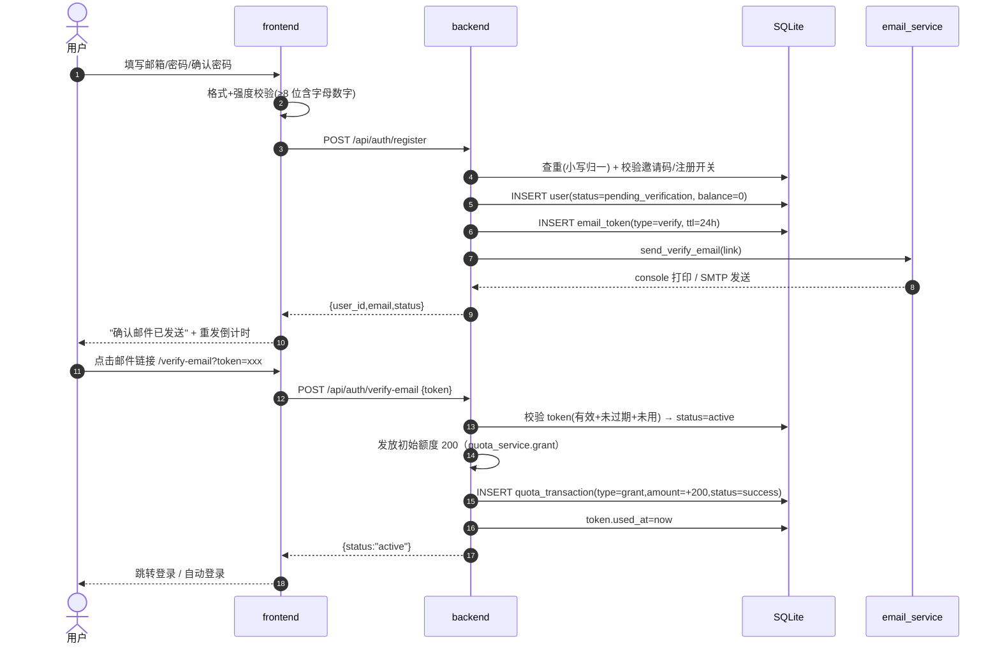

### 5.2 生图扣额（预扣→确认/回滚，PRD §6.2 / P0-08,12,13）

```mermaid
sequenceDiagram
    autonumber
    actor U as 用户
    participant FE as frontend
    participant BE as backend
    participant TS as task_service
    participant QS as quota_service
    participant DB as SQLite
    participant GW as gateway
    participant UP as chatgpt2api

    U->>FE: 输入 prompt → 发送
    FE->>FE: 生成/复用 Idempotency-Key；本地余额预检
    FE->>BE: POST /api/generate/image (Idempotency-Key) 
    BE->>TS: create_or_get(user, idem_key) 幂等
    alt 幂等键已存在
        TS-->>BE: 返回既有任务当前状态
        BE-->>FE: 200 既有任务（不重复扣费/调上游）
    else 新任务
        BE->>TS: count_active(user) < 上限?
        alt 超限
            TS-->>BE: TASK_LIMIT_EXCEEDED
            BE-->>FE: 429 TASK_LIMIT_EXCEEDED
        else 允许
            BE->>QS: pre_deduct(user, consume_image, 10, ref=task_id)
            QS->>DB: UPDATE balance-=10 WHERE balance>=10; INSERT tx(processing)
            BE->>DB: INSERT generation_task(status=running, last_activity_at=now)
            BE-->>FE: 202 {task}
            BE->>GW: POST /gw/images/generations (async)
            GW->>UP: POST /v1/images/generations (gpt-image-2)
            alt 上游不可达且 demo=on 或 auto
                GW->>GW: Pillow 生成占位图（demo=true）
                GW-->>BE: {code:OK,data:{demo:true,...}}
            else 正常
                UP-->>GW: {data:[{b64_json|url}]}
                GW-->>BE: {code:OK,data}
            end
            alt 成功
                BE->>BE: 落库图片→资产库+画布 state；task.progress=100
                BE->>QS: confirm(tx) → success
                BE->>DB: task.status=succeeded
                FE->>BE: 轮询/SSE GET /generate/tasks/{id}
                BE-->>FE: succeeded + balance + demo?
                FE-->>U: 图片落画布 + 余额刷新（demo 标注）
            else 失败/超时
                BE->>QS: refund(tx) → refunded（仅一次）
                BE->>DB: task.status=failed, error_code=UPSTREAM_ERROR
                BE-->>FE: 502 UPSTREAM_ERROR（未扣额）
            end
        end
    end
```

### 5.3 额度耗尽拦截（PRD §6.3 / P0-14,15）

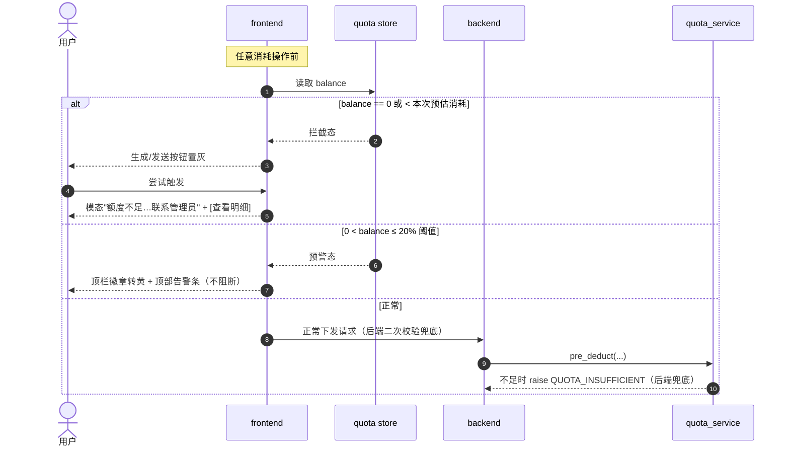

### 5.4 管理员分配额度（PRD §6.4 / P0-19）

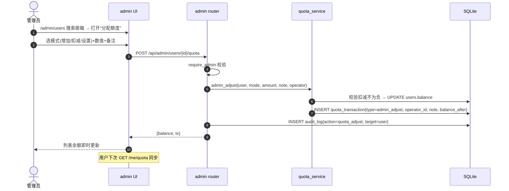

### 5.5 号池批量导入 + 刷新进度（P0-21,22 / §5.6）

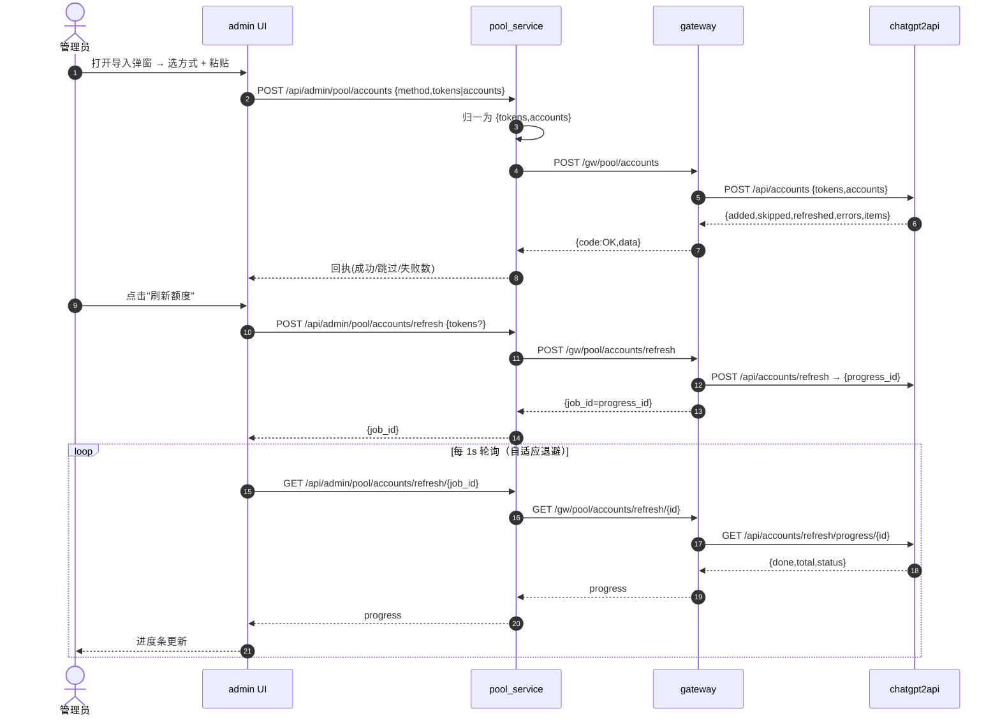

### 5.6 线上切换配置生效（P0-24 / §5.7）

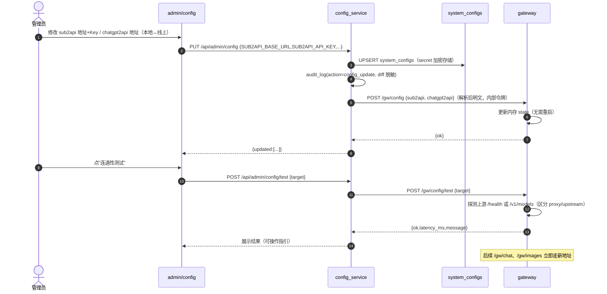

### 5.7 生成中暂停 → 恢复 / 放弃（约束 B1）

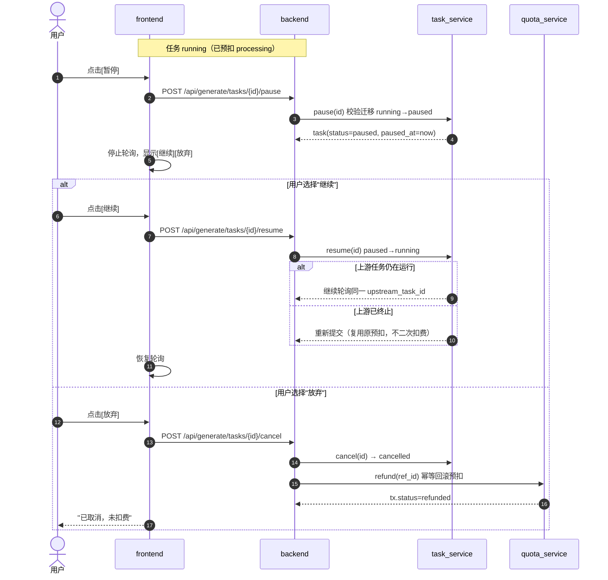

### 5.8 刷新页面状态恢复与续接（约束 B2）

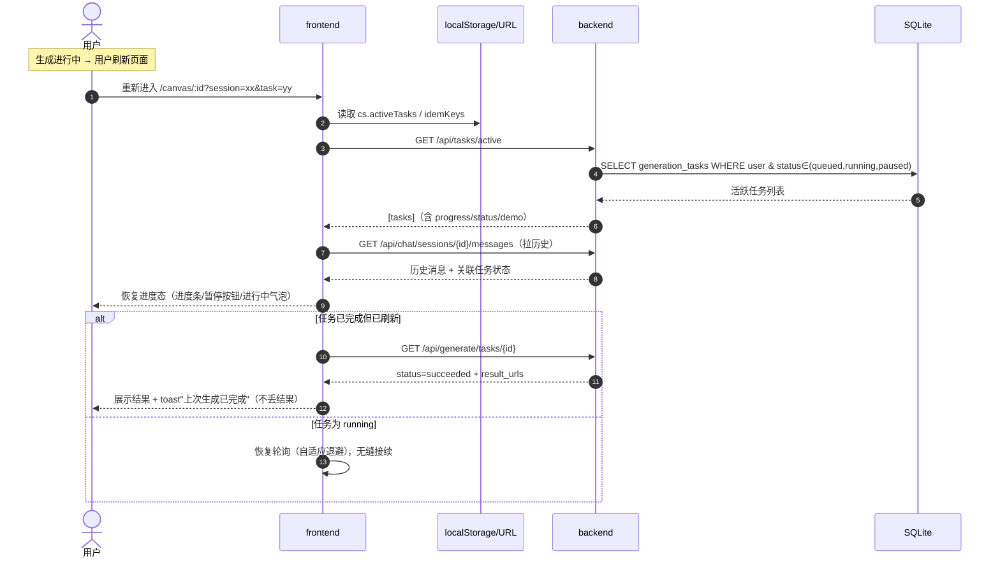

### 5.9 高延迟下幂等去重与防浪费（约束 B3）

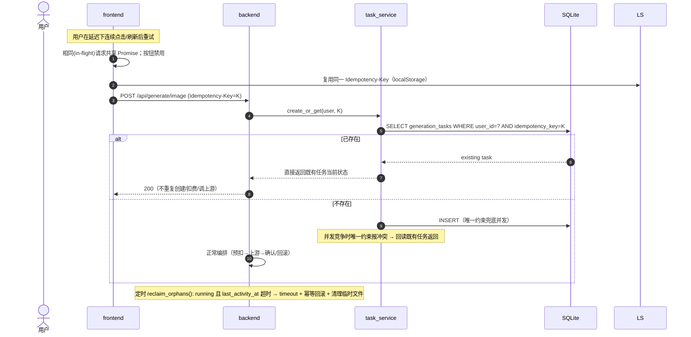

---

# Part B · 任务分解

## 6. 任务列表

> **8 个批次（Batch）**，每批次是工程师一个工作单元（同模块文件一起写，保证内部一致性）。任务按依赖顺序编排；依赖仅指向必要前置。每任务含：编号 / 描述 / 涉及文件 / 依赖 / 验收点。

### Batch B1 · 后端骨架 + 模型 + 认证 + 邮件（奠基）

| ID | 描述 | 涉及文件 | 依赖 | 验收点 |
|----|------|---------|------|--------|
| T-01 | 后端工程骨架：FastAPI app、配置、DB、安全、依赖注入、统一响应/错误码、健康检查 | `backend/{pyproject.toml,requirements.txt,.env.example,Dockerfile}`、`app/{main.py,config.py,database.py,security.py,deps.py,__init__.py}`、`app/utils/{errors.py,pagination.py,logging.py,ids.py}`、`app/routers/health.py` | — | `uvicorn` 可起；`/api/health` 返回 `{code:OK}`；env 校验生效 |
| T-02 | 全部 ORM 模型（generation_tasks 含状态机字段 + `UNIQUE(user_id,idempotency_key)`）+ Pydantic schemas + 建表/seed | `app/models/*.py(13)`、`app/schemas/*.py(12)`、`app/seed.py`、`app/migrations/run.py` | T-01 | `create_all` 建 13 表；唯一约束生效；seed 生成默认管理员 + 默认配置 |
| T-03 | 认证服务 + 邮件服务 | `app/services/{auth_service.py,email_service.py}`、`app/routers/auth.py`、`app/schemas/auth.py` | T-02 | 注册→pending；确认→active；登录签发 JWT；控制台可见确认链接 |
| T-04 | 个人资料路由 + 鉴权守卫 | `app/routers/me.py`、`app/schemas/user.py`、`app/deps.py` | T-03 | `require_admin` 对普通用户 403；PATCH /me 生效 |
| T-05 | 认证/邮件单测 | `backend/tests/{conftest.py,test_auth.py}` | T-03,T-04 | 注册/确认/登录/重置用例通过 |

### Batch B2 · 额度 + 项目/画布 + 资产

| ID | 描述 | 涉及文件 | 依赖 | 验收点 |
|----|------|---------|------|--------|
| T-06 | 额度服务（预扣/确认/**幂等回滚**/管理员调整/流水，含行锁与并发防超扣） | `app/services/{quota_service.py,config_service.py}`、`app/routers/quota.py`、`app/schemas/quota.py`、`app/routers/me.py`(quota 段) | T-02,T-04 | 预扣/确认/回滚同事务；`ref_id` 幂等；余额不为负；并发不超扣 |
| T-07 | 项目 + 画布服务与路由（含自动保存、分享 token、导出） | `app/services/{project_service.py,canvas_service.py}`、`app/routers/{projects.py,canvases.py}`、`app/schemas/{project.py,canvas.py}` | T-02,T-04 | 新建项目自动建默认画布；越权 403；分享页只读 |
| T-08 | 资产服务与路由（列表/上传/删除/下载）+ 本地存储（含 is_demo） | `app/services/{asset_service.py,storage_service.py}`、`app/routers/assets.py`、`app/schemas/asset.py` | T-02,T-04 | 上传 ≤20MB(png/jpg/webp) 入资产库；静态 URL 可访问 |
| T-09 | 审计服务（供 B2/B3/B4 复用） | `app/services/audit_service.py` | T-02 | 关键动作落 `audit_logs` |
| T-10 | 额度/项目 单测 | `backend/tests/{test_quota.py,test_projects.py}` | T-06,T-07 | 并发扣额不超扣；回滚一次 |

### Batch B3 · 网关 + 上游适配 + 任务状态机（含异常场景）

| ID | 描述 | 涉及文件 | 依赖 | 验收点 |
|----|------|---------|------|--------|
| T-11 | 网关骨架：内部令牌中间件、配置/状态、httpx 客户端（**代理 + connect/read 超时分离 + 重试退避**）、错误归一、健康检查 | `gateway/{pyproject.toml,requirements.txt,.env.example,Dockerfile}`、`gateway/app/{main.py,config.py,state.py,upstream.py}`、`gateway/app/utils/{errors.py,streaming.py,retry.py}`、`gateway/app/routers/health.py`、`gateway/app/schemas/common.py` | — | 无令牌 401；`/gw/health` OK；代理/超时读取 env |
| T-12 | 网关：对话 + 生图/编辑转发（含 SSE 透传、b64↔文件） | `gateway/app/routers/{chat.py,images.py}`、`gateway/app/services/{chat_router.py,image_router.py}`、`gateway/app/schemas/{chat.py,image.py}` | T-11 | 对话 SSE 逐块透传；生图返回统一结构 |
| T-13 | 网关：号池代理 + 配置接收/连通性测试 | `gateway/app/routers/{pool.py,config.py}`、`gateway/app/services/pool_proxy.py`、`gateway/app/schemas/pool.py` | T-11 | 五类导入/刷新进度/update/export 全通 |
| T-14 | 网关：**Demo 模式**（Pillow 占位图 + 模拟对话 + `demo:true`）+ health 区分 VPN/上游 | `gateway/app/services/{demo_service.py,error_mapper.py}`、`gateway/app/routers/{images.py,chat.py}`(demo 分支) | T-12,T-13 | `CS_DEMO_MODE=on` 时返回占位图/模拟回复；`auto` 上游不可达时自动降级 |
| T-15 | 后端 GatewayClient + 生成编排（**幂等去重 / 预扣→上游→确认/回滚 / 并发上限 / 进度 / 孤儿回收**） | `app/services/{gateway_client.py,generate_service.py,chat_service.py,task_service.py}`、`app/routers/{generate.py,chat.py}`、`app/schemas/{generate.py,chat.py,task.py}` | T-06,T-08,T-12,T-13 | 幂等键复用返回既有任务；成功扣额/失败不扣额；并发超限 429；demo 透传 |
| T-16 | 任务生命周期路由（暂停/恢复/取消/活跃任务/未读结果） | `app/routers/tasks.py`、`app/services/task_service.py`(扩展) | T-15 | running→paused→running/cancelled 迁移正确；`/api/tasks/active` 返回活跃任务；`/api/tasks/unread`+`/seen` 未读提醒；取消即回滚 |
| T-17 | 网关/生成客户端/任务单测 | `backend/tests/{test_gateway_client.py,test_tasks.py}`、`gateway/tests/{test_pool_proxy.py,test_demo.py}` | T-14,T-15,T-16 | mock 上游：成功/超时/池空/demo/幂等/暂停恢复 分支通过 |

### Batch B4 · 管理后台 API

| ID | 描述 | 涉及文件 | 依赖 | 验收点 |
|----|------|---------|------|--------|
| T-18 | 后台用户管理 + 概览 | `app/routers/admin/{overview.py,users.py}`、`app/schemas/admin.py` | T-06,T-09 | 搜索/筛选/分页；额度分配落流水+审计 |
| T-19 | 后台号池管理（代理转发 + 五方式归一 + 进度） | `app/routers/admin/pool.py`、`app/services/pool_service.py` | T-13,T-15 | 导入回执、刷新进度、启禁用、导出 |
| T-20 | 后台系统配置（读写/掩码/**推送网关**/连通性测试，含 Demo 与代理配置项） | `app/routers/admin/config.py`、`app/services/config_service.py` | T-11,T-15 | 保存后推送网关即生效；敏感值掩码；连通性区分 proxy/upstream |
| T-21 | 邀请码 + 公告 + 操作日志 | `app/routers/admin/{invites.py,announcements.py,logs.py}`、`app/services/{invite_service.py,announcement_service.py}`、`app/routers/announcements.py` | T-09 | 邀请码校验影响注册；公告 published 可读 |
| T-22 | APScheduler 定时任务（号池自动刷新、**孤儿回收**、临时文件清理） | `app/services/scheduler.py`、`app/main.py`(接入 lifespan) | T-19,T-20,T-16 | 周期任务按配置触发；超时任务自动 timeout+回滚 |

### Batch B5 · 前端骨架 + 认证 + 主题 + i18n

| ID | 描述 | 涉及文件 | 依赖 | 验收点 |
|----|------|---------|------|--------|
| T-23 | 前端工程骨架 + 构建配置 + 主题 token + Tailwind | `frontend/{package.json,vite.config.ts,tsconfig*.json,index.html,postcss.config.js,eslint.config.js,.env.example}`、`src/{main.tsx,App.tsx,router.tsx,index.css}`、`src/styles/tokens.css` | — | `vite dev` 起；双主题变量生效；search schema(session/task) 可用；`tsc` 通过 |
| T-24 | API client（含幂等头/去重）+ 错误映射 + 类型 | `src/lib/api/{client.ts,errors.ts}`、`src/lib/{utils.ts,events.ts,task-persistence.ts}`、`src/types/{models.ts,api.ts}` | T-23 | 统一解包 `{code,data,message}`；401 处理；in-flight 去重 |
| T-25 | 认证 store + 主题/语言 store + i18n 骨架 | `src/stores/{auth.ts,theme.ts}`、`src/i18n/index.ts`、`src/i18n/locales/**`(20)、`src/hooks/{use-auth.ts,use-theme.ts,use-language.ts,use-mobile.ts,use-debounce.ts}` | T-23 | 语言/主题持久化；无硬编码中文残留 |
| T-26 | UI 原语 + 布局壳 + ResumeGuard | `src/components/ui/*(24)`、`src/components/layout/{AppShell.tsx,TopBar.tsx,ThemeToggle.tsx,LocaleToggle.tsx,UserMenu.tsx,ProtectedRoute.tsx,AdminRoute.tsx,MaintenanceGate.tsx,ResumeGuard.tsx}` | T-25 | 组件符合设计规范枚举；路由守卫可用；ResumeGuard 挂载触发续接 |
| T-27 | 认证页面（登录/注册/确认/重置）+ 根路由 | `src/routes/{__root.tsx,index.tsx,login.tsx,verify-email.tsx,reset-password.tsx}`、`src/lib/api/{auth.ts,me.ts}`、`src/hooks/use-toast.ts` | T-26,T-03 | PG-01~03 全流程；确认邮件态；重发倒计时 |

### Batch B6 · 工作台画布 + 对话 + 生成（含暂停/续接/幂等）

| ID | 描述 | 涉及文件 | 依赖 | 验收点 |
|----|------|---------|------|--------|
| T-28 | 额度 store + 顶栏额度徽章 + 告警/拦截 | `src/stores/quota.ts`、`src/components/layout/{QuotaBadge.tsx,NotificationBell.tsx,AnnouncementBanner.tsx}`、`src/hooks/{use-quota.ts,use-polling.ts}`、`src/lib/api/quota.ts` | T-26,T-06 | 正常/预警/耗尽三态；阈值 20% |
| T-29 | 画布模块（移植 Excalidraw）+ 图片节点 + 自动保存 | `src/components/canvas/*(14)`、`src/stores/canvas.ts`、`src/types/canvas.ts`、`src/lib/api/{canvases.ts,assets.ts}` | T-26,T-07 | ≥2 图拖拽/缩放；刷新状态持久化 |
| T-30 | 对话面板（移植）+ 生成结果/编辑对比卡 + 任务控制 | `src/components/chat/*(11)`、`src/stores/chat.ts`、`src/lib/api/chat.ts`、`src/lib/sse.ts`、`src/hooks/use-chat-stream.ts` | T-29,T-15 | 多轮上下文；SSE 进度；结果落画布；暂停/继续/放弃按钮态 |
| T-31 | 生成/任务交互：生图/编辑 + **暂停恢复 + 刷新续接 + 幂等 + 未读结果/任务中心 + 网络恢复续接** | `src/lib/api/{generate.ts,tasks.ts}`、`src/hooks/{use-chat-stream.ts(扩展),use-idempotency.ts,use-active-tasks.ts}`、`src/lib/task-persistence.ts`、`src/components/{chat/TaskControls.tsx,chat/ActiveTasksPanel.tsx,layout/UnreadResultsBanner.tsx}` | T-30,T-16 | 刷新后自动续接；重复提交同一结果；demo 结果标注；暂停/继续/放弃；未读结果提醒；超时重试 |
| T-32 | 工作台页面组装（三栏 + 移动端分段 + 顶栏） | `src/routes/{workspace.tsx,canvas.$id.tsx}`、`src/components/layout/{WorkspaceLeftbar.tsx,WorkspaceRightPanel.tsx,MobileSegmented.tsx}`、`src/lib/api/projects.ts` | T-29,T-30,T-31 | PG-04 桌面三栏 + 移动端可用；URL 带 session/task |

### Batch B7 · 管理后台 UI + 其余页面

| ID | 描述 | 涉及文件 | 依赖 | 验收点 |
|----|------|---------|------|--------|
| T-33 | 后台壳 + 概览 | `src/routes/admin.tsx`、`src/routes/admin.index.tsx`、`src/components/layout/{AdminShell.tsx,AdminSidebar.tsx}`、`src/components/admin/MetricCard.tsx`、`src/lib/api/admin.ts` | T-26,T-18 | 仅管理员可入；指标卡 |
| T-34 | 用户管理页 + 额度分配弹窗 | `src/routes/admin.users.tsx`、`src/components/admin/{UserTable.tsx,QuotaAssignDialog.tsx}` | T-33,T-18 | PG-10/11；搜索/筛选/行操作 |
| T-35 | 号池管理页（指标卡/表格/导入/进度/状态操作） | `src/routes/admin.pool.tsx`、`src/components/admin/{PoolStatsCards.tsx,PoolTable.tsx,PoolStatusBadge.tsx,PoolImportDialog.tsx,PoolRefreshProgress.tsx}` | T-33,T-19 | 五方式导入+回执；进度轮询；状态徽章配色 |
| T-36 | 系统配置 / 邀请码 / 公告 / 日志页 | `src/routes/admin.{config,invites,announcements,logs}.tsx`、`src/components/admin/{SystemConfigForm.tsx,InviteCodeTable.tsx,AnnouncementEditor.tsx,AuditLogTable.tsx}` | T-33,T-20,T-21 | 敏感值掩码；连通性测试；本地/线上切换 + Demo 开关 |
| T-37 | 项目/资产/额度中心/设置/分享/404 页 | `src/routes/{projects,assets,usage,settings,share.$token,$}.tsx`、`src/components/{projects/*,assets/*}`、`src/lib/api/{assets.ts,announcements.ts}` | T-26,T-07,T-08 | PG-05~08,17,18 全可用；i18n/主题一致 |

### Batch B8 · 部署配置 + 打磨

| ID | 描述 | 涉及文件 | 依赖 | 验收点 |
|----|------|---------|------|--------|
| T-38 | Docker 化 + compose 一键起 | `frontend/{Dockerfile,nginx.conf}`、`backend/Dockerfile`、`gateway/Dockerfile`、`deploy/{docker-compose.yml,docker-compose.dev.yml,.env.example}`、`.env.example` | 全部 | `docker compose up` 起 5 服务无额外调整 |
| T-39 | 本地零依赖启动脚本 + 部署文档（含 VPN 代理 / Demo 说明） | `deploy/scripts/{start-local.sh,seed-admin.sh}`、`deploy/README.md`、`deploy/nginx/default.conf` | T-38 | 无 Docker 时可本地起后端+网关+前端 |
| T-40 | 全局一致性打磨（错误码映射、i18n 补全、响应式断点、无障碍、空态/骨架屏）+ 端到端联调（注册→确认→生图扣额→暂停恢复→刷新续接→号池→切配置→demo） | 跨 `frontend/src/**`、`backend/app/**`、`gateway/app/**`（补漏） | B1-B7 | tsc/构建通过；1440/1024/768/390 四档正常；异常场景联调通过 |

**统计**：8 批次 · 40 个任务 · 每批次 ≥3 文件（实际远超）。

---

## 7. 依赖包清单

### 7.1 frontend/package.json（关键依赖，含版本号）

```jsonc
{
  "dependencies": {
    "react": "^19.1.0",
    "react-dom": "^19.1.0",
    "@excalidraw/excalidraw": "^0.18.0",
    "@tanstack/react-router": "^1.120.15",
    "@tanstack/react-query": "^5.80.3",
    "@tanstack/react-query-persist-client": "^5.81.5",
    "@tanstack/query-async-storage-persister": "^5.81.5",
    "zustand": "^5.0.5",
    "i18next": "^25.2.1",
    "react-i18next": "^15.5.2",
    "i18next-browser-languagedetector": "^8.1.0",
    "lucide-react": "^0.484.0",
    "@tabler/icons-react": "^3.31.0",
    "sonner": "^2.0.3",
    "motion": "^12.16.0",
    "class-variance-authority": "^0.7.1",
    "clsx": "^2.1.1",
    "tailwind-merge": "^3.0.2",
    "tailwindcss": "^4.0.17",
    "@tailwindcss/vite": "^4.0.17",
    "react-resizable-panels": "^3.0.2",
    "react-markdown": "^10.1.0",
    "remark-gfm": "^4.0.1",
    "react-photo-view": "^1.2.7",
    "file-saver": "^2.0.5",
    "lodash.debounce": "^4.0.8",
    "nanoid": "^5.1.5",
    "mitt": "^3.0.1",
    "immer": "^10.1.1",
    "@radix-ui/react-avatar": "^1.1.10",
    "@radix-ui/react-checkbox": "^1.3.1",
    "@radix-ui/react-dialog": "^1.1.6",
    "@radix-ui/react-dropdown-menu": "^2.1.14",
    "@radix-ui/react-label": "^2.1.2",
    "@radix-ui/react-popover": "^1.1.14",
    "@radix-ui/react-scroll-area": "^1.2.3",
    "@radix-ui/react-select": "^2.1.6",
    "@radix-ui/react-separator": "^1.1.2",
    "@radix-ui/react-slot": "^1.1.2",
    "@radix-ui/react-switch": "^1.1.2",
    "@radix-ui/react-tooltip": "^1.1.8"
  },
  "devDependencies": {
    "vite": "^6.2.0",
    "@vitejs/plugin-react": "^4.3.4",
    "@tanstack/router-plugin": "^1.120.15",
    "typescript": "~5.7.2",
    "@types/react": "^19.0.10",
    "@types/react-dom": "^19.0.4",
    "@types/node": "^22.13.13",
    "@types/lodash.debounce": "^4.0.9",
    "@types/file-saver": "^2.0.7",
    "eslint": "^9.21.0",
    "typescript-eslint": "^8.24.1",
    "prettier": "^3.3.2"
  }
}
```

### 7.2 backend/requirements.txt

```
fastapi==0.115.6
uvicorn[standard]==0.34.0
sqlalchemy==2.0.36
aiosqlite==0.20.0
pydantic==2.10.4
pydantic-settings==2.7.0
python-multipart==0.0.20
pyjwt==2.10.1
passlib[bcrypt]==1.7.4
bcrypt==4.2.1
aiosmtplib==3.0.2
httpx==0.28.1
apscheduler==3.11.0
pillow==11.0.0
python-slugify==8.0.4
```

### 7.3 gateway/requirements.txt

```
fastapi==0.115.6
uvicorn[standard]==0.34.0
httpx==0.28.1
pydantic==2.10.4
pydantic-settings==2.7.0
python-multipart==0.0.20
pillow==11.0.0
```

### 7.4 上游（既有，仅容器编排）

- `chatgpt2api`：既有镜像/源码，端口 3000，`CHATGPT2API_AUTH_KEY`。
- `sub2api`：既有镜像，端口 8080，`sk-` Key（Docker Compose 起）。

---

## 8. 共享知识 + 待明确事项

### 8.1 环境变量清单

**业务变量（`CS_` 前缀）**

| 变量 | 默认值 | 用途 |
|------|--------|------|
| `CS_SECRET_KEY` | `dev-change-me` | JWT 签名密钥（生产必改） |
| `CS_JWT_ALGORITHM` | `HS256` | JWT 算法 |
| `CS_ACCESS_TOKEN_TTL` | `604800` | Access token 秒数（7d） |
| `CS_DATABASE_URL` | `sqlite+aiosqlite:///./data/canvas_studio.db` | DB 连接 |
| `CS_STORAGE_BACKEND` | `local` | 存储后端（local/s3 预留） |
| `CS_STORAGE_DIR` | `./data/storage` | 本地图片目录 |
| `CS_STORAGE_PUBLIC_BASE` | `http://localhost:8000/static` | 图片对外 URL 前缀 |
| `CS_FRONTEND_BASE_URL` | `http://localhost:5173` | 邮件确认/重置链接基址 |
| `CS_CORS_ORIGINS` | `http://localhost:5173` | 允许来源（逗号分隔） |
| `CS_GATEWAY_BASE_URL` | `http://localhost:8100` | backend→gateway 地址 |
| `CS_GATEWAY_INTERNAL_TOKEN` | `dev-internal-token` | 内部调用令牌（backend/gateway 共享） |
| `CS_DEFAULT_ADMIN_EMAIL` | `admin@canvas.studio` | seed 管理员邮箱 |
| `CS_DEFAULT_ADMIN_PASSWORD` | `Admin@12345` | seed 管理员密码 |
| `CS_INITIAL_GRANT` | `200` | 初始赠送积分 |
| `CS_VERIFY_TOKEN_TTL_HOURS` | `24` | 确认链接时效 |
| `CS_RESET_TOKEN_TTL_HOURS` | `1` | 重置链接时效 |
| `CS_QUOTA_PRICE_IMAGE` | `10` | 标准生图单价 |
| `CS_QUOTA_PRICE_IMAGE_HD` | `16` | 高清生图单价 |
| `CS_QUOTA_PRICE_EDIT` | `8` | 编辑单价 |
| `CS_QUOTA_PRICE_CHAT` | `2` | 纯文本对话单价 |
| `CS_QUOTA_WARN_PCT` | `20` | 预警阈值（%） |
| `CS_OPEN_REGISTRATION` | `true` | 开放注册开关 |
| `CS_MAINTENANCE_MODE` | `false` | 维护模式 |
| `CS_POOL_AUTOREFRESH_MINUTES` | `30` | 号池自动刷新周期 |
| `CS_MAX_UPLOAD_MB` | `20` | 上传大小上限 |
| `CS_EMAIL_BACKEND` | `console` | `console` \| `smtp` |
| `CS_SMTP_HOST` / `CS_SMTP_PORT` | `` / `587` | SMTP |
| `CS_SMTP_USER` / `CS_SMTP_PASSWORD` | `` | SMTP 凭据 |
| `CS_SMTP_FROM` | `no-reply@canvas.studio` | 发件人 |
| `CS_SMTP_TLS` | `true` | STARTTLS |
| `CS_DEMO_MODE` | `auto` | **Demo 降级**：auto\|on\|off |
| `CS_MAX_ACTIVE_TASKS_PER_USER` | `2` | **每用户并发活跃任务上限（仅计 queued+running，paused 不计）** |
| `CS_IDEMPOTENCY_WINDOW_SECONDS` | `300` | **幂等去重窗口**（窗口内同键 replay；超窗/终态失败视为新任务） |
| `CS_TASK_TIMEOUT_SECONDS` | `180` | **任务无进展超时秒数（孤儿回收）** |
| `CS_TASK_ORPHAN_SCAN_SECONDS` | `60` | 孤儿回收扫描间隔 |
| `CS_GW_CONNECT_TIMEOUT` | `10` | 网关→上游 连接超时(s) |
| `CS_GW_READ_TIMEOUT` | `300` | 网关→上游 读取超时(s) |
| `CS_GW_MAX_RETRIES` | `2` | 幂等安全请求最大重试次数 |
| `CS_POLL_BASE_INTERVAL_MS` | `1500` | 前端轮询基础间隔 |
| `CS_POLL_MAX_INTERVAL_MS` | `10000` | 前端轮询退避上限 |

**上游服务变量（沿用原生名）**

| 变量 | 默认值 | 用途 |
|------|--------|------|
| `SUB2API_BASE_URL` | `http://localhost:8080` | 对话中转（本地→线上只改此项） |
| `SUB2API_API_KEY` | `sk-xxx` | 对话 Key |
| `CHATGPT2API_BASE_URL` | `http://localhost:3000` | 生图/号池中转 |
| `CHATGPT2API_ADMIN_KEY` | `xxx` | 号池管理 admin key |
| `HTTP_PROXY` / `HTTPS_PROXY` | `` | **服务器 VPN 代理（网关 httpx 使用）** |
| `NO_PROXY` | `localhost,127.0.0.1` | 直连白名单 |

> **优先级**：`system_configs` 表 > 环境变量。启动时先读 env 兜底，再由 DB 覆盖并 push 给 gateway。前端仅需 `VITE_API_BASE_URL`（默认 `/api`）。

### 8.2 前端约定

- **API client**：`client.ts` 统一注入 `Authorization: Bearer` 与可选 `Idempotency-Key`，解析 `{code,data,message}`；`code!=="OK"` 抛 `ApiError(code,message,status)`；401 → 清 store + 跳 `/login`；对相同 `(method,url,body,idemKey)` 的 in-flight 请求做共享去重。
- **错误码 → i18n key**：`errors.json` 中 `QUOTA_INSUFFICIENT → errors.quota_insufficient`、`TASK_LIMIT_EXCEEDED → errors.task_limit_exceeded` 等，`lib/errors.ts` 提供 `errorMessage(apiError)`。
- **i18n key 命名**：`<namespace>:<section>.<key>`，例 `auth:login.title`；命名空间固定 10 个（common/auth/errors/workspace/canvas/chat/assets/projects/usage/settings/admin）。
- **主题 token 落地**：设计规范 §2 语义名 → CSS 变量：`--color-bg`、`--color-brand`、`--color-warning` … 定义于 `tokens.css` 的 `:root` 与 `[data-theme="dark"]`；`index.css` 用 `@theme inline { --color-brand: var(--color-brand); }` 暴露给 Tailwind，组件只用 `bg-surface`/`text-brand` 等语义工具类，**禁止硬编码色值**。
- **响应式**：断点 `sm<640 / md 640–1024 / lg 1024–1440 / xl≥1440`；移动端工作台用"画布/对话"分段切换（`MobileSegmented`）。
- **额度拦截**：发送/生成按钮由 `use-quota` 的 `canAfford(cost)` 控制 `disabled`；点击禁用按钮弹 `QUOTA_INSUFFICIENT` 模态。
- **任务续接**：进行中任务 ID 与幂等键写 localStorage；URL 携带 `?session=&task=`；`ResumeGuard` 挂载时调 `/api/tasks/active` 恢复。

### 8.3 统一错误码映射表

| 错误码 | HTTP | 触发场景 | 前端表现 | 是否扣额 |
|--------|------|---------|---------|---------|
| `QUOTA_INSUFFICIENT` | 402 | 余额 < 本次消耗 | 弹模态 + 置灰按钮 + "查看明细" | 否 |
| `UNAUTHORIZED` | 401 | 未登录/token 失效 | 跳登录 | 否 |
| `FORBIDDEN` | 403 | 越权/非管理员/未确认/封禁 | 提示 + 必要时跳转 | 否 |
| `UPSTREAM_ERROR` | 502 | 上游超时/限流/5xx | toast"上游繁忙，请稍后重试"+引导配置 | 否 |
| `POOL_UNAVAILABLE` | 503 | 号池无可用账号 | toast"当前无可用生图账号" | 否 |
| `PROXY_UNREACHABLE` | 503 | VPN/代理不通 | toast"网络代理不可达，请检查服务器 VPN" | 否 |
| `TASK_NOT_FOUND` | 404 | 任务不存在/已清理 | 提示并回退 | 否 |
| `TASK_STATE_CONFLICT` | 409 | 非法状态迁移（如暂停已完成任务） | toast + 刷新任务态 | 否 |
| `TASK_LIMIT_EXCEEDED` | 429 | 并发活跃任务超上限 | 模态"已有 N 个任务进行中" | 否 |
| `RATE_LIMITED` | 429 | 重发邮件/高频操作 | toast + 冷却 | 否 |
| `VALIDATION_ERROR` | 422 | 参数/格式/时效校验失败 | 行内/表单错误 | 否 |

> Demo 模式非错误：成功响应 `data.demo=true`，前端以"演示结果"样式展示。

### 8.4 跨组件共享约定

- 时间：全链路 ISO-8601 UTC；前端本地化展示。
- 金额/积分：整数 Credit，最小单位 1。
- ID：UUIDv4 字符串。
- 分页参数统一 `page`(1 起) / `size`(默认 20，max 100)。
- 幂等：`(user_id, idempotency_key)` 唯一去重；额度回滚以 `(ref_id,type)` 唯一键保证只回滚一次。
- 任务状态：单一真源 = `generation_tasks.status`；活跃 = `queued|running|paused`。
- 移植约定：jaaz 文件改造时移除 electron/桌面依赖，改用 `backend /api`（替换 jaaz 的 socket/http），画布持久化由后端 `PATCH /canvases/{id}` 承担。

### 8.5 待明确事项（含默认假设，工程按此执行）

| # | 事项 | 默认假设（据此实现） |
|---|------|-------------------|
| A1 | 计费时机 | **预扣→确认/回滚**；未完成（暂停/取消/失败/超时）绝不扣费 |
| A2 | 额度账本/任务状态归属 | **backend 唯一写入**（见 §1.2 决策 1），gateway 不扣额不落库 |
| A3 | gateway 是否对外 | **仅内网**，`/gw/*` 需内部令牌 |
| A4 | 上游配置真源 | **system_configs 表**，变更即 push 给 gateway；env 兜底 |
| A5 | 画布元素存储 | 内嵌 `canvases.state` JSON（Excalidraw 场景） |
| A6 | 生图同步/异步 | 异步任务 + 轮询/SSE；`b64_json` 由 gateway 转存本地目录 |
| A7 | 号池数据是否本地缓存 | 不缓存，实时经 gateway 读上游；仅审计记录导入/刷新动作 |
| A8 | 邀请码五方式中 oauth | 走 gateway 代理 chatgpt2api `/api/accounts/oauth/start\|finish` |
| A9 | 暂停语义 | **软暂停**：后端标记 + 前端停轮询；恢复时若上游已终止则重新提交（复用预扣） |
| A10 | Demo 默认行为 | `CS_DEMO_MODE=auto`：上游不可达自动降级，响应标 `demo:true`；平台功能不受影响 |
| A11 | 并发上限默认值 | 每用户 2 个活跃生成任务（`CS_MAX_ACTIVE_TASKS_PER_USER`） |
| A12 | 孤儿任务超时 | 无进展 180s → timeout + 幂等回滚；APScheduler 每 60s 扫描 |

### 8.6 与 PM §11 契约对齐确认

> 回应产品经理 §11 的两点待确认（Q15 暂停语义、§11.5 进度来源），达成一致：

| PM 关注点 | 架构决策 | 说明 |
|-----------|---------|------|
| Q15 暂停语义 | **软暂停（不强行中断上游）** | 任务对象（`generation_tasks`，持久化）与上游请求（`upstream_task_id`，临时）**解耦**：pause 仅标记任务 `paused` + 前端停轮询；上游若在暂停期间自行完成，后台巡检捕获并置 `succeeded`（结果留存，不丢）；resume 时若上游仍在跑则续航轮询，若上游已终止则**重新提交（复用原预扣，不二次扣费）**。见 §1.8.2 / §5.7 |
| Q18 暂停是否占并发 | **paused 不占并发配额** | 并发上限仅计 `queued + running`；paused 释放配额，恢复时重新排队（重新计入）。既满足 PM 要求，又不影响防堆积 |
| §11.5 进度来源 | **服务端为权威**：任务进度前端轮询（TanStack Query，自适应退避），对话文本走 SSE | **不采用 WebSocket 长连接**；断线用指数退避重连，重连后以 `GET /api/tasks/active` + `GET /api/generate/tasks/{id}` 服务端态为准重建视图（P0-30 / P0-35）|
| P0-32 幂等窗口 | `CS_IDEMPOTENCY_WINDOW_SECONDS` 默认 **300s** | `(user_id, idempotency_key)` 唯一约束硬去重 + 窗口语义；失败/取消后前端换新键视为新任务（与 PM 一致）|
| P0-33/34 兜底回收 | 后台巡检 180s 无进展 → `timeout` + 幂等回滚 | 与 PM 一致，保证"任务不会永远转圈" |
| P0-36 VPN 不可达 | 网关统一归一 `UPSTREAM_ERROR`/`POOL_UNAVAILABLE`，**不扣额、不产垃圾任务** | 与 PM 一致 |

**字段命名对齐**：本设计的 `generation_tasks.idempotency_key` = PM §11 的 `client_request_id`（同一字段，客户端生成 UUID）；`status / progress / cost / ref_id(=quota_transactions.ref_id=task_id) / user_id / canvas_id` 命名与 PM 一致，无冲突。

---

## 9. P0 需求追溯表

> PRD §4.1 的 P0-01 ~ P0-27 + 增量（异常场景，对应 PM 并行补充的 §11，编号 P0-28 起，本设计以主理人约束为准）。

| 需求 | 覆盖文件/接口 |
|------|-------------|
| P0-01 邮箱注册 | `routers/auth.py` `POST /api/auth/register`、`services/auth_service.register`、`routes/login.tsx` |
| P0-02 邮箱二次确认 | `services/email_service.py`、`POST /api/auth/verify-email`、`routes/verify-email.tsx` |
| P0-03 时效与重发 | `email_tokens`、`POST /api/auth/resend-verification`(RATE_LIMITED)、`routes/login.tsx`(倒计时) |
| P0-04 登录/登出 | `POST /api/auth/login|logout`、`security.py`(JWT)、`stores/auth.ts` |
| P0-05 忘记/重置密码 | `POST /api/auth/forgot-password|reset-password`、`routes/reset-password.tsx` |
| P0-06 权限模型 | `deps.require_admin`、`routers/admin/*`、`AdminRoute.tsx` |
| P0-07 无限画布 | `components/canvas/CanvasExcali.tsx`、`useCanvasAutosave.ts`、`PATCH /api/canvases/{id}`、`canvases.state` |
| P0-08 对话生成图片 | `POST /api/generate/image`、`generate_service`、`GenerationResultCard.tsx` |
| P0-09 对话式编辑 | `POST /api/generate/edit`、`EditCompareCard.tsx`、`canvas.$id.tsx` |
| P0-10 多轮迭代 | `chat_sessions`/`chat_messages`、`useChatStream.ts`、`POST /api/chat/messages` |
| P0-11 进度反馈 | `generation_tasks.progress/status`、`GET /generate/tasks/{id}/stream`、`Spinner.tsx` |
| P0-12 计费 | `quota_service.pre_deduct/confirm/refund`、`quota_transactions` |
| P0-13 实时展示额度 | `GET /api/me/quota`、`stores/quota.ts`、`QuotaBadge.tsx` |
| P0-14 额度预警 | `CS_QUOTA_WARN_PCT`、`QuotaBadge.tsx`、`AnnouncementBanner`(告警条) |
| P0-15 额度耗尽拦截 | `quota_service`(QUOTA_INSUFFICIENT)、`use-quota.canAfford`、拦截模态 |
| P0-16 资产库 | `assets` 表、`routers/assets.py`、`AssetGrid.tsx` |
| P0-17 我的项目 | `canvas_projects`、`routers/projects.py`、`ProjectList.tsx` |
| P0-18 用户管理 | `routers/admin/users.py`、`UserTable.tsx` |
| P0-19 额度分配 | `POST /api/admin/users/{id}/quota`、`QuotaAssignDialog.tsx` |
| P0-20 号池状态监控 | `GET /api/admin/pool/stats|accounts`、`PoolStatsCards.tsx`、`PoolStatusBadge.tsx` |
| P0-21 五种批量导入 | `POST /api/admin/pool/accounts`、`PoolImportDialog.tsx`、`pool_proxy.py` |
| P0-22 额度自动刷新 | `POST /api/admin/pool/accounts/refresh`+progress、`scheduler.py`、`PoolRefreshProgress.tsx` |
| P0-23 账号状态管理 | `POST /api/admin/pool/accounts/update|DELETE`、`PoolTable.tsx` |
| P0-24 系统配置 | `routers/admin/config.py`、`config_service.push_to_gateway`、`SystemConfigForm.tsx` |
| P0-25 暗黑模式 | `styles/tokens.css`、`stores/theme.ts`、`ThemeToggle.tsx` |
| P0-26 国际化 | `i18n/*`、`LocaleToggle.tsx`、`hooks/use-language.ts` |
| P0-27 响应式 | `MobileSegmented.tsx`、`WorkspaceLeftbar/RightPanel.tsx`、`AdminSidebar.tsx` |
| **P0-28 生成中暂停** | `POST /api/generate/tasks/{id}/pause`、`task_service.pause`、`TaskControls.tsx`、`generation_tasks.status=paused`、§5.7 |
| **P0-29 暂停后恢复/放弃** | `POST .../resume\|cancel`、`task_service.resume/cancel`、`quota_service.refund`(幂等)、§5.7 |
| **P0-30 刷新续接（进行中）** | `GET /api/tasks/active`、`task-persistence.ts`、`ResumeGuard.tsx`、`use-active-tasks.ts`、`generation_tasks`(持久化)、§5.8 |
| **P0-31 结果不丢失（已完成但已离开）** | `generation_tasks.result_seen`、`GET /api/tasks/unread`、`UnreadResultsBanner.tsx`、§5.8 |
| **P0-32 幂等防重** | `Idempotency-Key` 头、`UNIQUE(user_id,idempotency_key)`、`use-idempotency.ts`、`task_service.create_or_get`、§5.9 |
| **P0-33 防资源浪费（终态与回收）** | `task_service.reclaim_orphans`、`scheduler.py`、`last_activity_at/timeout_at`、终态枚举 |
| **P0-34 任务超时提示** | `CS_TASK_TIMEOUT_SECONDS`(180s)、`hooks/use-polling.ts`、`TaskControls.tsx`(重试)、§5.7 |
| **P0-35 网络恢复自动续接** | `hooks/use-active-tasks.ts`、`lib/sse.ts`(自动重连退避)、`GET /api/tasks/active`、P0-30 机制复用 |
| **P0-36 VPN/上游不可达显式反馈** | `gateway/app/{upstream.py,services/error_mapper.py}`、`UPSTREAM_ERROR/POOL_UNAVAILABLE`、`errors.json` |
| **P1-13 进行中任务中心** | `routes/tasks.tsx`、`components/chat/ActiveTasksPanel.tsx`、`GET /api/tasks/active` |
| **P1-14 未读结果提醒** | `UnreadResultsBanner.tsx`、`NotificationBell.tsx`、`POST /api/generate/tasks/{id}/seen` |
| **约束A Demo 演示降级（非 PRD 编号）** | `CS_DEMO_MODE`、`gateway/app/services/demo_service.py`、`GET /gw/health`、结果卡 demo 标注 |
| **约束B 并发上限/防堆积（工程保障，非 PRD 编号）** | `CS_MAX_ACTIVE_TASKS_PER_USER`、`task_service.count_active`、`TASK_LIMIT_EXCEEDED` |

> 编号对齐 PRD §11（P0-28~P0-36 / P1-13~P1-14）。约束 A（Demo 降级）与"并发上限"为主理人/工程约束，非 PRD 编号；实现上与 P0-30/32 共用同一任务状态机与幂等机制。

---

## 10. 任务依赖图

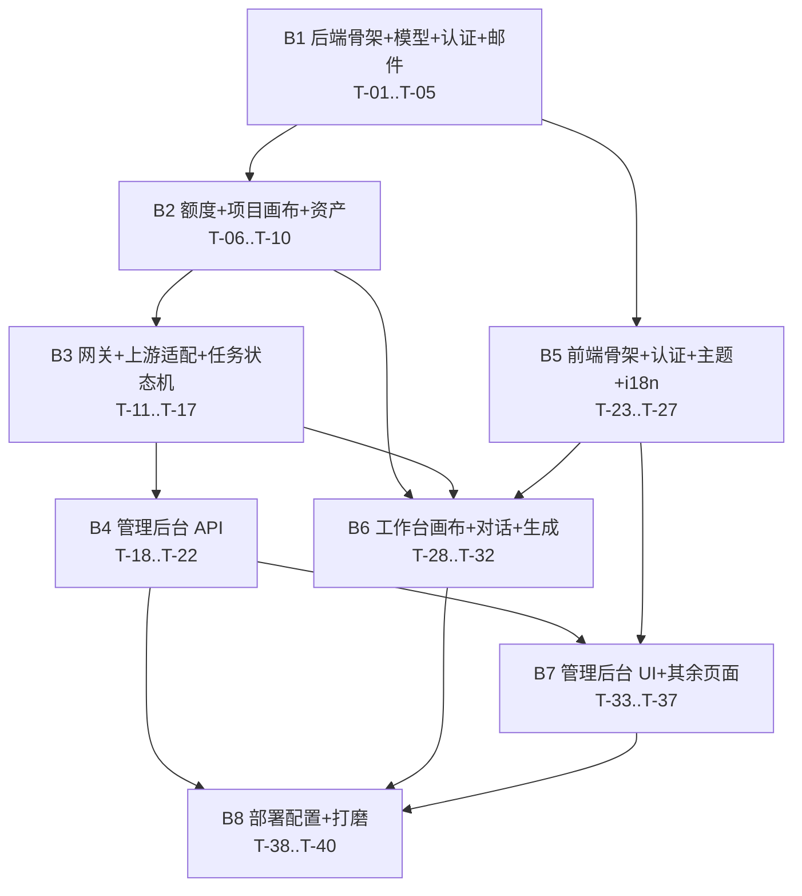

**关键路径**：B1 → B2 → B3 → B6 → B8（后端主链）；B5 可在 B1 完成后与 B2/B3/B4 并行；B7 依赖 B4+B5。异常场景（暂停/续接/幂等/回收/Demo/VPN）集中在 B3（T-14~T-17）与 B6（T-30~T-31），已并入主链，无需独立批次。

---

*文档结束 · 高见远 · 2026-10-16*
