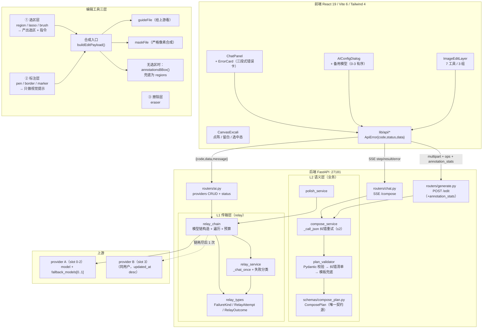
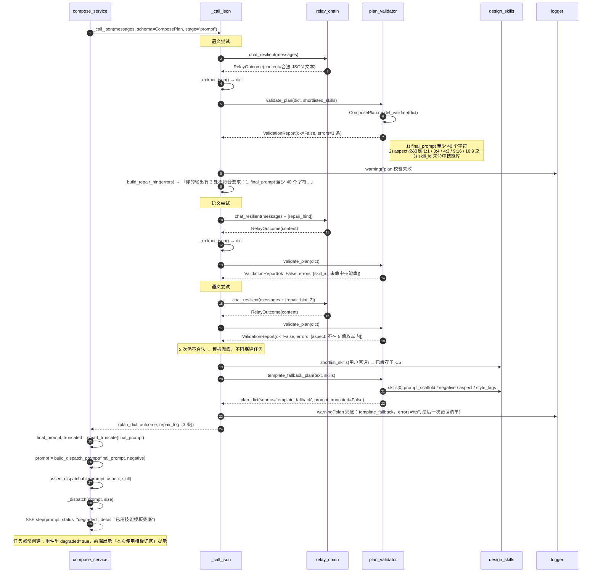

# canvas-studio 增量架构设计（v2）

> 输入：`docs/PRD-increment-v2.md`（21 条需求，R01–R21）
> 基线：一期已交付（三栏创作页 / Excalidraw 画布 / `POST /api/chat/compose` / 中转站配置 / 设计技能库 / 图片编辑层 / 导出 / 配额）
> 本文只描述**增量部分**的设计与任务分解。
> 读者：前后端工程师 / 测试 / 后续维护者。
> 文档性质：设计与任务分解。**不含实现代码**（仅类型定义、函数签名、JSON 示例）。

> ⚠️ **验收口径提醒（给 QA）**
> 项目工作区已有 **89 项历史未提交改动**（非本轮产生），因此 **`git diff` 无法用于判断本轮改了什么**。
> **本轮验收一律以本文 §6「文件改动清单」为准，不以 `git diff` 为准。**
> §6 逐文件列出了「新增 / 修改 + 改动要点 + 预估行数」，请按该表逐文件核对；表内 61 行对应 59 个唯一文件（2 个文件被两批改动，已注明）。

---

## 0. 与 PRD / 代码事实的冲突点（先读这一节）

PRD 终版（203 行）有 9 处需要与代码事实对齐。C1–C6 是「PRD 说法 vs 代码事实」的冲突；C7–C9 是 PRD 终版新增/修正口径后**引入的算术或分层问题**。按「代码事实优先 + 算术自洽优先」原则处理如下，后续所有设计均以此为准。

| # | PRD 说法 | 代码事实 / 算术问题 | 本文裁决 |
|---|---|---|---|
| C1 | R04：`aspect` 限定为 `1:1｜3:4｜4:3｜9:16｜16:9`（5 值） | `compose_service._ALLOWED_SIZES = {1024x1024, 1536x1024, 1024x1536}`（3 值），plan 里字段名是 `size` 不是 `aspect` | plan 契约**新增 `aspect`（5 值枚举）**，`size` 降级为**派生的下游字段**（由 `aspect` 映射，映射表见 §3.3）。`9:16` 与 `3:4` 落到同一个上游 `size`，这是上游能力上限，不是实现缺陷 |
| C2 | R04：`final_prompt ≤ 800` 字符 | `compose_service._MAX_PROMPT = 3800`；且真实超长场景的主因是**我们自己的技能模板**（`prompt_scaffold` + slots + 负向段 + 用户需求叠加），不是模型犯错 | **双上限 + 本地截断，不进纠错重试**（主理人裁决，v2 修正）：契约上限 **1500**（不是 800）；超 1500 → `smart_truncate()` 按 `。；！？\n` 从尾部整段丢弃直到 ≤1500，标 `prompt_truncated=true` + 日志 `original_len`/`final_len`；派发兜底 `_MAX_PROMPT = 3800` 不动（上游安全阀，与契约上限是两回事）。**关键结构保证：截断只作用于 `final_prompt`（不含负向段），负向段在拼装时追加，因此不可能被截断**——避免 R06「尾部含负向段」校验自相矛盾。详见 §3.4 |
| C3 | R03：错误卡要展示「现象 / 已尝试 / 下一步」，需把后端文案透传到前端 | `frontend/src/lib/errors.ts` 有一条铁律：**后端 `message` 一律不上屏**（只允许「错误码 → 固定 i18n 文案」）；且 `lib/api/client.ts` 的 `ApiError` **丢弃了 `envelope.data`** | 不透传 `message`。新增错误码 `UPSTREAM_FORMAT_ERROR` + **结构化 `data`**（全枚举 + 计数，无自由文本），前端 `ErrorCard` 读 `ApiError.data` 渲染三段式。`ApiError` 增加 `data` 字段（见 ADR-7） |
| C4 | R08：序号与选区编号规则一致（同一批编辑里序号与 regions 顺序对应） | 标注明确**不产生选区**（D3），没有 region 可对应 | **统一编号器**：标注序号从 `regions.length + 1` 起算，删除不回收号码。既满足「规则一致」，又保证「序号不与区域号撞号」（见 ADR-5） |
| C5 | R02①：备用模型 0–3 个，最多切换 2 个 | PRD 两处口径并存：「存 0–3 个」与「最多切换 2 个」 | **存 3、试 2**：字段允许存 0–3 个（配置自由），运行时只遍历前 2 个。第 3 个仅作为「主模型被删后自动顶上」的储备 |
| C6 | R13①：画布底纹为点阵网格（`--color-canvas-dot`，24px） | `tokens.css:100,203` 已定义 `--color-canvas-dot` 且 `index.css:19` 已桥接到 Tailwind（`bg-canvas-dot` 可用），但**全项目零引用** | R13① 是**纯新增渲染**，不是调参。同理 `--shadow-glow`（162/251）、`--ease-out`（167）、`--texture-paper`（185）均已存在，R13③⑤ 可直接用，无需新增 token |
| **C7** | R02⑤ + D2：**总尝试 ≤ 4 次**（主模型 1 + 模型链 ≤ 2 + 跨 provider ≤ 1） | 括号里 `1 + 2 + 1 = 4` 数的是**模型槽位**，不是 HTTP 调用数。但 R01 又要求「主模型自动重试 1 次，连续 2 次失败才进入 R02」——主模型占 2 次调用。若「4」指调用数，则 `2(主) + 2(链) + 1(跨) = 5 > 4`，R01 与 R02 在算术上无法同时成立 | **「4」= 模型槽位上限**，不是调用次数上限。定 `MAX_MODEL_SLOTS = 4`（与 PRD 括号完全一致）+ `MAX_HTTP_CALLS = 5`（4 槽位 + 主模型那 1 次 R01 强制重试）。**关键收敛：重试权只授予 slot 0（主模型）**——R01 原文「连续 2 次失败进入 R02」本就只描述主模型；fallback 链上的模型与跨 provider 候选**各只试 1 次、不重试**。这样既满足 R01，又让总调用压到 5，且槽位严格 = 4（见 ADR-3） |
| **C8** | R06 / §3.1-R06：约束表述为「`final_prompt` 尾部必须包含负向描述段」，**校验实现应校验最终拼装后的提示词，而不是 plan 的原始字段** | `compose_service._dispatch()`（956–976 行）在函数内部才把 `negative` 拼成 `f"{final_prompt}\n\n画面中避免出现：{negative}"`；而配额预扣发生在 `_dispatch` 调用的 `generate_service.create_*_task()` 里 | **拆成两层校验，不合并**：<br/>① **契约层**（`ComposePlan`）：`negative` 字段必填非空——这是「模型必须产出它」，属 R04/R05；<br/>② **出图前硬约束层**（新 `build_dispatch_prompt()` + `assert_dispatchable()`）：对**拼装后**的 `prompt` 校验「尾部含负向描述段」+ `aspect` 有值 + `≥40` 字 + 含 style_tag。**必须放在 `_dispatch()` 之前调用**，否则校验失败时配额已被预扣（见 ADR-4 收尾段） |
| **C9** | R11（去框）验收：全量搜索 `components/chat/**` 无 `ring-1 ring-inset ring-border-faint`；且「AI 回答区**任何层级**」都不出现 1px 描边包裹 | 8 处已知卡面之外，`ChatMessage.tsx` 的 AI 分支本身无边框（PRD §1.1 已确认）；三栏**未使用** `border-l/r`，无需改动 | R11 的实际改动面 = 8 处卡面 + `Markdown.tsx`。**「机检范围」扩大到 `components/chat/**` 全量 grep**（R11 验收②原文要求），但**必须排除非 AI 回答区的合法描边**（输入框 `ChatTextarea`、按钮、`PolishPopover` 等）——见 B9/B10 验收命令的限定写法 |
| **C10** | 主理人指出「`index.css:18` 的 `--color-gutter: var(--color-gutter)` 是自引用死声明，导致三栏缝隙无视觉分隔」 | **该判断有误，但结论对**。`index.css:6` 是 Tailwind v4 的 `@theme inline` 块，其写法就是 `--color-X: var(--color-X)`——`inline` 的语义是「把该变量的**解析值**内联进工具类」，变量本身从 `:root`（`tokens.css`）取真值。同一个块里 `--color-surface` / `--color-text` 等 20+ 个 token 全是这个写法，且 `bg-surface` / `text-text` 在全项目正常生效——**证明该模式工作正常，不是缺陷**。<br/>真正的原因很简单：**`--color-gutter` 除了这行桥接之外，全项目零引用**（`grep` 只有 `tokens.css:99/202` 的定义和 `index.css:18` 的桥接），所以它当然没有任何视觉效果 | **不要删 `index.css:18`**（删了 `bg-gutter` 就废了）。正确修复 = **在消费侧用它**：三栏容器的缝隙底色改为 `bg-gutter`（亮 `#e2dbca` / 暗 `#050403`，两个值 `tokens.css:99/202` 已有），让卡片"浮"起来。这是**用背景色分层、不画线**，符合既有视觉铁律。<br/>归入 **R13 第 6 个着力点**（原 5 项 + 分栏缝隙），落在 B11 |

**已由主理人裁决（PRD §6 D1–D5）、本文不再列为待确认的 5 条**：

1. **D1** 双层 fallback：provider 内 `fallback_models`（新增 JSON 字段）+ provider 间互备（同用户其他 provider 按 `updated_at desc`，**不改表**）
2. **D2** 重试不涉及配额变更（`quota_service.pre_deduct()` 只在建生图任务时发生），**不做退款/补偿分支**，但总尝试次数硬上限
3. **D3** 边框/标记不产出选区，与涂鸦同路径合成进参考图；纯标注无选区时以**全部标注的包围盒**为修改区域，且**提交前必须可见**（虚线框 + 尺寸）
4. **D4** 去框 = 静态无框、交互有框（hover 描边仅 `pointer: fine`；触屏改按压浅底）；**R11/R12 已提为 P0**
5. **D5** 画布验收 = 文字标准 + 亮/暗双主题截图，不做像素 diff

**补充 1**：上游**没有独立负向参数**，`negative` 折进 `final_prompt` 尾部，拼装串为 `f"{final_prompt}\n\n画面中避免出现：{negative}"`（`compose_service.py:976` 原文，不要写成「不要出现：」）——见 C8 与 ADR-4。

**补充 4（⚠️ 一处尚未对齐的口径冲突，工程按本文执行，请产品确认）**

**C2 的数值与处理方式，主理人与 PM 的裁决不一致**：

| | 上限 | 超限处理 | 来源 |
|---|---|---|---|
| **主理人**（较晚，已同步 dev-kou） | **1500** | **本地 `smart_truncate`，不进纠错重试** | 主理人裁决邮件 |
| **PM**（D7，PRD 已落盘） | **800** | **走纠错重试，3 次后截断 + `prompt_truncated=true`** | PRD §3.1 / D7 |

**本文按主理人口径实现**（1500 + 本地截断），理由：① 该口径更晚、且已同步给正在写 B3 的 dev-kou；② 技术上更稳（超长主因是技能模板撑长，模型"改短"执行力差且不可复现，会让 R05 的「3 次内 100%」不可测）；③ PM 的 D7 目标（`prompt_truncated` 标记 + 对用户可解释）在本文方案里同样满足，且更确定。

**但 PM 的 800 有一个具体问题需要他知道**：技能骨架 `prompt_scaffold` 本身就有 300–600 字，加上 `slots` 填充 + 负向段，**800 会把大量本来正确的输出判超限**，进而触发重试（每次 5–20 秒）或落到 `template_fallback`——直接冲击 G2 的「模板兜底占比 ≤5%」。

**请主理人与 PM 对齐一次，二选一**：
- **A（本文当前实现）**：1500 + 本地截断。改动量 = 0（已写进 B3）。
- **B（PRD 原文）**：800 + 纠错重试。改动量 = 改 `PROMPT_CONTRACT_MAX` 一个常量 + 把「超长」加回 L2 的 5 类触发清单（变 6 类）+ 删 5 条 `smart_truncate` 单测。

在收到答复前，B3 按 **A** 执行；QA 验收时也按 A 判定。

**补充 2（PRD §6 遗留风险，本文采纳）**：跨 provider 互备会让同一需求落到能力档位不同的 provider 上（4K vs 1K），本期**接受该波动、不做能力对齐**。但 `relay_chain` 预留一个纯函数 `_filter_by_capability(candidates)`，本期**直接返回入参**（恒等），后续按 `max_tokens` / 模型名档位过滤时只改这一个函数体，不动调用方。

**补充 3（编号对照，给 QA 用）**：主理人裁决邮件里的编号与本文不完全一致，对照如下，避免验收时对不上——

| 主理人邮件 | 本文 §0 | 内容 |
|---|---|---|
| C1 | **C1** | `aspect` 5 值 vs `size` 3 值 |
| C2 | **C2** | `final_prompt` 上限（已按裁决改为 1500 + 本地截断） |
| C3 | **C3** | R03 与「后端 message 不上屏」铁律 |
| C4（fallback 存 3 试 2） | **C5** | `fallback_models` 存 3 试 2 |
| C5（budget_exhausted） | 不是冲突项 | 它是 ADR-2 的 `FailureKind` 之一 + ADR-3 的终止条件，不是 PRD 与代码的冲突 |
| C6（PromptComposePlan vs ImageEditPlan） | **无对应项，已确认跳过** | 主理人已确认：这两个类型名是他顺编号回应时的笔误，**文档里不存在、也不需要存在**。compose 走单一 `ComposePlan` 契约；编辑链路走 `plan_service.plan_edit` 的 `ops`（既有能力注册表输出，本期不动）。**本文不需要为此改动。** |
| — | **C4** | 标注序号与 regions 编号（本文独有） |
| — | **C6** | `--color-canvas-dot` token 零引用（本文独有） |
| — | **C7** | R02「总尝试 ≤ 4」与 R01 重试的算术冲突（本文独有，需 PM 确认） |
| — | **C8** | R06 校验必须在拼装之后、且分两层（本文独有） |
| — | **C9** | R11 机检范围应扩到 `components/chat/**`（本文独有） |

---

## 1. 方案总览

### 1.1 架构图



### 1.2 说明（约 290 字）

本期把「上游不确定性」和「模型输出不确定性」拆成两个**互不越界**的层。

**L1 传输层**（`relay_chain` + `relay_service`）只解决一个问题：拿到一段**可用的文本**。它做三件事——把上游响应归入 15 个 `FailureKind` 之一（`html_body` / `empty_body` / `truncated_json` …）；**只在主模型（slot 0）上重试 1 次**（token 截断类重试时放大 `max_tokens`）；按 `[primary, fallback×2, 跨 provider×1]` 的 **4 个模型槽位**切换，全程受「`MAX_HTTP_CALLS = 5` + `TOTAL_DEADLINE_S = 120`」预算约束。

**L2 语义层**（`compose_service` + `plan_validator`）只解决另一个问题：这段文本是不是**合规的 JSON**、出图参数够不够。它做三件事——Pydantic 严格校验（`extra='forbid'`）+ 出图前硬约束校验（拼装后提示词尾部含负向描述段）；把校验错误拼成「字段路径 + 期望」清单追加到下一次请求（≤2 次纠错）；仍不合法则用技能模板兜底并标记 `source=template_fallback`，**不阻塞建任务**。

两层职责不合并：`_call_json` 原有的「追加纠错提示再试」保留在 L2（语义纠错），L1 的重试是**传输重试**。合并会导致「上游返回网页」被当成「模型输出格式不对」而重复消耗纠错预算。同理 L2 内部也分两小层——**契约层**（模型原始输出）与**出图前硬约束层**（拼装后提示词），后者必须在配额预扣之前跑（见 C8）。

编辑工具按「选区 / 标注 / 擦除」三层重排。新增的边框与标记进**标注层**，与涂鸦共用合成入口但不产出选区；纯标注无选区时以标注包围盒兜底为修改区域，并在提交前用虚线框 + 尺寸明示。

---

## 2. 关键设计决策（ADR）

### ADR-1：重试下沉到传输层（relay），不留在业务层（compose）

**问题**
`compose_service._call_json()`（291–331 行）写了 `while attempts < 2` 的「解析失败重试一次」，但 `relay_service.chat()` 在 `json.loads` 失败时**直接 `raise AppError`**（495–498 行）。异常穿透 `_call_json` 的循环，第 2 次尝试**从未执行**——这是「返回格式异常」的直接根因，也是 R01 的核心。

**候选方案**
- (a) 只改 `_call_json`：`try/except AppError` 包住调用再循环。
- (b) 全部下沉到 `relay_service.chat()` 内部。
- (c) 在 relay 层旁新增 `relay_chain.py` 承担链遍历与预算，`relay_service` 只负责「单次调用 + 失败分类」，`chat()` 保留原签名并内部委托给新入口。

**选定：方案 (c)**

**理由**
1. 方案 (a) 治不了根：`_call_json` 重试拿到的是**同一条坏管道**（同一个 base_url、同一个坏网关），第二次几乎必然同样返回 HTML。且业务层拿不到 HTTP 状态、拿不到响应体形态，无法判断「该重试」还是「该换模型」还是「该让用户改地址」。
2. 方案 (b) 会把 `relay_service.py` 从 632 行推到 950+ 行，且把「链构造 / 预算 / 遍历」和「协议适配 / SSRF 校验」混在一个文件里，后续维护成本高。
3. 方案 (c) 保留 `chat()` 的签名与返回结构（`{content, model, provider, source, elapsed_ms}`）不变，内部改为委托 `chat_resilient()`，于是**全部 2 个调用点（`compose_service:309`、`polish_service:711`）零改动即获得韧性**——这是最小的爆炸半径。需要 `attempts` 的调用方（`_call_json`）改用 `chat_resilient()` 拿完整 `RelayOutcome`。
4. 两层职责分离清楚：
   - **L1 传输重试**：目标是「拿到一段非空文本」。触发条件 = 响应体形态不对（html/empty/not_json/truncated/not_object）或 HTTP 5xx 或 timeout。
   - **L2 语义纠错重试**：目标是「这段文本能解析成合规 JSON」。触发条件 = `_extract_json()` 返回 `None`，或 Pydantic 校验失败。纠错手段是**往 messages 里追加一段纠错提示**（模型能读到，才会改）。
   - 两者**不合并**：L1 不会因为 JSON 不合规而换模型（那是 L2 的事，L2 换模型会浪费一次纠错预算）；L2 不会因为响应体是 HTML 而重试（它拿不到 `raw`，且重试同一条管道无意义）。

**代价**
- 新增 2 个文件（`relay_types.py` 90 行、`relay_chain.py` 180 行），`relay_service.py` +120 行。
- `chat()` 变成一层薄包装，读代码时多一次跳转。
- 需要为 L1 写一套可注入故障的假上游（`tests/mock_relay.py`），否则 R01 的 6 类失败无法测。

---

### ADR-2：失败分类的判定标准

**问题**
「上游返回格式异常」是一句人话，不是可编程的判据。R01 要求日志记录 `reason=html_body|empty_body|not_object|truncated_json`，R02 要求按失败分类决定是否换模型，R03 要求错误卡展示「现象」。三者都需要一套**唯一、确定、有序**的分类规则。

**候选方案**
- (a) 按 HTTP 状态码分类（2xx/4xx/5xx）。→ 不够：200 + HTML 是最常见的故障形态。
- (b) 按异常类型分类（`JSONDecodeError` / `TimeoutException` …）。→ 不够：`json.loads` 的多种失败原因混在一个异常里。
- (c) 按「响应体形态 + 状态码 + 异常类型」三源合成，且**判定顺序固定**。

**选定：方案 (c)**。`FailureKind` 枚举 14 值，判定顺序严格如下（先到先判，不再往下走）：

| 序 | `FailureKind` | 判定条件（精确） | 同模型重试 | 换模型 |
|---|---|---|---|---|
| 1 | `connect_error` | `httpx.ConnectError` | ✗ | ✗ **终止整链** |
| 2 | `bad_url` | `guard_url()` 抛 `VALIDATION_ERROR`（SSRF / 非 http(s) / 端口是平台自己） | ✗ | ✗ **终止整链** |
| 3 | `timeout` | `httpx.TimeoutException`（含 `ReadTimeout`/`ConnectTimeout`/`WriteTimeout`） | ✗ | ✓ |
| 4 | `auth_error` | `status ∈ {401, 403}` | ✗ | ✗ **终止整链**（Key 错，换模型无意义） |
| 5 | `http_5xx` | `500 ≤ status ≤ 599` | ✓ 1 次（间隔 300ms，`temperature - 0.2`） | ✓ |
| 6 | `http_4xx` | `400 ≤ status ≤ 499` 且 `_short_reason()` **含** `model` / `does not exist` / `not found` | ✗ | ✓（模型名错，换模型有意义） |
| 7 | `http_4xx`（其他） | 其余 4xx | ✗ | ✗ **终止整链**（参数/额度问题，换模型无用） |
| 8 | `empty_body` | `len(raw) == 0` 或 `raw.strip() == b""` | ✓ 1 次 | ✓ |
| 9 | `html_body` | `raw[:512]` 解码后 `lstrip().lower()` 以 `<!doctype` / `<html` / `<?xml` / `<head` / `<body` 开头，**或**响应头 `content-type` 含 `text/html` | ✓ 1 次 | ✓ |
| 10 | `not_json` | `json.loads` 抛错，且 `exc.msg` **不含** `Unterminated` / `Expecting ',' delimiter` / `Expecting value: line 1 column N (char 0)` 之外的截断特征 | ✓ 1 次 | ✓ |
| 11 | `truncated_json` | `json.loads` 抛错，且（`"Unterminated string"` ∈ msg **或** `raw` 尾部去空白后不以 `}`/`]` 结尾） | ✓ 1 次，且**重试时 `max_tokens = min(int(max_tokens*1.5), 8192)`** | ✓ |
| 12 | `not_object` | `json.loads` 成功但 `not isinstance(payload, dict)` | ✓ 1 次 | ✓ |
| 13 | `upstream_refused` | `status < 400` 但 `payload` 顶层含 `error` 键 | ✗ | ✓ |
| 14 | `truncated_output` | dict 但 `_extract_text()` 为空，且 `_finish_reason() == "length"` | ✓ 1 次，`max_tokens` 同上放大 | ✓ |
| 15 | `no_content` | dict 但 `_extract_text()` 为空，`finish_reason != "length"` | ✓ 1 次 | ✓ |
| — | `ok` | dict 且 `_extract_text()` 非空 | — | 停止，成功 |

> **上表的「同模型重试」列表示「这类失败**值不值得**重试」，实际是否重试还要过一道闸**：`RETRY_SLOTS = {0}` —— **只有 slot 0（主模型）** 有重试权，slot 1/2/3（fallback×2 + 跨 provider×1）各只试 1 次。这是 C7 的算术收敛点：R01 只承诺主模型重试，PRD R02⑤ 的「4」数的是槽位不是调用数。若不做这道闸，4 槽位 × 2 次 = 8 次调用，最坏 12 分钟。

**关键设计点**

1. **必须先判响应体形态，再判内容抽取**。很多中转站在「地址填错」时返回一个 200 的网关首页，此时 `status < 400`、`json.loads` 失败——如果不先看 `raw` 形态，会误判成「模型没给正文」并去调 `max_tokens`，用户白等 90 秒。
2. **`truncated_json` / `truncated_output` 的重试要放大 `max_tokens`**。截断的根因是 token 不够，原样重试必然再截断一次。这是唯一一个「重试时改请求参数」的分支。注意：因为重试权只在 slot 0，这个放大逻辑实际只作用于主模型；若截断发生在 fallback 槽位，直接换下一个槽位（新模型有独立的 `max_tokens` 配置）。
3. **`timeout` 不重试直接换模型**。读超时 90s，重试一次就把用户等待拉到 180s+，体验上等价于卡死。换模型通常更快成功。
4. **`connect_error` / `bad_url` / `auth_error` 终止整链**。这三种是「配置错误」，换模型、换 provider 都救不了，继续尝试只是在浪费用户时间。错误卡直接给「检查地址 / 检查 Key」的下一步。
5. **`FailureKind` 永远不进用户文案**。它只进日志与 `data.reason`，前端按 `reason → i18n key` 映射成中文/英文（ADR-7）。

**代价**
- 判定分支多（15 条），但每条都是 3–5 行纯函数，可 100% 单测覆盖。
- `truncated_json` 的判定依赖 `json.JSONDecodeError.msg` 的英文文本，CPython 版本升级可能改文案 → 增加「`raw` 尾部不以 `}`/`]` 结尾」的兜底判据（已在上表体现），双判据降低脆弱性。
- `http_4xx` 第 6/7 条依赖 `_short_reason()` 的关键词匹配，属于启发式。误判代价是「本该换模型却直接失败」——可接受，因为错误卡里给了「换模型重试」按钮让用户手动绕过。

---

### ADR-3：备用模型链的遍历顺序与终止条件

**问题**
两层 fallback（provider 内 `fallback_models` + provider 间互备）叠在一起，如果「每个模型都允许重试」，最坏情况会变成「4 个模型 × 2 次 = 8 次调用 × 90s ≈ 12 分钟」。必须有明确的顺序与硬预算。PRD 终版（R02⑤ + D2）给的约束是「**总尝试 ≤ 4 次**（主模型 1 + 模型链 ≤ 2 + 跨 provider ≤ 1）」——注意括号里 `1+2+1` 数的是**模型槽位**（C7），不是 HTTP 调用数。

**候选方案**
- (a) 深度优先：每个模型重试到成功为止再换下一个。→ 延迟不可控。
- (b) 广度优先：先把所有模型各试 1 次，全失败再统一重试。→ 实现复杂，且主模型通常配置最好，值得多给它一次机会。
- (c) **重试权只给 slot 0（主模型），其余槽位各试 1 次；整体受槽位预算 + 调用预算 + 时间预算三重约束。**

**选定：方案 (c)**

**为什么「重试权只给主模型」是关键收敛**
R01 原文是「系统在同一模型上自动重试 1 次……**连续 2 次失败进入 R02**」——这句话本身就只描述**主模型**的行为；R02 描述的是 fallback 链「按序切换」，没有要求链上的模型也重试。所以：
- slot 0（主模型）：最多 2 次调用（首次 + R01 强制重试 1 次）
- slot 1/2/3（fallback×2 + 跨 provider×1）：各 **1 次**，失败即换下一个

于是 `2 + 1 + 1 + 1 = 5` 次 HTTP 调用，`4` 个模型槽位——**槽位数严格等于 PRD 的 4，调用数被压到 5**。这一条同时解决了 C7 的算术冲突，并把最坏延迟从 12 分钟压到可接受范围。

**为什么「重试权」该给主模型、不该给 fallback（逻辑链，留档防止被"对称化"）**

这一条不是随手挑的，有完整推理，**下一期不要为了"看起来对称"改成每个模型都重试**：

1. **fallback 模型本身就是「换一个再试」**。切换模型这个动作，语义上已经是「这个模型/这条链路不行，换一条」。在这个动作之上再叠一层「同一个 fallback 再试一次」，等于**对同一个坏上游连打两次**——而它刚刚才失败过一次，第二次大概率同样失败。
2. **主模型是用户精心配置的那一个**：`base_url`、`key`、`model`、`temperature`、`max_tokens`、`extra` 全是他自己调的，是他认为「最合适」的组合。它失败的原因更可能是**瞬时抖动**（网关 5xx、偶发超时、一次性截断），而不是配置错。给它第二次机会的期望收益最高。
3. **PRD 的原文也只承诺主模型**：R01「连续 2 次失败进入 R02」——这句话的结构就是「主模型试两次，然后才换」。R02 描述 fallback 时用的是「按序切换」，没有"重试"二字。
4. **成本不对称**：给主模型 1 次重试的代价是「最坏多 1 次调用」（5 次）；给全部 4 个槽位都重试的代价是「最坏 8 次调用」（12 分钟）。前者换来的是最高价值的第二次机会，后者换来的是三次低价值机会。
5. **可验证**：`RETRY_SLOTS = {0}` 是常量，单测直接断言「slot 1/2/3 各只被调用 1 次」。若改成"每个都重试"，这条断言会立刻失败——这就是我们想要的护栏。

**链构造顺序**（`relay_chain.build_chain()`）

```
chain = []
slot 0: primary provider 的 model                              （必选，1 个，可重试）
slot 1: primary provider 的 fallback_models[0]                  （C5：存 3 试 2）
slot 2: primary provider 的 fallback_models[1]
slot 3: 同用户其他 provider 按 updated_at desc 取第 1 个的 model  （跨 provider 互备，不改表）
去重（同名模型只保留首次出现）、去空串、去掉与 slot 0 完全相同的项
截断：len(chain) ≤ MAX_MODEL_SLOTS = 4
过滤：chain = _filter_by_capability(chain)   # 本期恒等函数，预留能力档位扩展位
```

**三重预算（硬上限，任一触发即终止）**

| 常量 | 值 | 触发后的行为 |
|---|---|---|
| `MAX_MODEL_SLOTS` | **4** | 链构造时截断（与 PRD R02⑤ 括号 `1+2+1` 严格一致） |
| `MAX_HTTP_CALLS` | **5** | 用尽即终止，`FailureKind = budget_exhausted`（= 4 槽位 + slot 0 的 1 次重试） |
| `RETRY_SLOTS` | **`{0}`** | 只有 slot 0 允许重试 1 次；slot 1–3 各只 1 次（C7 的关键收敛） |
| `TOTAL_DEADLINE_S` | **120** | 从**第一次**调用开始计时；到点即终止，返回已尝试链 |

**为什么还要 `TOTAL_DEADLINE_S`**：即使只有 5 次调用，若全是 `timeout`（90s/次）最坏仍是 450s。`timeout` 虽然不重试（ADR-2），但 4 个槽位各超时一次仍是 360s。120s 的截止让「全上游超时」场景在 2 分钟内给用户一个明确的失败结果 + 已尝试链，而不是让用户干等 6 分钟。**超时截断优先于槽位耗尽**，此时 `FailureKind = budget_exhausted`，`attempts` 里记录已完成的部分。

**`resolve()` 语义变更（PRD §3.1-R02 明确要求）**

| 函数 | 语义 | 用在哪 |
|---|---|---|
| `resolve(db, user_id) -> RelayTarget \| None` | **保留原样**，等价于 `resolve_candidates(...)[0]`。向后兼容，不改现有调用点 | `routers/ai.py:297` 的 `/status` |
| `resolve_candidates(db, user_id) -> list[RelayTarget]` | **新增**。返回有序候选列表（≤4），即 slot 0–3 的完整 chain，含 `fallback_models` 与跨 provider 互备 | `relay_chain.build_chain()` |
| `target=` 显式指定 | **旁路**：只调这一个 target，**不构造链、不 fallback、不重试** | `/providers/{id}/test`（`test_target`）、任何显式指定 provider 的场景 |

`target=` 旁路是硬要求：连通性测试的语义是「验证**这一个**配置能不能用」，如果它偷偷 fallback 到别的 provider，用户会看到「测试通过」但主模型其实是坏的——这会把 R03 的排障能力直接毁掉。

**终止条件（按优先级）**

1. **成功**：拿到 `FailureKind = ok`（dict + content 非空）。**schema 不合规不算失败**，不在 L1 终止条件里——那是 L2 的事。L1 只要「有一段文本」就算成功。
2. **不可恢复配置错误**：`connect_error` / `bad_url` / `auth_error` / 其他 `http_4xx` → 立即终止整链，不试 fallback。
3. **时间预算耗尽**：`TOTAL_DEADLINE_S` 到点。
4. **调用预算耗尽**：`MAX_HTTP_CALLS` 用尽。
5. **槽位耗尽**：所有 slot 都试过。

终止后统一抛 `AppError(UPSTREAM_FORMAT_ERROR, data={reason, chain, attempts, total_calls, elapsed_ms, next_actions, trace_id})`。`reason` 取**最后一次**失败的 `FailureKind`；`attempts` 是**全量有序列表**（这是 R03「已尝试 A→B→C」的数据源）。

**代价**
- 最坏等待受 `TOTAL_DEADLINE_S = 120s` 约束（不是 15 分钟），但仍比单模型的 90s 差。缓解：前端在 8s 时把「思考中」文案切成「正在换一个模型…」，并在 SSE `step` 流里插入一条 `retry` 步骤，让用户看到进度而不是白屏。
- 跨 provider 互备会让同一需求落到能力档位不同的 provider 上（4K vs 1K），产出质量有波动。PRD §6 遗留风险已明确**接受该波动**；本文只预留 `_filter_by_capability()` 恒等函数作为扩展位，本期不加过滤逻辑。
- 「同 provider 内 fallback」与「跨 provider 互备」共用一个模型名时会被去重——若用户两个 provider 都配了 `gpt-4.1-mini` 且都没配额，只会试 1 次。这是刻意的：同名模型不同 Key 的成功率差异极小，不值得多花 90s。
- 跨 provider 互备读的是同用户的其他 provider，**会用到用户的另一个 Key**。日志与错误卡里只记 provider `name`，不记 `base_url` 与 `key_hint`（R02③ 明确「不含 Key」）。
- 把「重试权只给 slot 0」写死后，如果主模型是「偶发 5xx、重试即好」的类型，而某个 fallback 是「稳定但慢」的类型，链上会少给 fallback 一次机会。这是有意的取舍：R01 只承诺主模型重试，且多给 fallback 重试会把最坏调用数推到 8 次。

---

### ADR-4：输出契约的实现方式

**问题**
R04 要求「plan 有唯一 schema 契约，被 analyze / reason / prompt 三阶段共用，字段名集合与前端消费集合有断言用例」。R05 要求「校验失败时把错误清单（字段路径 + 期望）拼进下一次请求」。选型直接决定 R05 的工作量。

**候选方案**

| 方案 | 校验能力 | 错误信息质量 | 依赖成本 | 与前端同步 |
|---|---|---|---|---|
| (a) 手写 `if` 校验 | 可控 | 需自己拼「路径 + 期望」，40 字段约 200 行 | 0 | 手工维护，必然漂移 |
| (b) JSON Schema + `jsonschema` 库 | 强 | `ValidationError` 给 `absolute_path` + `message`，但 message 是英文且需二次解析 | 新增 1 个依赖 | 可导出 schema 给前端生成类型 |
| (c) **Pydantic v2 model** | 强（含 `extra='forbid'`） | `ValidationError.errors()` 直接给 `loc`（字段路径元组）+ `msg` + `type`，**天然就是 R05 要的格式** | **0**（FastAPI 已依赖） | `model_json_schema()` 导出 `docs/compose-plan.schema.json` |

**选定：方案 (c) Pydantic v2**

**理由**
1. 零新增依赖——FastAPI 项目里 Pydantic 已是硬依赖。
2. `errors()` 的返回结构正好是 R05 的输入：`[{loc: ('final_prompt',), msg: 'String should have at least 40 characters', type: 'string_too_short'}]`。拼成「`final_prompt`：至少 40 个字符」只需 5 行。
3. `model_json_schema()` 可导出成 JSON Schema 文件，前端用脚本断言「schema 字段集合 == 前端消费字段集合」（R04 的可验证标准），字段变更只改一处。
4. 方案 (a) 在 40 字段规模下必然与文档漂移；方案 (b) 多一个依赖，且 `jsonschema` 的错误路径是 `deque`，还需转换。

**契约结构（3 个 model 共享一个 `StrictBase`）**

```
StrictBase（base.py）
  model_config = ConfigDict(
      extra='forbid',              # R05 明确要求覆盖「多余字段」用例
      str_strip_whitespace=True,
      populate_by_name=True,
  )
  extra_notes: str | None = None   # ≤200；给模型一个「额外说明」的合法出口，
                                   # 避免它把说明塞进 final_prompt 或乱加字段
```

| Model | 用途 | 关键约束 |
|---|---|---|
| `ComposeAnalysis` | analyze 阶段 | `subject: str (1..120)`、`missing: list[str] (≤5, 每条 ≤60)`、`confidence: float (0..1)` |
| `ComposeOption` | 澄清卡选项 | `id: str`、`label: str (1..40)`、`description: str (≤120)`、`prompt: str (1..1500)`、`aspect: ComposeAspect`、`image_count: int (1..4)` |
| `ComposePlan` | reason / prompt 阶段最终产出 | 见下表 |

**`ComposePlan` 字段表（前端消费的唯一契约）**

| 字段 | 类型 | 必填 | 约束 | 说明 |
|---|---|---|---|---|
| `schema_version` | `int` | ✓ | `== 2` | 版本号，后端写入，模型不产出 |
| `title` | `str` | ✓ | 1..60 | 方案标题 |
| `subject` | `str` | ✓ | 1..120 | 画面主体 |
| `aspect` | `Literal['1:1','3:4','4:3','9:16','16:9']` | ✓ | 枚举 | 比例（C1） |
| `negative` | `str` | ✓ | 1..200 | 负向词，非空（R06） |
| `final_prompt` | `str` | ✓ | **40..1500**（C2 修正版，见 §3.4） | 最终提示词。超 1500 **本地截断、不进纠错重试** |
| `skill_id` | `str` | ✓ | 必须命中 `design_skills.get_skill()` | 命中失败 → 校验失败（不再静默回退 `shortlisted[0]`） |
| `style_tags` | `list[str]` | ✓ | 1..5 项，每项 1..40 | 至少 1 个必须出现在 `final_prompt` 里（R06） |
| `reasoning` | `list[str]` | ✓ | 1..4 项，每项 ≤80 | 展示用 |
| `source` | `Literal['relay','template_fallback','verbatim']` | ✓ | 枚举 | 后端写入 |
| `prompt_truncated` | `bool` | ✓ | — | 后端写入，C2 的截断标记 |

**R06 硬约束的落点：分两层，见下方「R06 硬约束落在『两层』」小节。** 一句话概括：`aspect` / `negative` 的**字段级**必填在契约层（①）；「拼装后尾部含负向描述段 + ≥40 字 + 含 style_tag」的**跨字段级**校验在出图前硬约束层（②），且必须在 `_dispatch()` 之前执行。

**`aspect → size` 映射（C1 + PM D7）**

**不做成裸常量**，见 §3.3 的 `resolve_size(aspect, image_model)`。默认表（`DEFAULT_ASPECT_TO_SIZE`）：

```
'1:1'  → '1024x1024'
'3:4'  → '1024x1536'
'4:3'  → '1536x1024'
'9:16' → '1024x1536'   # 上游无更窄尺寸，刻意降级为 3:4
'16:9' → '1536x1024'   # 同理
```

> 第二维是 **`image_model`（图像模型名）**，不是 `RelayTarget`——文本 relay 不收 `size`，见 §3.3 的前提纠正。

**R06 硬约束落在「两层」，不能合并（C8）**

PRD §3.1-R06 明确：`negative` 不是独立参数，约束表述为「`final_prompt` **尾部**必须包含负向描述段」，**校验对象是拼装后的提示词**。而 `compose_service._dispatch()`（956–976 行）是在函数内部才拼装的，且配额预扣发生在 `_dispatch` 调用的 `generate_service.create_*_task()` 里。所以必须拆成两层，且**硬约束层必须在 `_dispatch()` 之前调用**，否则校验失败时配额已被扣掉：

| 层 | 校验对象 | 校验内容 | 失败后果 | 归属需求 |
|---|---|---|---|---|
| **① 契约层**（`plan_validator.validate_plan`） | 模型原始输出的 `ComposePlan` | `negative` 字段**必填非空**（模型必须产出它）、`aspect` 是 5 值枚举、`skill_id` 命中技能库、`style_tags` 1..5 项、`final_prompt ≥ 40`。**`final_prompt > 1500` 不算校验失败**——它走本地截断（见 §3.4），不消耗纠错预算 | 走纠错重试（≤2）→ 模板兜底。**不阻塞建任务** | R04 / R05 |
| **② 出图前硬约束层**（`plan_validator.build_dispatch_prompt` + `assert_dispatchable`） | **拼装后**的 `prompt` 字符串 | ① `aspect` 有值（缺失时取命中技能的 `aspect` 默认值）<br/>② `prompt` **尾部含负向描述段**（即拼装串里出现 `\n\n画面中避免出现：` 且其后非空）<br/>③ `prompt` 长度 ≥ 40 且含该技能 `style_tags` 中至少 1 个 | 抛 `VALIDATION_ERROR` + `data.missing=[...]`，**拒绝建任务**，不静默通过 | R06 |

**为什么必须分两层**：① 是「模型输出合不合规」，靠改 prompt 能救；② 是「出图参数够不够」，救不了（比如技能库没召回任何 skill → 没有 `style_tags` 可比对），只能拒绝。把 ② 塞进 ① 会导致「技能召回不准」被判成「模型格式漂移」，从而多跑两次无意义的纠错重试，还掩盖了真实原因。

**拼装串原文（照抄 `compose_service.py:976`，不要改写）**

```python
def build_dispatch_prompt(final_prompt: str, negative: str) -> str:
    """把 negative 折进提示词尾部。上游 gpt-image 系列没有独立负向参数。"""
    if negative:
        return f"{final_prompt}\n\n画面中避免出现：{negative}"
    return final_prompt
```

受 3800 上限（`_MAX_PROMPT`）保护。**注意截断顺序**：先对 `final_prompt` 做 `smart_truncate(≤1500)`，再调 `build_dispatch_prompt()` 追加负向段（§3.4 的四步顺序）。若拼装后仍超 3800（只可能因为 `negative` 本身极长），截断 `negative` 部分而不是 `final_prompt` 主体。

**`negative` 字段仍然保留在 plan 里**：前端要展示、要可编辑、`_compose_attachment` 要回传。它同时是 ① 层的必填项（模型必须产出）和 ② 层的拼装输入。两层各自校验不同的东西，不重复。

**L2 纠错重试的触发条件只有 5 类（不要扩大）**

主理人裁决：L2 的「追加纠错提示再试」只对**模型可通过改输出修复**的问题触发。超长不属于这一类（见下）。清单：

| # | 触发 | 为什么模型能修 |
|---|---|---|
| 1 | 缺必填字段 | 补上即可 |
| 2 | 类型错（如 `style_tags` 给了字符串而非数组） | 改成正确类型即可 |
| 3 | 枚举越界（`aspect` 不在 5 值内） | 选一个合法值即可 |
| 4 | `skill_id` 不存在（未命中技能库） | 从给定的候选技能里挑一个 |
| 5 | JSON 结构不合规（`_extract_json()` 返回 `None`） | 按「只输出 JSON」重写 |

**明确不在 L2 触发清单里的（避免下一期又改回去）**：`final_prompt` 超长、`final_prompt` 过短（<40，属 R06 ② 层直接拒绝）、`style_tags` 未出现在 `final_prompt` 里（属 R06 ② 层，靠模型"把标签塞进正文"往往只是硬拼，不如直接拒绝并提示用户）、任何计费/配额相关状态。

**ADR-4 附：为什么「超长」是本地截断而不是纠错重试（留档，防止下一期改回去）**

- **超长的成因大概率不是模型犯错，而是我们自己的模板撑长的**：`prompt_scaffold`（技能骨架本身就有 300–600 字）+ `slots` 填充 + 负向段 + 用户需求叠加，很容易到 1000–1400。让模型"改短点"等于让它替我们的模板负责。
- **模型对"改短"的执行力很差**：实测模型通常只是换个说法、加一句"更简洁"，长度没有实质下降。20 秒换一个仍然超长的结果，是把**确定性**问题交给了**概率模型**。
- **本地截断是确定性的、零延迟、可复现**：`smart_truncate()` 按语义边界从尾部丢弃，结果稳定，单测可断言。而纠错重试的结果不可复现（同一输入两次可能不同长度），会让 R05 的「3 次内通过率 100%」变得不可测。
- **代价可接受**：截断丢掉的是尾部修饰性描述（光影、质感、氛围词），保留的是主体 + 构图 + 风格标签 + 负向段——这正好是出图最关键的四个要素。
- **留痕**：`prompt_truncated=true` + 日志 `original_len`/`final_len`，前端展示「已精简」，用户可见，不是黑箱。

**代价**
- `extra='forbid'` 会让「模型多返回一个 `note` 字段」判为失败，多吃一次纠错。缓解：`StrictBase.extra_notes` 给了合法出口，且在纠错提示里明确写「不要输出 `extra_notes` 之外的任何额外字段」。
- 契约变严后 `source=template_fallback` 的占比可能短期上升。R05 的度量是 ≤5%，需要在 B3 的验收里盯这个数。
- `skill_id` 从「静默回退」改成「校验失败」，意味着技能库召回不准时会更早暴露。这是**期望行为**（PRD §1.1 明确「格式漂移时只能丢弃、不能纠偏」是缺陷）。
- ② 层的「含 style_tag」依赖技能库召回结果。若 `shortlist_skills()` 返回空列表，② 层必然失败并拒绝建任务——这是正确的（没有技能骨架就没有出图参数），但会表现为「用户写了很怪的需求 → 建不了任务」。缓解：② 层失败时 `data.missing` 明确写「没有匹配到设计技能，换个说法或手动选一个技能」，并给「用这个技能」的跳转（R20 已有该能力）。
- 契约上限从 800 放到 1500 后，`final_prompt` 会明显变长，上游 token 成本略升。但 1500 仍远低于 3800 安全阀，且比"重试 2 次"的 token 成本低得多。

---

### ADR-5：标注对象的坐标系与持久化形态

**问题**
R07 要「矩形/椭圆描边，可拖动位置、可删除、可撤销重做」；R08 要「箭头/序号/文字标签」。现有 `DoodleStroke`（`canvas-helpers.ts:28`）只有 `points/color/width/mode`，`EditRegion`（`edit-draft.ts`）语义是「产出选区 + 填指令」。选错载体，要么拖动实现不了，要么掩码逻辑被污染。

**候选方案**

| 方案 | 拖动 | 文字/序号 | 与掩码隔离 | 撤销栈 |
|---|---|---|---|---|
| (a) 全部降维成 `DoodleStroke` | 只能整体平移点集，虚线 dash 相位会跑 | 放不下 `text`/`index` | ✓ | ✓（复用现有） |
| (b) 复用 `EditRegion` | ✓ | ✗ | ✗ **会污染掩码**（`paintUnionMask` 会把标注挖洞） | ✗ |
| (c) **独立 `AnnotationObject` 判别式联合类型** | ✓（`box` / `from,to` 直接平移） | ✓（`text` / `index`） | ✓（不进 `regions` 数组） | 需统一栈 |

**选定：方案 (c)**

**理由**
1. 不能复用 `DoodleStroke`：边框要「拖动位置」，笔迹没有位置语义——只能重算全部点。对虚线而言，`setLineDash` 的相位是按路径长度累积的，重算后视觉会跳。
2. 不能复用 `EditRegion`：`EditRegion` 会进 `regions` 数组，进而被 `paintUnionMask()` 当成「挖洞区」。主理人裁决 3 明确「边框/标记不产出选区」，混用会让上游重绘整块区域。
3. 判别式联合类型让「渲染 / 命中测试 / 合成」三处都只 switch 一次，新增工具的成本是「加一个 case」而不是「改三个地方」。

**数据结构（TypeScript，唯一来源 `components/canvas/annotations.ts`）**

```ts
/** 归一化坐标点（0-1，相对原图宽高）——与 DoodleStroke 完全一致 */
export interface Pt { x: number; y: number }

/** 所有标注共有的字段：坐标归一化、线宽归一化，与分辨率/缩放解耦 */
interface AnnotationBase {
  id: string
  /** 归一化线宽（相对原图宽度），保证 1K 与 4K 图视觉一致 */
  width: number
  color: string
}

/** 涂鸦（既有能力，迁移为判别式成员） */
export interface DoodleAnnotation extends AnnotationBase {
  kind: 'doodle'
  points: Pt[]
  mode: 'draw' | 'erase'
}

/** 边框（R07）：矩形 / 椭圆描边 */
export interface BorderAnnotation extends AnnotationBase {
  kind: 'border'
  shape: 'rect' | 'ellipse'
  /** 包围盒（归一化）；拖拽时只平移 box 的 x/y */
  box: { x: number; y: number; w: number; h: number }
  dash: 'solid' | 'dashed'
}

/** 标记（R08）：箭头 / 序号 / 文字标签 */
export interface MarkerAnnotation extends AnnotationBase {
  kind: 'marker'
  shape: 'arrow' | 'index' | 'label'
  /** 箭头：起点=尾，终点=头；index/label：from 为锚点，to 忽略 */
  from: Pt
  to: Pt
  /** shape==='label' 时必填，≤20 字符 */
  text?: string
  /** shape==='index' 时必填，1..99 */
  index?: number
}

export type AnnotationObject = DoodleAnnotation | BorderAnnotation | MarkerAnnotation
```

**坐标系裁决**
- 全部**归一化 0–1**，相对原图宽高。理由：`edit-draft.ts` 的草稿键是「元素 id + 图片指纹」，图片会被重新生成/替换，像素坐标一旦换图就错位。
- **线宽也归一化**（`width` 相对原图宽度）。现有 `DoodleStroke.width` 已是此约定，保持一致。
- **不存像素坐标、不存 DPR、不存画布缩放**。渲染时乘当前图片显示尺寸。

**持久化裁决**
- **只存内存**，挂在 `edit-draft.ts` 的 `EditDraft` 上，新增 `annotations: AnnotationObject[]` 与 `annotationSeq: number`。
- **不落 localStorage、不落 DB**。理由：标注是「未提交的临时意图」，与选区同生命周期；提交后标注已合成进 `guideFile`，原对象无复用价值。落库需要迁移 + 清理策略，收益为零。
- **后端只需感知计数**：`POST /api/generate/edit` 新增 multipart 字段 `annotation_stats`（JSON 字符串），形如 `{"border":2,"marker":3,"doodle":1}`，后端**只写日志、不入库**（R09 的验收就是日志里有这行）。

**编号规则（C4 的解法）**
- 统一编号器：`annotationSeq` 初值 = `regions.length + 1`。
- 新增序号标记时取 `annotationSeq++`；删除**不回收**号码（回收会让用户刚看到的「第 3 处」变成「第 2 处」）。
- 与 `EditRegion` 的 1..n 连续编号共存而不撞号：区域永远是 1..n，标注永远是 n+1..。
- 渲染规格复用现有选区编号徽章（同一组件、同一尺寸），避免两套视觉（R08 明确要求）。

**代价**
- `DoodleStroke` 与 `DoodleAnnotation` 结构重叠（`points/color/width/mode`），存在两份定义。缓解：`annotations.ts` 里 `DoodleAnnotation` 的字段顺序与 `DoodleStroke` 严格一致，并提供一个 `toDoodleAnnotation()` 适配函数；`canvas-helpers.paintStrokePath()` 继续只吃 `DoodleStroke` 形状，标注层传 `DoodleAnnotation`（结构兼容）。
- 撤销栈必须重构（见 ADR-5 配套决策与风险 3）。现有 `redoRef` 只存 `DoodleStroke`，无法容纳 border/marker。

---

### ADR-6：去框后如何用间距/小标题建立层级（token 层表达）

**问题**
R11 要求「AI 侧 8 处 `ring-1 ring-inset ring-border-faint` + `bg-surface` + `shadow-sheet` 卡面清零，层级改由间距 + 小标题 + 字色表达」。这不是「删一个 class」，而是要有一套**可复用、双主题可验、不靠 JS 分支**的 token + 组件约定。

**候选方案**
- (a) 在 8 个组件里各自写间距。→ 必然漂移，暗色主题分组不可辨。
- (b) 抽一个 `<Group>` 容器组件，靠 props 控制间距。→ 过度抽象，8 处结构差异大。
- (c) **token 定义节奏 + 一个 `<SectionLabel>` 原子组件 + 一段明确的 class 约定**。

**选定：方案 (c)**

**新增 token（`frontend/src/styles/tokens.css`）**

```
/* 纵向堆叠节奏（去框后层级的唯一承担者） */
--space-stack-1: 8px;    /* 块内元素 */
--space-stack-2: 16px;   /* 块与块（硬下限，低于它会糊成一段） */
--space-stack-3: 24px;   /* 组与组（暗色主题下也是这个值，R11 要求 ≥12px） */
--space-stack-4: 40px;   /* 话题之间 */

/* 表面策略：静态无框、交互有框（主理人裁决 4） */
--surface-ghost: transparent;                    /* 静态卡面背景 */
--hover-ring: 1px solid var(--color-border);     /* hover 才出现的描边 */
--press-veil: rgba(20, 19, 13, 0.04);            /* 触屏按压浅底（亮色） */
```

**不新增**（复用既有，避免 token 爆炸）：小标题字号用 `--text-micro`（12px）、字距用 `--ls-caps`（0.12em）、颜色用 `--color-text-tertiary`。

**命名约定**：`--space-stack-N` 专表「纵向节奏」，与页面级 `--space-block: 64px` / `--space-section: 112px` **不冲突**（后者是落地页/首页的呼吸感，不可被消息流复用）。

**class 约定（8 处卡面统一遵守）**

| 层级 | class | 具体值 |
|---|---|---|
| 块内元素 | `space-y-2` | 8px |
| 块与块 | `space-y-4` | 16px（**硬下限**） |
| 组与组 | `space-y-6` | 24px |
| 话题之间 | `space-y-10` | 40px |
| 静态卡面 | `bg-transparent shadow-none ring-0` | 无面 |
| 可交互卡面 · hover（仅 `pointer: fine`） | `hover:ring-1 hover:ring-border hover:shadow-sheet` 包在 `@media (hover:hover) and (pointer:fine)` 内 | 描边 = 可点信号 |
| 可交互卡面 · 触屏 | `active:bg-[var(--press-veil)]` | 按压浅底，替代 hover |
| 错误态（**例外，必须保留面**） | `border-l-2 border-danger bg-[var(--color-danger-subtle)]` | 错误必须看起来像错误 |

**「仅 `pointer: fine` 才 hover」的实现方式**：在 `index.css` 里新增一个工具层
```
@media (hover: hover) and (pointer: fine) { .hover-frame { ... } }
```
而不是在组件里用 JS 判断 `matchMedia`。理由：JS 判断会有 SSR/首帧闪烁，且要在 8 处重复；媒体查询是纯 CSS，双主题下自动跟随。

**`<SectionLabel>` 原子组件（新增 `components/ui/SectionLabel.tsx`）**
- 12px / `--ls-caps`（0.12em）/ `--color-text-tertiary` / `--fw-medium`
- 用文字当分隔线，**不用线**（R11 的核心）
- 可选 `as` prop（`h3` / `div`），保证语义化
- 文案全部走 i18n（`chat.section.thinking` / `chat.section.plan` / `chat.section.result`）

**代价**
- 「静态无框」让 8 处卡面的边界消失，**可点击性下降**是最大风险（见风险 2）。缓解：hover 描边 + `focus-visible` 环 + 触屏按压浅底三条腿。
- 组间距从「框」变成「空」，暗色主题下如果间距不足会糊。R11 把「暗色组间距 ≥ 12px」写进验收，本文用 24px（更宽）留余量。
- 8 处卡面要逐个改，任何一处漏改都会让 R11 的「卡面数 = 0」验收失败。缓解：B9/B10 两个批次按文件清单逐个签收，最后用 `grep -c "ring-inset ring-border-faint"` 做机检。

---

### ADR-7：错误语义透传 vs 「后端 message 不上屏」铁律

**问题**
R03 要求错误卡展示「① 现象 ② 已尝试（模型 × 次数）③ 下一步」。但 `frontend/src/lib/errors.ts` 有一条明确铁律：**后端 `message` 一律不上屏**（可能含上游原始报文、内网地址、异常堆栈），只允许「错误码 → 固定 i18n 文案」。而且 `lib/api/client.ts` 的 `ApiError` 构造时**丢掉了 `envelope.data`**，结构化信息根本到不了前端。

**候选方案**
- (a) 破例，允许透传 `message`。→ 破坏安全铁律，且无法 i18n。
- (b) 后端直接返回已翻译的中文文案。→ 破坏多语言（`en` locale 会看到中文），且后端文案无法复用前端 i18n 体系。
- (c) **新增结构化错误码 + 全枚举 `data` + 前端 i18n 渲染**。

**选定：方案 (c)**

**设计**

1. `backend/app/utils/errors.py` 新增
   - `ErrorCode.UPSTREAM_FORMAT_ERROR = "UPSTREAM_FORMAT_ERROR"`，HTTP 502
   - `ERROR_MESSAGES[UPSTREAM_FORMAT_ERROR] = "这次没能从上游拿到可用的结果"`（**兜底文案，正常不会上屏**）
2. `AppError.data` 承载结构化信息（已有字段，无需改类）
3. `frontend/src/lib/api/client.ts`：`ApiError` 增加 `data?: unknown`，构造时传入 `envelope.data`
4. `frontend/src/lib/errors.ts`：`errorTextByCode()` **完全不动**（拿通用兜底文案）
5. 新增 `components/chat/ErrorCard.tsx`：读 `ApiError.data`，三段式渲染
   - 现象：`t('errors.upstream.reason.' + data.reason)`
   - 已尝试：遍历 `data.attempts`，渲染 `模型名 × 次数 · 失败原因`
   - 下一步：遍历 `data.next_actions`，`t('errors.upstream.action.' + action)`
   - 主按钮：「换模型重试」（复用同一 `messages` 重发，用户不重填）

**理由**
- 不破坏铁律：`data` 里**没有一个自由文本字段**。`reason` / `next_actions` 是枚举，`model` 是用户自己填的模型名，`tries` / `elapsed_ms` 是数字。上游原始报文只进日志（`body_head` 截 120 字符，仅 logger）。
- 多语言可用：所有文案走 i18n key，`zh-CN` 与 `en` 各一份。
- `errorTextByCode` 不动意味着**其余 14 个错误码的行为零变化**，回归面最小。

**代价**
- `ApiError` 构造签名从 `(code, message, status)` 变成 `(code, message, status, data?)`，需检查全部 `new ApiError(...)` 调用点（`client.ts` 内 4 处 + 其他文件）。
- 前端多一个组件 + 2 个 i18n 文件的新增 key（约 20 个 key × 2 语言）。
- `data.reason` 是枚举，后端新增 `FailureKind` 时前端必须同步加 key，否则回落兜底文案。缓解：把「`FailureKind` 枚举值集合」写进 B1 与 B5 的共享约定，并在 B5 的验收里用脚本比对（`reason` 全集 == `errors.json` 里 `upstream.reason.*` 的 key 全集）。

---

## 3. 数据模型变更

### 3.1 `ai_providers.fallback_models`

**模型（`backend/app/models/ai_provider.py`）**

```python
# 备用模型链：主模型失败时按序切换。
# - 0-3 个模型名（有序），存 3 但运行时只遍历前 2 个（延迟保护，见 ADR-3）
# - 空列表 = 不启用 fallback（保持一期行为）
fallback_models: Mapped[list] = mapped_column(JSON, default=list)
```

**迁移（`backend/app/migrations/run.py`，追加到 `_apply_column_patches()`）**

```python
# 中转站备用模型链（ADR-3）
await _ensure_column("ai_providers", "fallback_models", "fallback_models JSON DEFAULT '[]'")
```

- SQLite `ADD COLUMN` 只允许常量默认值，`'[]'` 是常量字符串，合法。
- 既有行的 `fallback_models` 会是字符串 `'[]'`；SQLAlchemy `JSON` 类型会 `json.loads` 它 → 得到 `[]`，无需数据回填。
- **代码侧防御**：所有读取处统一 `[str(x) for x in (row.fallback_models or []) if str(x).strip()]`，兼容 `None` / 空列表 / 脏数据。

### 3.2 标注对象

见 ADR-5 的完整 TypeScript 定义（唯一来源 `frontend/src/components/canvas/annotations.ts`）。

**后端感知的字段（仅日志，不入库）**

```
POST /api/generate/edit   multipart 新增字段：
  annotation_stats: str | null   # JSON 字符串，如 {"border":2,"marker":3,"doodle":1}
```

**`edit-draft.ts` 的 `EditDraft` 扩展**

```ts
export interface EditDraft {
  regions: EditRegion[]
  strokes: DoodleStroke[]              // 保留（既有字段，涂鸦的历史载体）
  annotations: AnnotationObject[]      // 新增：border / marker / doodle 的判别式集合
  annotationSeq: number                // 新增：统一编号器（初值 = regions.length + 1）
  updatedAt: number
}
```

> 兼容说明：`strokes` 保留不动（`paintUnionMask` / `paintBrushStroke` / `strokesBBox` 仍吃 `DoodleStroke[]`）。新代码写 `annotations`，`kind === 'doodle'` 的成员在合成时转成 `DoodleStroke` 形状喂给既有函数。这是**刻意保留双轨**，避免一次性重构 1181 行的 `canvas-helpers.ts`。

### 3.3 `aspect → size` 映射：**必须按图像模型解析，不能做成裸常量**（PM D7 修正）

**先纠正一个前提（重要，否则修错地方）**
PM D7 说「跨 provider fallback 时不同 provider 支持的 size 可能不同，所以映射表按 target 解析」。**方向对，但对象错了**：

- 文本 relay provider（`RelayTarget`）**根本不收 `size` 参数**——它只返回 JSON 文本，`_openai_body()` / `_anthropic_body()` 里没有任何 `size` 字段。所以文本层的 fallback 换 provider，**不影响 size**。
- 真正决定 `size` 合法性的是**图像模型**：`compose_service._dispatch()` 把 `size` 传给 `generate_service.create_image_task(model=model or "gpt-image-2", size=size)`（`compose_service.py:985-986 / 998-999`）。这个 `model` 是**图像模型名**，来自 `stream_compose(model=...)`，与文本 provider 完全独立。

→ 所以映射表的第二维必须是 **`image_model`**，不是 `RelayTarget`。

**设计**

```python
# 默认表：gpt-image 系列支持的 3 个尺寸
DEFAULT_ASPECT_TO_SIZE: dict[str, str] = {
    "1:1":  "1024x1024",
    "3:4":  "1024x1536",
    "4:3":  "1536x1024",
    "9:16": "1024x1536",   # 上游无更窄尺寸，刻意降级到 3:4
    "16:9": "1536x1024",   # 上游无更扁尺寸，刻意降级到 4:3
}

# 按「图像模型」覆盖；"*" 表示该模型的通配兜底
IMAGE_MODEL_SIZE_OVERRIDES: dict[str, dict[str, str]] = {
    # 例：某个只支持方形的图像模型
    # "gpt-image-1-mini": {"*": "1024x1024"},
}

def resolve_size(aspect: str, image_model: str | None) -> str:
    """按实际使用的图像模型解析尺寸。

    查找顺序：IMAGE_MODEL_SIZE_OVERRIDES[image_model][aspect]
           → IMAGE_MODEL_SIZE_OVERRIDES[image_model]["*"]
           → DEFAULT_ASPECT_TO_SIZE[aspect]
           → "1024x1024"（最终兜底，永不抛错）
    """
```

**为什么不用裸常量**：`ASPECT_TO_SIZE` 作为模块级常量会被 4 处直接索引，一旦某个图像模型只支持方形，就得改 4 处；做成函数后**只加一行 override**，调用方零改动。且 `resolve_size` 的 `image_model` 参数强制调用方显式传"到底给哪个模型出图"，避免将来引入第二个图像模型时静默发出对方不认的尺寸。

**调用点**：`stream_compose` 里 `size = resolve_size(plan['aspect'], image_model)`，`image_model` 即 `stream_compose(model=...)` 的入参（缺省 `None` → 走 `DEFAULT_ASPECT_TO_SIZE`）。

> **刻意降级，不是 bug**：`9:16` 与 `3:4` 同映射 `1024x1536`，`16:9` 与 `4:3` 同映射 `1536x1024`。**不要试图"修正"这个映射**（例如把 `9:16` 改成不存在的 `768x1365`），那会让上游直接报错。

**aspect 是「双层」关系，不是二选一（主理人 + PM 一致裁决）**

| 层 | 值 | 为什么 |
|---|---|---|
| **契约层**（模型可输出） | **5 值**：`1:1` \| `3:4` \| `4:3` \| `9:16` \| `16:9` | 模型需要理解「竖版海报」（`9:16`）与「人像特写」（`3:4`）的**语义差异**。收窄成 3 值会让它丢掉这个判断力，只能输出"竖版"，无法区分有多竖。 |
| **UI 层**（用户手动选） | **3 档**：`1:1` \| 竖版 `2:3` \| 横版 `3:2` | 下游只有 3 个 size，多给选项就是制造预期落差（选了 9:16 拿到 2:3）。 |
| **映射** | `9:16 → 1024x1536`（同 `3:4`）、`16:9 → 1536x1024`（同 `4:3`） | 见上表，**注释写明"刻意降级，不要试图修正"**。 |

**「UI 3 档是契约 5 档的子集视图」——两者并存，不要统一成 3 值。** 契约是**能力/语义声明**（模型表达意图的空间），UI 是**呈现取舍**（用户只看到能兑现的选项）。任何"为了对齐而把契约收窄到 3 值"的改动都是错的。

**⚠️ 一个数值事实（必须知道，否则会误标比例）**

`_ALLOWED_SIZES` 的三个尺寸换算成比例是：

| size | 实际比例 | 说明 |
|---|---|---|
| `1024x1024` | **1:1** | 精确 |
| `1024x1536` | **2:3**（≈0.667） | **不是 3:4（0.75）** |
| `1536x1024` | **3:2**（=1.5） | **不是 4:3（≈1.333）** |

也就是说：**契约里的 `3:4` / `4:3` 是"语义意图"，不是几何真相**——真正出图是 `2:3` / `3:2`。这正是 UI 层 label 必须写 `2:3` / `3:2` 的原因：**用户在 UI 上看到 `2:3`，拿到的图确实是 2:3；若 UI 写 `3:4`，那就是误标。** 契约层保留 `3:4`/`4:3` 只是为了模型能表达更细的语义，不代表下游能兑现。

→ **展示层规则**：所有面向用户展示比例的地方（UI 选项、方案卡、提示词预览、`_compose_attachment`）**一律走 `ASPECT_UI_LABELS` 映射显示实际比例，禁止直接显示契约值**。契约值只出现在 JSON 字段里。详见 §4.4。


### 3.4 提示词长度与截断策略（C2 修正版）

**三个数字，三种职责，不要混**

| 常量 | 值 | 作用对象 | 触发行为 |
|---|---|---|---|
| `PROMPT_MIN` | `40` | `final_prompt` | 低于则**校验失败**（R06 ② 层，拒绝建任务） |
| `PROMPT_CONTRACT_MAX` | **`1500`** | `final_prompt`（模型产出） | 超出则**本地 `smart_truncate()`，不进纠错重试** |
| `_MAX_PROMPT` | `3800`（**不动**） | 拼装后的最终 `prompt` | 上游安全阀。`verbatim` 路径（用户原话）不受 1500 约束，只受 3800 约束 |

**为什么契约上限是 1500 而不是 PRD 原写的 800**
PRD 的 800 是拍的。实测超长的主因不是模型啰嗦，而是**我们自己的技能模板把长度撑起来的**——`prompt_scaffold`（长）+ `slots` 填充 + 负向段 + 用户需求叠加，很容易到 1000–1400。设 800 会让大量**本来正确**的输出被判超限。1500 覆盖了「技能骨架 + 合理主体描述」的绝大多数情况。

**`smart_truncate()` 规格**

```python
# 降级级别：记录"丢到哪一级边界才够"，供 R21 统计与线上排障
TruncateLevel = Literal["none", "sentence", "semicolon", "newline", "comma", "hard"]

def smart_truncate(text: str, limit: int = PROMPT_CONTRACT_MAX) -> tuple[str, TruncateLevel]:
    """按语义边界从尾部整段丢弃，直到长度 ≤ limit。

    切分边界（优先级从高到低）：句末标点「。！？」→ 分号「；」→ 换行「\n」→ 逗号「，」
    先按最粗的边界切；若切完还超限，再降一级边界。
    若已丢弃到只剩第一段仍超限 → 硬截断（level="hard"，保底，不允许无限循环）。

    返回 (截断后文本, 降级级别)：
      "none"      = 未截断（长度已 ≤ limit）
      "sentence"  = 按句末标点丢句
      "semicolon" = 降级到分号
      "newline"   = 降级到换行
      "comma"     = 降级到逗号
      "hard"      = 硬截断（内容已无可用语义边界，属异常信号，R21 要盯）
    """
```

**关键结构保证：负向段不可能被截断**

截断**只作用于 `final_prompt`**（模型产出，本身**不含**负向段）；负向段是在 `build_dispatch_prompt()` 里**追加**的。执行顺序：

```
1. final_prompt, level = smart_truncate(plan.final_prompt)          # ≤ 1500，不含负向段
2. prompt = build_dispatch_prompt(final_prompt, plan.negative)      # 追加 "\n\n画面中避免出现：{negative}"
3. assert_dispatchable(prompt, aspect, skill)                       # R06 ② 层：尾部负向段必然存在
4. _dispatch(prompt, size)                                          # 此处才预扣配额
```

这样「尾部含负向段」是**结构性成立**的，不依赖后处理修补。主理人指出的隐患（截断把负向段切掉 → R06 校验自相矛盾）在结构上被消除，而不是靠「截断后再补回来」。

**若 `final_prompt` 本身已含负向描述**（模型自己写进去了）：它属正文，按普通正文截断，不特殊处理。负向段的权威来源始终是 `plan.negative` 字段。

**截断必须留痕（两处，共用一份埋点）**

| 位置 | 内容 | 谁消费 |
|---|---|---|
| **plan 字段** | `prompt_truncated: bool`（`level != "none"` 时为 `true`） | 前端展示「本次提示词较长，已精简至 1500 字以内」（i18n `chat.degraded.prompt_truncated`）；`_compose_attachment` 回传 |
| **结构化日志** | `logger.info("prompt 截断 stage=%s original_len=%s final_len=%s level=%s", stage, orig, final, level)` | **R21 可观测面板**（超长截断率 + 降级级别分布）；线上排障「为什么这张图跟描述不完全一样」 |

> **`prompt_truncated` 字段保留**：主理人 C2 裁决明确要求「标 `prompt_truncated=true`」，PM 一度以为该字段不在口径内，已澄清——**字段保留**（它是前端可解释性的依据），同时按 PM 建议**补上三项结构化日志**（`original_len` / `final_len` / `level`）。两者共用同一份埋点，不做两套。
>
> `level="hard"` 是**异常信号**（内容已无可用语义边界，说明模型产出的是一整段无标点长文），R21 要单独盯这个分布——它升高意味着提示词质量在退化。


---

## 4. 接口契约

### 4.1 `relay_service.chat_resilient()`（新增）

```python
async def chat_resilient(
    db: AsyncSession,
    user_id: str,
    messages: list[dict[str, Any]],
    *,
    json_mode: bool = False,
    temperature: float | None = None,
    max_tokens: int | None = None,
    target: RelayTarget | None = None,
    purpose: str = "generic",   # compose | polish | plan | generic，仅用于日志与 R21 统计
) -> RelayOutcome: ...
```

**返回结构（`relay_types.py`）**

```python
class FailureKind(str, Enum):
    OK = "ok"
    CONNECT_ERROR = "connect_error"
    BAD_URL = "bad_url"
    TIMEOUT = "timeout"
    AUTH_ERROR = "auth_error"
    HTTP_5XX = "http_5xx"
    HTTP_4XX = "http_4xx"
    EMPTY_BODY = "empty_body"
    HTML_BODY = "html_body"
    NOT_JSON = "not_json"
    TRUNCATED_JSON = "truncated_json"
    NOT_OBJECT = "not_object"
    UPSTREAM_REFUSED = "upstream_refused"
    TRUNCATED_OUTPUT = "truncated_output"
    NO_CONTENT = "no_content"
    BUDGET_EXHAUSTED = "budget_exhausted"


@dataclass
class RelayAttempt:
    model: str
    provider: str            # provider 展示名（用户自己起的，非 base_url）
    provider_id: str | None  # 内部 id，仅日志
    try_index: int           # 1-based，同一模型内第几次
    ok: bool
    reason: FailureKind
    http_status: int | None
    elapsed_ms: int
    body_head: str           # 前 120 字符，仅日志，永不进响应


@dataclass
class RelayOutcome:
    content: str
    model: str               # 最终成功的模型
    provider: str
    source: str              # user | global
    elapsed_ms: int
    attempts: list[RelayAttempt]   # 全量有序（含成功那次）
    chain: list[str]               # 计划遍历的模型名，供错误卡展示 "A → B → C"
    total_calls: int
    degraded: bool                 # True = 不是链上第一个模型成功的
```

**`chat()` 的兼容策略**

```python
async def chat(db, user_id, messages, *, json_mode=False, temperature=None,
               max_tokens=None, target=None) -> dict[str, Any]:
    """签名与返回结构**完全不变**，内部委托 chat_resilient()。
    返回 {content, model, provider, source, elapsed_ms}，丢弃 attempts。
    """
```

→ `compose_service:309` 与 `polish_service:711` **零改动**即获得韧性；需要 `attempts` 的 `_call_json` 改用 `chat_resilient()`。

**`resolve` 家族（PRD §3.1-R02 明确要求「返回有序候选列表」+ 保留 `target=` 旁路）**

```python
# 新增：有序候选（≤ MAX_MODEL_SLOTS = 4）
# slot 0 = 当前 is_active provider 的 model
# slot 1/2 = 该 provider 的 fallback_models[0..1]
# slot 3 = 同用户其他 provider（updated_at desc）第 1 个的 model
async def resolve_candidates(db: AsyncSession, user_id: str) -> list[RelayTarget]: ...

# 保留原签名，等价于 resolve_candidates(...)[0]，None 表示未配置
async def resolve(db: AsyncSession, user_id: str) -> RelayTarget | None: ...

# 恒等函数占位（PRD §6 遗留风险的扩展位：按 max_tokens / 模型名档位过滤二级候选）
def _filter_by_capability(candidates: list[RelayTarget]) -> list[RelayTarget]:
    return candidates
```

**`target=` 旁路的语义（硬要求）**：`chat_resilient(..., target=X)` 时**只调 X 一次**，不建链、不 fallback、不重试。用于 `/providers/{id}/test`（`test_target`）与任何显式指定 provider 的场景——连通性测试必须只验证「这一个配置」，否则用户会看到「测试通过」而主模型其实是坏的。

**`_call_json` 的新签名**

```python
async def _call_json(
    db: AsyncSession,
    user_id: str,
    messages: list[dict[str, Any]],
    *,
    temperature: float = 0.4,
    max_tokens: int = 1600,
    target: relay_service.RelayTarget | None = None,
    schema: type[BaseModel] | None = None,   # 新增：传入即做契约校验（R04/R05）
    stage: str = "generic",                   # analyze | reason | prompt
) -> tuple[dict[str, Any], RelayOutcome, list[str]]:
    """返回 (plan_dict, outcome, repair_log)。
    - 语义纠错重试 ≤2 次（保留原有「追加纠错提示」机制）
    - schema 校验失败 → 把错误清单拼进下一次 messages
    - 3 次仍不合法 → 返回 template_fallback 产出（不抛异常，不阻塞建任务）
    """
```

### 4.2 REST 接口变更

| 方法 | 路径 | 变更 |
|---|---|---|
| `GET` | `/api/ai/providers` | 每项新增 `fallback_models: string[]` |
| `POST` | `/api/ai/providers` | 接受 `fallback_models?: string[]` |
| `PATCH` | `/api/ai/providers/{id}` | 同上 |
| `GET` | `/api/ai/status` | 新增 `fallback_models: string[]`、`chain_preview: string[]`、`backup_provider: {id,name,model} \| null` |
| `POST` | `/api/ai/providers/{id}/test` | **不变**（只测主模型，避免测试一次烧 5 次调用） |
| `POST` | `/api/generate/edit` | 新增 multipart 字段 `annotation_stats: str \| null` |

**`fallback_models` 的服务端校验（`routers/ai.py`）**

```
- 类型：list[str]；非法类型 → VALIDATION_ERROR
- 长度：0 ≤ len ≤ 3
- 每项：strip 后 1 ≤ len ≤ 120
- 去重（保序）
- 不得与同一条 provider 的 model 相同（相同项静默丢弃，不报错）
- 空字符串项静默丢弃
```

**`GET /api/ai/status` 响应示例**

```json
{
  "configured": true,
  "source": "user",
  "provider_name": "我的 DeepSeek 中转",
  "model": "deepseek-chat",
  "kind": "deepseek",
  "reason": "",
  "skills_count": 78,
  "fallback_models": ["gpt-4.1-mini", "claude-sonnet-4-5"],
  "chain_preview": ["deepseek-chat", "gpt-4.1-mini", "claude-sonnet-4-5"],
  "backup_provider": { "id": "prov_xxx", "name": "备用网关", "model": "qwen-max" }
}
```

> `chain_preview` 是**实际会遍历的链**（含跨 provider 互备的第 4 个），`fallback_models` 是用户配置的原始值。二者不同的原因见 ADR-3（存 3 试 2 + 跨 provider 追加）。

### 4.3 错误响应体里 `attempts` 的形状

**HTTP 502**

```json
{
  "code": "UPSTREAM_FORMAT_ERROR",
  "message": "这次没能从上游拿到可用的结果",
  "data": {
    "reason": "html_body",
    "chain": ["deepseek-chat", "gpt-4.1-mini", "qwen-max"],
    "attempts": [
      { "model": "deepseek-chat",  "provider": "我的 DeepSeek 中转", "tries": 2, "reason": "html_body",       "elapsed_ms": 1240 },
      { "model": "gpt-4.1-mini",   "provider": "我的 DeepSeek 中转", "tries": 2, "reason": "truncated_json", "elapsed_ms": 3810 },
      { "model": "qwen-max",       "provider": "备用网关",           "tries": 1, "reason": "timeout",        "elapsed_ms": 90000 }
    ],
    "total_calls": 5,
    "elapsed_ms": 95050,
    "next_actions": ["check_base_url", "switch_model", "raise_max_tokens"],
    "trace_id": "relay_01HQ8..."
  }
}
```

**字段约束**

| 字段 | 类型 | 说明 |
|---|---|---|
| `reason` | `FailureKind` 枚举 | 最后一次失败的分类 |
| `chain` | `string[]` | 计划遍历的模型名（≤4） |
| `attempts` | `{model, provider, tries, reason, elapsed_ms}[]` | **按模型聚合**（不是按调用），`tries` = 该模型调用次数 |
| `total_calls` | `int` | 实际 HTTP 调用总数（≤5） |
| `elapsed_ms` | `int` | 总耗时 |
| `next_actions` | `string[]` | 枚举：`check_base_url` / `switch_model` / `raise_max_tokens` / `check_api_key` / `retry_later` |
| `trace_id` | `string` | 关联日志用；前端只在「联系客服」时展示 |

**SSE 路径的错误帧**（`/api/chat/compose` 是 SSE，不走 envelope）

```
event: error
data: {"code":"UPSTREAM_FORMAT_ERROR","data":{...同上 data 结构...}}
```

→ 前端 `lib/sse.ts` 的 `onMessage` 收到 `event === 'error'` 时构造一个 `ApiError(code, message, 502, data)` 抛给上层，让 `ErrorCard` 有**唯一**的消费入口（HTTP 与 SSE 两条路径同构）。

### 4.4 前端消费的 plan schema

```ts
/** 唯一来源：frontend/src/lib/api/chat.ts（禁止在组件里重复声明） */
export type ComposeAspect = '1:1' | '3:4' | '4:3' | '9:16' | '16:9'

export interface ComposePlan {
  schema_version: 2
  title: string            // 1..60
  subject: string          // 1..120
  aspect: ComposeAspect
  negative: string         // 1..200
  final_prompt: string     // 40..1500（超 1500 本地截断，见 §3.4）
  skill_id: string
  style_tags: string[]     // 1..5 项，每项 1..40
  reasoning: string[]      // 1..4 项，每项 ≤80
  source: 'relay' | 'template_fallback' | 'verbatim'
  prompt_truncated: boolean
}
```

**UI 暴露的档位（主理人 + PM 一致裁决：3 档，且 label 用「实际比例」）**

契约保留 5 值，UI 只让用户看到 3 档——正好对应 3 个**互不相同**的上游 `size`：

| UI label（展示） | 契约值（JSON 字段） | 实际 `size` | 实际比例 | 说明 |
|---|---|---|---|---|
| `1:1` 方形 | `1:1` | `1024x1024` | 1:1 | 精确 |
| `2:3` 竖版 | `3:4` | `1024x1536` | **2:3** | label 写实际比例，不写契约值 |
| `3:2` 横版 | `4:3` | `1536x1024` | **3:2** | 同上 |
| —（不暴露） | `9:16` | `1024x1536` | 2:3 | 与竖版同 size，用户无法区分 |
| —（不暴露） | `16:9` | `1536x1024` | 3:2 | 与横版同 size |

**展示层唯一映射表（前端 `lib/api/chat.ts` 里定义，禁止在组件内联）**

```ts
/** 契约值 → 面向用户展示的比例（写实际能兑现的比例，不写契约值） */
export const ASPECT_UI_LABELS: Record<ComposeAspect, string> = {
  '1:1':  '1:1',
  '3:4':  '2:3',   // 实际出图 1024x1536 = 2:3
  '4:3':  '3:2',   // 实际出图 1536x1024 = 3:2
  '9:16': '2:3',
  '16:9': '3:2',
}

/** 用户可手动选的 3 档（契约 5 值的子集视图） */
export const ASPECT_UI_OPTIONS: ComposeAspect[] = ['1:1', '3:4', '4:3']
```

**硬规则**：所有面向用户展示比例的地方（UI 选项、方案卡、提示词预览、`_compose_attachment` 的展示字段）**一律走 `ASPECT_UI_LABELS`，禁止直接显示契约值**。契约值只活在 JSON 字段里。

> **为什么 label 是 `2:3` 而不是 `3:4`**：`1024x1536` 换算就是 **2:3（≈0.667）**，不是 `3:4`（0.75）。UI 写 `3:4` 会让用户拿到一张"比预期更瘦"的图——那是**误标**，比"少两个选项"更伤。详见 §3.3 的「一个数值事实」。
> **为什么契约仍留 `3:4`/`4:3`**：那是模型表达语义意图的空间（`3:4` 与 `9:16` 在模型眼里是"人像特写"与"竖版海报"两种不同构图）。**契约 5 值是 UI 3 档的超集视图，两者并存，不要收窄契约。**


**字段集合断言用例（R04 的可验证标准）**

`frontend/scripts/check-plan-schema.mjs`：
1. 读 `docs/compose-plan.schema.json`（后端 `ComposePlan.model_json_schema()` 导出）→ 取 `properties` 的 key 集合
2. 读 `frontend/src/lib/api/chat.ts` → 用正则抽 `interface ComposePlan { ... }` 的 key 集合
3. 断言**两个集合相等**，不等则 `process.exit(1)` 并打印差集
4. 同时断言 `ComposeAspect` 的字面量集合 == `["1:1","3:4","4:3","9:16","16:9"]`
5. 断言 `Object.keys(ASPECT_UI_LABELS)` 覆盖全部 5 个契约值（缺一个就 `exit(1)`）
6. 断言 `ASPECT_UI_OPTIONS.length === 3` 且是契约 5 值的**真子集**（防止有人"顺手收窄契约"）

> `compose_service._compose_attachment()` / `_compose_result()` 继续输出 `size`（派生值）与既有字段，**保持向后兼容**；新增 `aspect` / `schema_version` / `prompt_truncated` 三个字段。

---

## 5. 时序图

### 5.1 上游返回 HTML 的完整降级链路

```mermaid
sequenceDiagram
    autonumber
    actor U as 用户
    participant FE as ChatPanel
    participant API as routers/chat.py (SSE)
    participant CS as compose_service
    participant CJ as _call_json (L2)
    participant RC as relay_chain (L1)
    participant RS as relay_service._chat_once
    participant P1 as provider A
    participant P2 as provider B (跨 provider)

    U->>FE: 输入「做一张活动海报」
    FE->>API: POST /api/chat/compose (SSE)
    API->>CS: stream_compose()
    CS->>CJ: _call_json(messages, schema=ComposePlan, stage="reason")

    Note over CJ: 第 1 次语义尝试
    CJ->>RC: chat_resilient(messages, json_mode=True)
    RC->>RC: build_chain() → slot0=deepseek-chat, slot1=gpt-4.1-mini, slot2=qwen-max
    Note over RC: MAX_MODEL_SLOTS=4 / MAX_HTTP_CALLS=5 / RETRY_SLOTS={0}
    RC->>RS: _chat_once(deepseek-chat, temperature=0.4)   # slot 0
    RS->>P1: POST /chat/completions
    P1-->>RS: 200 text/html（网关首页）
    RS->>RS: classify() → raw 以 &lt;!doctype 开头 → HTML_BODY
    RS-->>RC: RelayAttempt(reason=html_body, status=200)

    Note over RC: HTML_BODY → 同模型重试 1 次（temperature - 0.2）
    RC->>RS: _chat_once(deepseek-chat, temperature=0.2)
    RS->>P1: POST /chat/completions
    P1-->>RS: 200 text/html
    RS-->>RC: RelayAttempt(reason=html_body, try_index=2)

    Note over RC: 主模型连续 2 次失败 → 按 R01 进入 R02，换 slot 1
    RC->>RS: _chat_once(gpt-4.1-mini, temperature=0.4)   # slot 1
    RS->>P1: POST /chat/completions
    P1-->>RS: 200 JSON 但 finish_reason=length
    RS->>RS: classify() → _extract_text 为空 且 finish_reason=length → TRUNCATED_OUTPUT
    RS-->>RC: RelayAttempt(reason=truncated_output, try_index=1)

    Note over RC: slot 1 不是主模型 → RETRY_SLOTS={0} → 不重试，直接换 slot 2
    RC->>RS: _chat_once(qwen-max, temperature=0.4)       # slot 2
    RS->>P1: POST /chat/completions
    P1-->>RS: 200 JSON + 正文
    RS-->>RC: RelayAttempt(reason=ok)
    RC-->>CJ: RelayOutcome(content, attempts=[4 条], degraded=True, total_calls=4)

    CJ->>CJ: _extract_json() → dict
    CJ->>CJ: ComposePlan.model_validate() → 通过
    CJ-->>CS: (plan_dict, outcome, repair_log=[])
    CS->>CS: size = ASPECT_TO_SIZE[plan.aspect]
    CS->>CS: prompt = build_dispatch_prompt(final_prompt, negative)
    CS->>CS: assert_dispatchable(prompt, aspect, skill)  # R06 ② 层，在 _dispatch 之前
    CS->>CS: _dispatch(prompt, size)                      # 此处才预扣配额
    CS-->>API: SSE step(dispatch) + result(plan, relay={model: qwen-max, degraded: true})
    API-->>FE: event: result
    FE-->>U: 展示方案 + 「已用备用模型生成」轻提示
```

**关键点**：整个链路里用户**从未看到** `json` / `JSONDecodeError` / `html` 字样。日志里记录 `reason=html_body` 两次（slot 0 的首次 + 重试）、`reason=truncated_output` 一次（slot 1），共 4 次调用、3 个槽位、`degraded=True`。

### 5.2 schema 校验失败 → 纠错重试 → 模板兜底



**关键点**：
- 纠错提示**必须携带具体字段路径与期望**（R05）。"请输出合法 JSON"这种泛化提示无效。
- **纠错只对 5 类可修复问题触发**（缺字段 / 类型错 / 枚举越界 / `skill_id` 不存在 / JSON 不合规）。**超长不在其中**——超长走 `smart_truncate()`，零延迟、确定性、可复现（ADR-4 附）。
- 3 次不合法 → **不抛异常**，返回模板兜底产出。R05 明确「不阻塞建任务」。
- 每次非法输出保留**前 200 字符**到日志（R05 明确要求），用于事后分析模型漂移。
- **截断在拼装之前**：`smart_truncate` 只作用 `final_prompt`，负向段在 `build_dispatch_prompt` 里追加，所以「尾部含负向段」是结构性成立的，不会被截断破坏。
- `source='template_fallback'` 的占比是 R05 的度量指标（≤5%），由 R21 面板统计。

---

## 6. 文件改动清单

> **共 60 个文件**（新增 20 / 修改 40）。`✚` = 新增，`✎` = 修改，行数为预估值。
> 表内 60 行 = 60 个唯一文件（一行一个文件）。**批次维度的文件次是 63**，因为 3 个文件被两批先后改动：`tokens.css`（B8+B11）、`index.css`（B8+B11）、`test_relay_resilience.py`（B1+B12）。
> **本清单是 QA 的唯一验收基准**——工作区有 89 项历史未提交改动，`git diff` 不可用（见文首提醒）。

### 6.1 后端（18 个）

| # | 文件路径 | 类型 | 改动要点 | 预估行数 |
|---|---|---|---|---|
| 1 | `backend/app/services/relay_types.py` | ✚ | `FailureKind`(16 值) / `RelayAttempt` / `RelayOutcome` / 预算常量（`MAX_MODEL_SLOTS` / `MAX_HTTP_CALLS` / `RETRY_SLOTS` / `TOTAL_DEADLINE_S`） | +90 |
| 2 | `backend/app/services/relay_chain.py` | ✚ | `build_chain()` / `chat_resilient()` 遍历循环 / 三重预算 / 跨 provider 互备 / `resolve_candidates()` / `_filter_by_capability()` | +190 |
| 3 | `backend/app/services/relay_service.py` | ✎ | 抽出 `_chat_once()`；新增 `classify_failure()`；`chat()` 改为委托 `chat_resilient()`；`resolve()` 改为 `resolve_candidates()[0]`；`test_target()` 走 `target=` 旁路 | +120 |
| 4 | `backend/app/utils/errors.py` | ✎ | 新增 `UPSTREAM_FORMAT_ERROR` 错误码 + HTTP 502 映射 + 兜底文案 | +6 |
| 5 | `backend/app/models/ai_provider.py` | ✎ | 新增 `fallback_models: JSON` | +6 |
| 6 | `backend/app/migrations/run.py` | ✎ | `_ensure_column("ai_providers","fallback_models",...)` | +4 |
| 7 | `backend/app/routers/ai.py` | ✎ | `_to_out()` 带 `fallback_models`；`ProviderUpsert` 接受并校验（≤3/去重/≠model）；`/status` 加 `chain_preview` + `backup_provider` | +45 |
| 8 | `backend/app/schemas/__init__.py` | ✚ | 导出 `ComposePlan` / `ComposeAnalysis` / `ComposeOption` / `DEFAULT_ASPECT_TO_SIZE` / `resolve_size` | +12 |
| 9 | `backend/app/schemas/compose_plan.py` | ✚ | `StrictBase` + 3 个 model + `DEFAULT_ASPECT_TO_SIZE` + `IMAGE_MODEL_SIZE_OVERRIDES` + `resolve_size()` + `PLAN_SCHEMA_VERSION=2` + `PROMPT_MIN` / `PROMPT_CONTRACT_MAX` | +240 |
| 10 | `backend/app/services/plan_validator.py` | ✚ | `validate_plan()`（① 契约层）/ `build_repair_hint()` / `template_fallback_plan()` / **`smart_truncate()`（C2，本地截断）** / `build_dispatch_prompt()`（拼装串唯一来源）/ `assert_dispatchable()`（② 出图前硬约束层） | +200 |
| 11 | `backend/app/services/compose_service.py` | ✎ | `_call_json` 改用 `chat_resilient` + 接 `schema` 参数 + 纠错重试改造（**仅 5 类触发**）；`stream_compose` 在 `_dispatch` 前按 §3.4 四步执行；`_dispatch` 改为接收已拼好的 `prompt`（去掉内部 `if negative` 分支）；`size = resolve_size(aspect, image_model)`；SSE `event: error` 帧在此 yield；`aspect`/`prompt_truncated`/`schema_version` 写入 plan | +170 / -50 |
| 12 | `backend/app/routers/generate.py` | ✎ | `/edit` 新增 `annotation_stats` multipart 字段 → 解析 → 写日志 | +20 |
| 13 | `backend/tests/mock_relay.py` | ✚ | 可注入 html/empty/truncated/not_object/502/timeout 的假上游 | +150 |
| 14 | `backend/tests/test_relay_resilience.py` | ✚ | 6 类失败分类 + 链遍历顺序 + 三重预算 + 跨 provider 互备 + `target=` 旁路断言 | +280 |
| 15 | `backend/tests/test_compose_plan_schema.py` | ✚ | 缺字段/类型错/枚举越界/多余字段 4 类 + 纠错重试（5 类触发）+ `smart_truncate` 5 条 + 模板兜底 | +260 |
| 16 | `backend/tests/test_provider_fallback_models.py` | ✚ | 读写 + 校验（>3 / 重复 / 等于 model / 非字符串） | +120 |
| 17 | `backend/tests/test_compose_golden.py` | ✚ | R14 6 条典型需求 golden（活动海报/电商主图/社交头像/公众号封面/PPT 封面/插画角色） | +200 |
| 18 | `docs/compose-plan.schema.json` | ✚ | `ComposePlan.model_json_schema()` 导出（**脚本生成物，不手写**，随契约变更重跑） | ~120 |

> **`backend/app/routers/chat.py` 无需改动（主理人核对项）**：已核查 `routers/chat.py:180` 是 `return StreamingResponse(compose_service.stream_compose(...))`——**纯直通**，不做任何帧加工。SSE 的 `event: error` 帧由 `compose_service.stream_compose` 内部 `yield _sse({...})` 产出即可，路由层零改动。原 §6 曾把该文件列为修改项，已修正为「无需改动」。

### 6.2 前端 · 基础设施与 API（7 个）

| # | 文件路径 | 类型 | 改动要点 | 预估行数 |
|---|---|---|---|---|
| 19 | `frontend/src/types/api.ts` | ✎ | `ErrorCode` 加 `UPSTREAM_FORMAT_ERROR`；新增 `UpstreamAttempt` / `UpstreamFailureData` / `NextAction` 类型 | +35 |
| 20 | `frontend/src/lib/api/client.ts` | ✎ | `ApiError` 加 `data?: unknown`，透传 `envelope.data`（ADR-7） | +10 |
| 21 | `frontend/src/lib/api/ai.ts` | ✎ | `AIProvider.fallback_models: string[]`、`ProviderUpsert.fallback_models`、`RelayStatus` 加 `chain_preview`/`backup_provider` — **归属 B4**（主理人核对项：它在这里，不在 §6.3） | +12 |
| 22 | `frontend/src/lib/api/chat.ts` | ✎ | `ComposePlan` 类型（唯一来源）+ `ComposeAspect`（5 值）；**`ASPECT_UI_LABELS`（契约值 → 实际比例展示，`3:4→2:3`、`4:3→3:2`）** + **`ASPECT_UI_OPTIONS`（3 档）**；compose 结果加 `aspect`/`schema_version`/`prompt_truncated` — **归属 B3**（与后端契约同批，保证两端字段集合同步改） | +45 |
| 23 | `frontend/src/lib/sse.ts` | ✎ | `event: error` 帧 → 构造带 `data` 的 `ApiError` 抛给上层（与 HTTP 路径同构） | +20 |
| 24 | `frontend/scripts/check-plan-schema.mjs` | ✚ | R04 字段集合相等断言（schema.json ↔ chat.ts） | +90 |
| 25 | `frontend/src/styles/tokens.css` | ✎ | 新增 `--space-stack-1..4` / `--surface-ghost` / `--hover-ring` / `--press-veil` / `--canvas-dot-size`（ADR-6 + R13①） | +45 |

### 6.3 前端 · 中转站配置与错误卡（3 个）

| # | 文件路径 | 类型 | 改动要点 | 预估行数 |
|---|---|---|---|---|
| 26 | `frontend/src/components/ai/AIConfigDialog.tsx` | ✎ | 备用模型区：3 个有序输入（可拖排序/可删/可空）、与主模型去重校验、`chain_preview` 预览 | +120 |
| 27 | `frontend/src/components/chat/ErrorCard.tsx` | ✚ | 三段式错误卡（现象/已尝试/下一步）+「换模型重试」按钮（复用同一 messages 重发） | +180 |
| 28 | `frontend/src/components/ui/SectionLabel.tsx` | ✚ | 小标题原子组件（12px / 0.12em / tertiary / 可选 `as`） | +40 |

> **主理人核对项**：「§6.3 漏了 `lib/api/ai.ts`」——它**不在 §6.3，在 §6.2 #22**（「前端 · 基础设施与 API」分类下），归属 **B4**。它确实必须存在（前端读写 `fallback_models` 的 API 层），已核对：`AIProvider.fallback_models` + `ProviderUpsert.fallback_models` + `RelayStatus.chain_preview/backup_provider` 三项都在 #22 的改动要点里。不是遗漏。

### 6.4 前端 · AI 回答区去框（10 个）

| # | 文件路径 | 类型 | 改动要点 | 预估行数 |
|---|---|---|---|---|
| 29 | `frontend/src/components/chat/Markdown.tsx` | ✎ | `blockquote` 去左边框 → 左留白 16px + 次级字色；`hr` → 24px 空白；`code` 去描边保底色；表格只留横向分隔线 | +30 / -12 |
| 30 | `frontend/src/components/chat/SkillRunCard.tsx` | ✎ | 去 `ring-1 ring-inset ring-border-faint` + `bg-surface` + `shadow-sheet`；改 `space-y-4` + `SectionLabel` | -8 / +14 |
| 31 | `frontend/src/components/chat/AnalysisSteps.tsx` | ✎ | 同上 | -8 / +14 |
| 32 | `frontend/src/components/chat/ThinkingTrace.tsx` | ✎ | 去框 + 默认收成一行摘要（点开才展开，展开后只用缩进 16px + 次级字色） | +35 / -12 |
| 33 | `frontend/src/components/chat/GenerationResultCard.tsx` | ✎ | 去框；结果图保留圆角 + 投影（图本身即容器，不套外层卡片） | -8 / +12 |
| 34 | `frontend/src/components/chat/ConfirmCountCard.tsx` | ✎ | 去框；静态无框、hover 有框（`.hover-frame`） | -8 / +12 |
| 35 | `frontend/src/components/chat/EditCompareCard.tsx` | ✎ | 同上 | -8 / +12 |
| 36 | `frontend/src/components/chat/LatestResultDock.tsx` | ✎ | 同上 | -8 / +12 |
| 37 | `frontend/src/components/chat/ChatPanel.tsx` | ✎ | AI 侧容器（1428 行）去框；挂 `ErrorCard`（替换现有错误渲染）；SSE error 帧接入 | +55 / -25 |
| 38 | `frontend/src/components/ui/StateBlock.tsx` | ✚ | 空态/加载态/错误态三态共用块（R16：对话区与画布区同源复用） | +110 |

### 6.5 前端 · 编辑工具（5 个）

| # | 文件路径 | 类型 | 改动要点 | 预估行数 |
|---|---|---|---|---|
| 39 | `frontend/src/components/canvas/annotations.ts` | ✚ | `Pt` / `AnnotationObject` 判别式联合 + `annotationsBBox()` / `hitTest()` / `translate()` / `nextIndex()` | +260 |
| 40 | `frontend/src/components/canvas/annotation-history.ts` | ✚ | 统一撤销栈（`AnnotationOp` / `RegionOp` / `StrokeOp` 混合，深度 50） | +140 |
| 41 | `frontend/src/components/canvas/AnnotationLayer.tsx` | ✚ | SVG 渲染层（rect/ellipse/dashed/arrow/index 徽章/label）+ 拖拽 + 删除 + 显隐开关（R19） | +300 |
| 42 | `frontend/src/components/canvas/canvas-helpers.ts` | ✎ | `buildEditPayload` 接受 `annotations`；新增 `paintAnnotations()` 画进 guideFile；`annotationsBBox()` 兜底 regions | +95 |
| 43 | `frontend/src/components/canvas/edit-draft.ts` | ✎ | `EditDraft` 加 `annotations` + `annotationSeq`；读写函数同步 | +22 |

### 6.6 前端 · 编辑层 UI 与画布视觉（3 个）

| # | 文件路径 | 类型 | 改动要点 | 预估行数 |
|---|---|---|---|---|
| 44 | `frontend/src/components/canvas/ImageEditLayer.tsx` | ✎ | `Tool` 加 `border`/`marker`；工具条三组重排（选区\|标注\|擦除）+ 组间 1px 分隔；两个 popover（矩形/椭圆；箭头/序号/文字）；快捷键 `R`/`A`/`M`/`L`；`annotation_stats` 提交；撤销栈接 `annotation-history` | +420 / -70 |
| 45 | `frontend/src/components/canvas/CanvasExcali.tsx` | ✎ | 点阵网格背景（`--canvas-dot-size: 24px`）+ `--texture-paper`；缩放 < 40% 淡出；隐藏 Excalidraw 默认选中态 → 青柠 1.5px + `--shadow-glow`；图片默认 `--shadow-lift`、hover `--shadow-float`（`translateY(-1px)`, 200ms `--ease-out`） | +85 |
| 46 | `frontend/src/components/canvas/CanvasToolbar.tsx` | ✎ | 工具岛距底 12px、图标统一 16px、`backdrop-blur` + 1px 内描边 + `--shadow-lift`、hover 上浮 1px | +40 |

### 6.7 前端 · 画布留白、空态与分栏缝隙（1 个）

| # | 文件路径 | 类型 | 改动要点 | 预估行数 |
|---|---|---|---|---|
| 47 | `frontend/src/components/canvas/WorkspaceView.tsx` | ✎ | 内容四周 ≥64px 安全边、底部让出 56px；新图片落位居中（复用 `findEmptySpot`/`viewportCenterScene`）；空白画布引导文案 + 主操作按钮（接 `StateBlock`）；**三栏容器加 `bg-gutter` 让缝隙露出 `--color-gutter`（C10 分栏缝隙，R13 第 6 着力点）** | +60 |

### 6.8 i18n（8 个 = 4 组双语，**必须同批提交**）

| # | 文件路径 | 类型 | 改动要点 | 预估行数 |
|---|---|---|---|---|
| 48 | `frontend/src/i18n/locales/zh-CN/errors.json` | ✎ | `upstream_format_error` + `upstream.reason.*`（16 个 FailureKind）+ `upstream.action.*`（5 个 NextAction）+ `upstream.attempt_line` 模板 | +26 |
| 49 | `frontend/src/i18n/locales/en/errors.json` | ✎ | 同步 49 | +26 |
| 50 | `frontend/src/i18n/locales/zh-CN/canvas.json` | ✎ | `tool.border` / `tool.marker` / `tool.lasso.hint` / `tool.*.shortcut` / `marker.*` / `border.*` / `annotation.hide` / `annotation.too_small` / `empty.hint` / `empty.action.*` | +34 |
| 51 | `frontend/src/i18n/locales/en/canvas.json` | ✎ | 同步 51 | +34 |
| 52 | `frontend/src/i18n/locales/zh-CN/chat.json` | ✎ | `section.thinking` / `section.plan` / `section.result` / `section.skill` / `degraded.template` / `degraded.fallback_model` / **`degraded.prompt_truncated`（C2 新增：「本次提示词较长，已精简至 1500 字以内」）** / `error.retry_with_model` / `error.change_prompt` | +20 |
| 53 | `frontend/src/i18n/locales/en/chat.json` | ✎ | 同步 53 | +20 |
| 54 | `frontend/src/i18n/locales/zh-CN/settings.json` | ✎ | `provider.fallback.*`（标题/说明/占位/上限提示/去重提示/链预览） | +14 |
| 55 | `frontend/src/i18n/locales/en/settings.json` | ✎ | 同步 55 | +14 |

### 6.9 验收脚本与文档（2 个）

| # | 文件路径 | 类型 | 改动要点 | 预估行数 |
|---|---|---|---|---|
| 56 | `e2e/annotation_tools_verify.mjs` | ✚ | 7 工具亮/暗双主题逐一可用 + 可撤销 + 纯标注无选区的包围盒兜底（Playwright） | +240 |
| 57 | `docs/acceptance-v2.md` | ✚ | R01–R21 逐条签收表 + 亮/暗双主题截图清单 + 对比度核对表（R18） | +120 |

### 6.10 补充行（构建配置与两处易漏项）

| # | 文件路径 | 类型 | 归属批次 | 改动要点 | 预估行数 |
|---|---|---|---|---|---|
| 58 | `frontend/src/index.css` | ✎ | **B8 + B11** | B8：加 `@media (hover:hover) and (pointer:fine)` 下的 `.hover-frame` 工具层（ADR-6）。B11：**不动 `@theme inline` 块**（`--color-gutter` 桥接保留），仅在文件尾部加注释说明分栏缝隙走 `bg-gutter`（C10） | +12 / +4 |
| 59 | `frontend/src/components/chat/GenerationSkeleton.tsx` | ✎ | B10 | 改用 `StateBlock variant="loading"`，去掉自己的卡面 | +10 / -18 |
| 60 | `frontend/package.json` | ✎ | B12 | 新增 `"check:schema": "node scripts/check-plan-schema.mjs"` | +1 |

> 说明：表内编号 1–60 共 **60 行 = 60 个唯一文件**（一行一个文件，无重复）。
> `docs/compose-plan.schema.json`（#18）为**脚本生成物**，不计入手写工作量。
> 分类小计：新增 **20** / 修改 **40**。
> **批次文件次 = 63**：3 个文件被两批先后改动——`tokens.css`（#25，B8+B11）、`index.css`（#58，B8+B11）、`test_relay_resilience.py`（#14，B1+B12）。

---

## 7. 任务列表

### 7.0 批次划分说明

主理人建议 8 批。但硬性规则要求「每批 3–6 个文件」，而本次涉及 **60 个文件 / 63 个文件次**，8 批意味着平均 7.5 文件/批，其中「去框」一批就是 13 个文件、i18n 双语还必须同批——必然超限。

因此拆为 **12 批**，每批 4–6 个手写文件、可独立验证。相比 8 批的方案，多 4 个轮次，但每轮都在工程师一次能写完的体量内，且任何一批失败不会污染其他批。

**依赖拓扑**（B1–B5 与 B6–B7 完全并行；B8 依赖 B6；B9–B10 依赖 B8；B11 独立；B12 收尾）

> **批次编号 = 依赖顺序，不是优先级顺序。** PRD 终版把 R11/R12 提为 P0（P0 共 11 条：R01–R09 + R11 + R12），因此 **B8/B9/B10 是 P0 批次**，与 B1 同属第一批次可启动的工作。若只派一个工程师，建议顺序：B1 → B8 → B9 → B10 → B3 → B6 → B7 → B2 → B4 → B5 → B11 → B12（先把两条 P0 主线打通，再做配置 UI 与画布视觉）。

**P0 批次（必须本期交付）**：B1（R01/R02/R03）、B2（R02 配置）、B3（R04/R05/R06）、B4（R02 UI）、B5（R03 前端）、B6（R07/R08/R09 数据）、B7（R07/R08/R09 UI）、**B8（R12）**、**B9（R11）**、**B10（R11）**
**P1 批次**：B11（R13）、B12 的 R14/R18 部分
**P2**：R19（在 B7 内顺带）、R20（B12 记录）、R21（日志聚合方案，B12 记录）

```
B1 ──► B2 ──► B4 ──┐
  └──► B3 ─────────┼──► B5 ──────────────────┐
B6 ──► B7 ──► B8 ──┴──► B9 ──► B10 ─────────┼──► B12
B11 ────────────────────────────────────────┘
```

---

### B1 · 传输层容错（后端）

| 项 | 内容 |
|---|---|
| **需求覆盖** | R01（响应体格式识别与同模型重试）、R02（后端 fallback 链）、R03（错误语义后端侧） |
| **依赖** | 无 |
| **文件（6）** | `backend/app/services/relay_types.py` ✚<br/>`backend/app/services/relay_chain.py` ✚<br/>`backend/app/services/relay_service.py` ✎<br/>`backend/app/utils/errors.py` ✎<br/>`backend/tests/mock_relay.py` ✚<br/>`backend/tests/test_relay_resilience.py` ✚ |

**实施要点**
1. `relay_service.py` 把现有 `chat()` 的请求-发送-解析-抽取主体抽成 `_chat_once(target, messages, **overrides) -> tuple[dict|None, FailureKind, int, bytes]`（不发异常，返回分类结果）。
2. `classify_failure(status, raw, exc) -> FailureKind` 严格按 ADR-2 的 15 条顺序实现。
3. `relay_chain.build_chain(db, user_id, primary) -> list[RelayTarget]`：primary → `fallback_models[:2]` → 同用户其他 provider 第 1 个。去重、截断到 4。
4. `relay_chain.chat_resilient()` 实现三重预算：`MAX_MODEL_SLOTS=4` / `MAX_HTTP_CALLS=5` / `RETRY_SLOTS={0}`（**只有主模型可重试 1 次**，见 C7+ADR-3）/ `TOTAL_DEADLINE_S=120`。
5. `resolve_candidates(db, user_id) -> list[RelayTarget]`（新增，≤4 有序）；`resolve()` 保留为 `resolve_candidates()[0]`；**`target=` 显式指定时走旁路，不建链、不 fallback、不重试**。
6. `_filter_by_capability(candidates)` 恒等函数占位（PRD §6 遗留风险的扩展位）。
7. `chat()` 改为 `outcome = await chat_resilient(...)` 后返回原 dict 结构，**签名与返回不变**。
8. 全部失败时抛 `AppError(ErrorCode.UPSTREAM_FORMAT_ERROR, data={reason, chain, attempts, total_calls, elapsed_ms, next_actions, trace_id})`。
9. **不出现**任何 `json` / `JSONDecodeError` 字样于 `AppError.message`。

**验收命令**
```bash
cd backend
python -c "from app.services.relay_service import chat, chat_resilient; print('ok')"
python -c "from app.services.relay_chain import MAX_MODEL_SLOTS, MAX_HTTP_CALLS, RETRY_SLOTS; assert (MAX_MODEL_SLOTS, MAX_HTTP_CALLS, RETRY_SLOTS) == (4, 5, {0}); print('budget ok')"
python -m pytest tests/test_relay_resilience.py -q
python -m pytest tests/test_ai_relay_api.py tests/test_polish_fidelity.py -q   # 回归：现有调用点不破
grep -c "JSONDecodeError\|不是标准 JSON" app/services/relay_service.py         # 期望 0
```

**必测断言（写进 `test_relay_resilience.py`）**
- `MAX_MODEL_SLOTS == 4`（PRD R02⑤ 的括号 `1+2+1`）
- 主模型连续 2 次 `html_body` → 进入 fallback（R01 原文「连续 2 次失败进入 R02」）
- slot 1/2/3 各只被调用 **1 次**（`RETRY_SLOTS == {0}`，C7 的关键收敛）
- 全失败时 `len(attempts) == 4`、`total_calls == 5`
- `target=` 显式指定时 `total_calls == 1`（旁路，不 fallback）

---

### B2 · 备用模型配置（后端）

| 项 | 内容 |
|---|---|
| **需求覆盖** | R02（配置侧）、R21 的 `chain_preview` 数据源 |
| **依赖** | B1 |
| **文件（4）** | `backend/app/models/ai_provider.py` ✎<br/>`backend/app/migrations/run.py` ✎<br/>`backend/app/routers/ai.py` ✎<br/>`backend/tests/test_provider_fallback_models.py` ✚ |

**实施要点**
1. `fallback_models: Mapped[list] = mapped_column(JSON, default=list)`。
2. `_ensure_column("ai_providers", "fallback_models", "fallback_models JSON DEFAULT '[]'")`，幂等。
3. `_to_out()` 输出 `fallback_models`（过滤空串、`str()` 归一）。
4. `ProviderUpsert.fallback_models: list[str] | None = None`；写入前 `_normalize_fallback(models, primary_model)`：strip → 去空 → 去重 → 去掉等于 primary 的 → 截断到 3。
5. `GET /ai/status` 新增 `fallback_models`、`chain_preview`（复用 `relay_chain.build_chain` 的纯函数部分，不实际发请求）、`backup_provider`。
6. **`/test` 接口不改**（只测主模型）。

**验收命令**
```bash
cd backend
python -m app.migrations.run                                    # 幂等，重复执行无副作用
python -m pytest tests/test_provider_fallback_models.py -q
# 手测（需已登录 token）
curl -s -X PATCH localhost:27181/api/ai/providers/<id> \
  -H "Authorization: Bearer $TOKEN" -H 'Content-Type: application/json' \
  -d '{"fallback_models":["gpt-4.1-mini","claude-sonnet-4-5","qwen-max","extra"]}' | head -c 400
# 期望：只保留前 3 个；GET /api/ai/status 的 chain_preview 长度 ≤ 4
```

---

### B3 · 输出契约与校验（后端契约 + 前端契约镜像）

| 项 | 内容 |
|---|---|
| **需求覆盖** | R04（单一 schema 源）、R05（校验→纠错→兜底）、R06（出图参数硬约束） |
| **依赖** | B1 |
| **文件（6 个手写 + 1 个生成物）** | `backend/app/schemas/__init__.py` ✚<br/>`backend/app/schemas/compose_plan.py` ✚<br/>`backend/app/services/plan_validator.py` ✚<br/>`backend/app/services/compose_service.py` ✎<br/>`backend/tests/test_compose_plan_schema.py` ✚<br/>`frontend/src/lib/api/chat.ts` ✎（**前端契约镜像**，与后端同批改，保证字段集合同步）<br/>+ `docs/compose-plan.schema.json` ✚（**脚本生成物，不手写**，不计入手写文件数） |

**实施要点**
1. `compose_plan.py` 严格按 ADR-4 的字段表实现；`StrictBase` 用 `extra='forbid'` + `extra_notes`。
2. `aspect` 用 `Literal` 枚举；`ASPECT_TO_SIZE` 常量（**注释写明 `9:16`/`3:4` 同映射是刻意降级**）；`PLAN_SCHEMA_VERSION = 2`；`PROMPT_MIN = 40` / `PROMPT_CONTRACT_MAX = 1500`。
3. `plan_validator.validate_plan(raw, shortlisted) -> ValidationReport`：先 Pydantic 校验，再补一条**跨字段校验**（`final_prompt` 至少含 1 个 `style_tags`）。**`final_prompt > 1500` 不判失败**（交给 `smart_truncate`），只判 `< 40`。
4. `plan_validator.build_repair_hint(errors) -> str`：把 `[(loc, msg)]` 拼成「你的输出有 N 处不符合要求：\n1. `final_prompt`：至少 40 个字符\n…」。
5. `plan_validator.template_fallback_plan(text, skills) -> dict`：基于既有 `_template_plan()` 改造，输出**同样满足 `ComposePlan`** 的 dict，`source='template_fallback'`。
6. **`plan_validator.smart_truncate(text, limit=1500) -> tuple[str, TruncateLevel]`（C2 新增）**：按语义边界从尾部整段丢弃直到 ≤1500。边界优先级 `。！？` → `；` → `\n` → `，` → 硬截断；返回 `(text, level)`，`level ∈ {none, sentence, semicolon, newline, comma, hard}`。**纯函数、零 I/O、可单测**。`level="hard"` 是异常信号，R21 单独盯。
7. `plan_validator.build_dispatch_prompt(final_prompt, negative) -> str`：**照抄 `compose_service.py:976` 的拼装串** `f"{final_prompt}\n\n画面中避免出现：{negative}"`，从 `_dispatch()` 抽出来成为纯函数（供 ② 层校验与 `_dispatch` 共用，避免两处拼装串不一致）。
8. `plan_validator.assert_dispatchable(prompt, aspect, skill) -> None`：**出图前硬约束层（C8 的 ②）**，校验对象是**拼装后**的 `prompt`：
   - `aspect` 有值（缺失时取 `skill.aspect`）
   - `prompt` 尾部含 `\n\n画面中避免出现：` 且其后非空
   - `len(prompt) >= 40` 且含 `skill.style_tags` 中至少 1 个
   - 不满足抛 `VALIDATION_ERROR` + `data.missing`
   - **必须在 `_dispatch()` 之前调用**（否则配额已被 `generate_service.create_*_task()` 预扣）
9. `compose_service._call_json` 改签名（§4.1），**语义纠错 ≤2 次，且只对 5 类可修复问题触发**（缺字段 / 类型错 / 枚举越界 / `skill_id` 不存在 / JSON 不合规）→ 3 次仍不合法走模板兜底。
10. `stream_compose` 在 `_dispatch()` **之前**按 §3.4 的四步顺序执行：`smart_truncate(final_prompt)` → `build_dispatch_prompt(...)` → `assert_dispatchable(...)` → `_dispatch(prompt=..., size=resolve_size(plan['aspect'], image_model))`。
11. 截断留痕（两处共用一份埋点）：`plan['prompt_truncated'] = (level != "none")`；日志 `logger.info("prompt 截断 stage=%s original_len=%s final_len=%s level=%s", ...)`——**三项都必须有**，供 R21「超长截断率 + 降级级别分布」，不允许静默截断。
12. `_dispatch()` 内部改为直接接收拼装好的 `prompt`（不再自己拼），签名加 `prompt: str` 参数、去掉内部的 `if negative` 分支——**保证拼装串只有一处定义**。
13. `_compose_attachment` / `_compose_result` 加 `aspect` / `schema_version` / `prompt_truncated`，`size` 保留。
14. 导出脚本：`python -c "import json;from app.schemas.compose_plan import ComposePlan;print(json.dumps(ComposePlan.model_json_schema(),ensure_ascii=False,indent=2))" > docs/compose-plan.schema.json`。

**验收命令**
```bash
cd backend
python -m pytest tests/test_compose_plan_schema.py -q
python -m pytest tests/test_edit_orchestration.py tests/test_png_and_prompt.py -q   # 回归
python -c "import json;from app.schemas.compose_plan import ComposePlan;print(json.dumps(ComposePlan.model_json_schema(),ensure_ascii=False,indent=2))" > ../docs/compose-plan.schema.json
python -c "import json;d=json.load(open('../docs/compose-plan.schema.json'));assert set(d['properties'])=={'schema_version','title','subject','aspect','negative','final_prompt','skill_id','style_tags','reasoning','source','prompt_truncated','extra_notes'},set(d['properties']);print('schema ok')"
# C8 关键断言：拼装串只有一处定义，且文案与既有实现一致
grep -rn "画面中避免出现" app/ | wc -l          # 期望 1（只在 plan_validator.build_dispatch_prompt）
grep -rn "不要出现：" app/ | wc -l              # 期望 0
```

**必测断言（写进 `test_compose_plan_schema.py`）**

**① 契约校验 6 条用例（R05 原文 4 类 + PM 追加 2 类）**

| # | 用例 | 期望 |
|---|---|---|
| 1 | 缺必填字段（删掉 `negative`） | ① 层拦，`errors` 含 `negative` 路径 |
| 2 | 类型错（`style_tags` 给字符串而非数组） | ① 层拦，`errors` 含类型期望 |
| 3 | 枚举越界（`aspect = "1:2"`） | ① 层拦，`errors` 列出 5 个合法值 |
| 4 | 多余字段（多一个 `note`） | ① 层拦（`extra='forbid'`） |
| 5 | **`skill_id` 不存在**（未命中技能库） | ① 层拦（不再静默回退 `shortlisted[0]`） |
| 6 | **超长不得触发纠错**（仅 `final_prompt` 超 1500，其余全合法） | **不进纠错**：mock `chat_resilient` 调用次数 = **1**；`prompt_truncated=True`；`level != "none"` |

**② 出图前硬约束层（② 层）**

- `negative` 为空的 plan → ① 层拦（必填）；`negative` 非空但拼装后尾部被改坏 → ② 层拦
- ② 层校验失败时**配额未被扣减**（mock `quota_service.pre_deduct` 断言调用次数 = 0）
- `build_dispatch_prompt` 输出以 `\n\n画面中避免出现：` 结尾段

**③ `smart_truncate` 6 条（C2 专项，返回值改 `(text, level)`）**

| # | 输入 | 期望 `level` |
|---|---|---|
| 1 | `len < 1500` | `"none"`，原文不变 |
| 2 | `len == 1501`，尾部是完整句子 | `"sentence"`，按 `。` 丢掉最后一句 |
| 3 | 只有分号无句末标点 | `"semicolon"` |
| 4 | 只有换行无标点 | `"newline"` |
| 5 | 全是逗号 | `"comma"` |
| 6 | 单段 2000 字无任何标点 | `"hard"`，硬截断到 1500，**不死循环** |

**④ 负向段不被截断（结构性不变量）**

`build_dispatch_prompt(smart_truncate(big_prompt)[0], negative)` 的结果必须以 `\n\n画面中避免出现：{negative}` 结尾。

**⑤ 截断埋点三项齐全**

断言日志调用参数含 `original_len` / `final_len` / `level` 三个键（用 `caplog` 或 mock logger 校验），供 R21「超长截断率 + 降级级别分布」统计。**不允许静默截断。**

**⑥ G2 统计口径（PM 明确）**

「R05 3 次内通过率 100%」的**分母不含超长样本**——超长不进纠错、不参与通过率计算。断言：构造 10 条输入其中 2 条仅超长，通过率分母为 8 而非 10。

---

### B4 · 备用模型配置 UI（前端）

| 项 | 内容 |
|---|---|
| **需求覆盖** | R02（配置 UI） |
| **依赖** | B2 |
| **文件（4）** | `frontend/src/lib/api/ai.ts` ✎<br/>`frontend/src/components/ai/AIConfigDialog.tsx` ✎<br/>`frontend/src/i18n/locales/zh-CN/settings.json` ✎<br/>`frontend/src/i18n/locales/en/settings.json` ✎ |

**实施要点**
1. `AIProvider` 加 `fallback_models: string[]`；`ProviderUpsert` 加 `fallback_models?: string[]`；`RelayStatus` 加 `chain_preview: string[]` / `backup_provider`。
2. `AIConfigDialog` 在「模型」下方新增「备用模型（可选，最多 3 个）」区：
   - 3 个行位（`1` / `2` / `3`），每行一个 `input` + 上移/下移/清空
   - 实时去重提示（与主模型或前面的行重复 → 行内 warning）
   - 底部一行 `chain_preview`：「失败时依次尝试：A → B → C →（备用网关的 D）」
   - 说明文案：「主模型返回异常时自动切换。填 3 个也只试前 2 个，第 3 个留作储备。」
3. 提交前本地归一（strip / 去空 / 去重 / 去等于 model），与服务端规则一致。
4. 两个 i18n 文件同批写。

**验收命令**
```bash
cd frontend
npx tsc --noEmit
npm run build
npm run lint -- src/components/ai/AIConfigDialog.tsx
# 手测：填 4 个 → 第 4 个无法添加；填与主模型相同的 → 行内提示且提交后被丢弃
```

---

### B5 · 错误语义前端（错误卡 + 结构化透传）

| 项 | 内容 |
|---|---|
| **需求覆盖** | R03（前端）、R16 的错误态部分 |
| **依赖** | B1（后端已产出结构化 data）、B3（错误可能来自 compose） |
| **文件（6）** | `frontend/src/types/api.ts` ✎<br/>`frontend/src/lib/api/client.ts` ✎<br/>`frontend/src/lib/sse.ts` ✎<br/>`frontend/src/components/chat/ErrorCard.tsx` ✚<br/>`frontend/src/i18n/locales/zh-CN/errors.json` ✎<br/>`frontend/src/i18n/locales/en/errors.json` ✎ |

**实施要点**
1. `ErrorCode` 加 `'UPSTREAM_FORMAT_ERROR'`；新增类型：
```ts
export type FailureReason =
  | 'html_body' | 'empty_body' | 'not_json' | 'truncated_json' | 'not_object'
  | 'truncated_output' | 'no_content' | 'timeout' | 'http_5xx' | 'http_4xx'
  | 'auth_error' | 'connect_error' | 'upstream_refused' | 'budget_exhausted' | 'bad_url'
export type NextAction =
  | 'check_base_url' | 'switch_model' | 'raise_max_tokens' | 'check_api_key' | 'retry_later'
export interface UpstreamAttempt {
  model: string; provider: string; tries: number; reason: FailureReason; elapsed_ms: number
}
export interface UpstreamFailureData {
  reason: FailureReason
  chain: string[]
  attempts: UpstreamAttempt[]
  total_calls: number
  elapsed_ms: number
  next_actions: NextAction[]
  trace_id: string
}
```
2. `ApiError` 加 `data?: unknown`；`client.ts` 里 `throw new ApiError(envelope.code, envelope.message, res.status, envelope.data)`。
3. `sse.ts`：收到 `event === 'error'` 时 `throw new ApiError(msg.code, msg.message, 502, msg.data)`。
4. `ErrorCard`：
   - `reason` → `t('upstream.reason.' + reason, {ns:'errors'})`
   - `attempts` → 每行「`model` × `tries` 次 · 失败原因」
   - `next_actions` → 列表
   - 主按钮「换模型重试」→ 回调 `onRetry()`（由 ChatPanel 传，用同一 messages 重发）
   - 次按钮「改需求」→ 聚焦输入框
   - 无 `data` 时（其他错误码）退化为单行 `errorTextByCode()` + 通用重试
5. **`lib/errors.ts` 完全不动**（铁律保持）。

**验收命令**
```bash
cd frontend
npx tsc --noEmit
npm run build
# 枚举一致性机检：FailureReason 全集 == errors.json 里 upstream.reason.* 的 key 全集
node -e "
const fs=require('fs');
const src=fs.readFileSync('src/types/api.ts','utf8');
const m=src.match(/export type FailureReason =([\s\S]*?)\n\n/)[1];
const reasons=[...m.matchAll(/'([a-z0-9_]+)'/g)].map(x=>x[1]).sort();
const j=JSON.parse(fs.readFileSync('src/i18n/locales/zh-CN/errors.json','utf8'));
const keys=Object.keys(j.upstream.reason).sort();
const missing=reasons.filter(r=>!keys.includes(r));
if(missing.length){console.error('缺 i18n key:',missing);process.exit(1)}
console.log('reason i18n ok',reasons.length);
"
```

---

### B6 · 标注数据层（类型 + 合成 + 撤销栈）

| 项 | 内容 |
|---|---|
| **需求覆盖** | R07/R08 的数据结构、R09（合成路径）、R17（撤销重做底座）、R19（显隐开关的数据位） |
| **依赖** | 无（与 B1–B5 并行） |
| **文件（5）** | `frontend/src/components/canvas/annotations.ts` ✚<br/>`frontend/src/components/canvas/annotation-history.ts` ✚<br/>`frontend/src/components/canvas/canvas-helpers.ts` ✎<br/>`frontend/src/components/canvas/edit-draft.ts` ✎<br/>`backend/app/routers/generate.py` ✎ |

**实施要点**
1. `annotations.ts` 按 ADR-5 定义 `Pt` / `DoodleAnnotation` / `BorderAnnotation` / `MarkerAnnotation` / `AnnotationObject`，以及：
   - `annotationsBBox(items): NormRegion | null`（纯标注无选区时的兜底修改区域）
   - `hitTestAnnotation(items, pt, tol): AnnotationObject | null`
   - `translateAnnotation(item, dx, dy): AnnotationObject`（不改 `id`）
   - `nextAnnotationIndex(seq, items): number`
   - `toDoodleStroke(a: DoodleAnnotation): DoodleStroke`（结构兼容适配）
2. `annotation-history.ts`：统一 op 栈，`op = {type:'add'|'remove'|'move', target:'annotation'|'region'|'stroke', id, before?, after?}`；深度 50；`undo()` / `redo()` / `commit(op)` / `canUndo` / `canRedo`。**不存全量快照**（2113 行的编辑层里存快照会爆内存）。
3. `canvas-helpers.buildEditPayload` 新增 `annotations?: AnnotationObject[]`：
   - 新增 `paintAnnotations(ctx, items, w, h)`：`border` 画 `rect`/`ellipse`（`setLineDash`）、`marker` 画箭头（三角头）/序号（圆徽章 + 数字）/文字（`fillText`，字号 = `width * 8`）
   - 只画进 **guideCanvas**（给上游看），**不画进 baseCanvas**（严格保真）
   - `regions` 为空且 `annotations` 非空时，`payload.regions = [annotationsBBox(annotations)]`
4. `edit-draft.ts`：`EditDraft` 加 `annotations` / `annotationSeq`；`writeEditDraft` 的空判断加 `annotations.length === 0`。
5. `routers/generate.py`：`/edit` 新增 `annotation_stats: str | None = Form(default=None)` → `json.loads` 容错 → `logger.info("edit annotations: %s", stats)`。**不入库**。

**验收命令**
```bash
cd frontend && npx tsc --noEmit && npm run build
cd ../backend && python -m pytest tests/test_brush_mask.py tests/test_mask_generation.py tests/test_edit_upstream_only.py -q
# 合成路径不回归：既有涂鸦/画笔掩码用例必须全绿
```

---

### B7 · 标注工具 UI（7 工具 / 3 组）

| 项 | 内容 |
|---|---|
| **需求覆盖** | R07、R08、R10（套索可用性）、R15（工具条信息架构）、R17（撤销覆盖）、R19（显隐开关） |
| **依赖** | B6 |
| **文件（5）** | `frontend/src/components/canvas/AnnotationLayer.tsx` ✚<br/>`frontend/src/components/canvas/ImageEditLayer.tsx` ✎<br/>`frontend/src/i18n/locales/zh-CN/canvas.json` ✎<br/>`frontend/src/i18n/locales/en/canvas.json` ✎<br/>`e2e/annotation_tools_verify.mjs` ✚ |

**实施要点**
1. `Tool` 扩为 `'region' | 'lasso' | 'brush' | 'pen' | 'border' | 'marker' | 'eraser'`。
2. 工具条三组重排（`ImageEditLayer.tsx:1730-1762`）：`[框选][套索][画笔] | [标注][边框][标记] | [橡皮]`，组间 `<span className="mx-0.5 h-4 w-px bg-border" />`；当前工具青柠高亮；同一时刻只激活 1 个。
3. 每个 `ToolButton` 补 `title`（含快捷键）：框选 `R`、套索 `L`、画笔 `B`、标注 `P`、边框 `F`、标记 `M`、橡皮 `E`。`border`/`marker` 的 tooltip 必须写明「只做提示，不产生选区」。
4. `border` popover：矩形 / 椭圆；线宽沿用现有 `SIZES`；实线 / 虚线。拖拽绘制 → 松手 `commit({type:'add', target:'annotation'})`。
5. `marker` popover：箭头 / 序号 / 文字。序号自动 `nextAnnotationIndex`（初值 `regions.length + 1`）；文字点一下就地输入（`maxLength=20`）。
6. `AnnotationLayer.tsx`：SVG 覆盖层，渲染 + 拖拽（`pointerdown/move/up`，`pointer-events` 只在标注命中区开启）+ 删除（选中后 `Delete`/`Backspace`）+ 显隐开关按钮。
7. 撤销/重做（`Ctrl+Z` / `Ctrl+Shift+Z`）接 `annotation-history`，替换现有 `handleUndo/handleRedo` 的 `strokesRef` 单栈。
8. R10 套索四条：顶点抽稀 ≥2px；面积 < 0.3% 时提示 `canvas.annotation.too_small` 而非生成空选区；`L` 快捷键；tooltip 补说明。
9. **纯标注无选区时的包围盒必须提交前可见（PRD §3.1-R07/R09，D3）**：当 `regions.length === 0 && annotations.length > 0` 时，`AnnotationLayer` 叠加一层**虚线框**（`stroke-dasharray: 6 4`、`--color-select-line`）+ 右下角**尺寸标签**（如 `320 × 180`，mono 12px，半透明底），实时跟随标注变化（`annotationsBBox` 重算）。该框**不参与**标注渲染/导出（只是预览），且必须在点「提交」之前就一直在画面上——不允许点了提交才出现。
10. 提交时把 `annotation_stats` 一并放进 `onSubmit`。

**验收命令**
```bash
cd frontend && npx tsc --noEmit && npm run build && npm run lint
# 7 工具亮/暗双主题 + 撤销 10 步 + 纯标注包围盒兜底
node e2e/annotation_tools_verify.mjs
# 期望输出：7 工具 × 2 主题 = 14 项 PASS；undo 10 步状态一致；
# 仅画 1 个边框不框选时：虚线框可见 + 尺寸标签非空 + 提交后 regions 长度 = 1
grep -c "stroke-dasharray\|strokeDasharray" src/components/canvas/AnnotationLayer.tsx   # 期望 ≥1
```

---

### B8 · 去框基建 + Markdown（R11 底座 / R12）

| 项 | 内容 |
|---|---|
| **需求覆盖** | R12（Markdown 内元素去框）、R11 的 token 与组件底座 |
| **依赖** | B6（无关，实际可与 B1–B7 并行；排在此处仅为顺序编号） |
| **文件（6）** | `frontend/src/styles/tokens.css` ✎<br/>`frontend/src/index.css` ✎<br/>`frontend/src/components/ui/SectionLabel.tsx` ✚<br/>`frontend/src/components/chat/Markdown.tsx` ✎<br/>`frontend/src/i18n/locales/zh-CN/chat.json` ✎<br/>`frontend/src/i18n/locales/en/chat.json` ✎ |

> 说明：`tokens.css` 在本批只加 `--space-stack-*` / `--surface-ghost` / `--hover-ring` / `--press-veil`；`--canvas-dot-size` 留给 B11（同文件第二次改动）。

**实施要点**
1. `tokens.css` 新增 `--space-stack-1..4` / `--surface-ghost` / `--hover-ring` / `--press-veil`（亮暗各一套 `--press-veil`）。
2. `index.css` 新增工具层：
```css
@media (hover: hover) and (pointer: fine) {
  .hover-frame { transition: box-shadow 200ms var(--ease-out), border-color 200ms var(--ease-out); }
  .hover-frame:hover { border-color: var(--color-border); box-shadow: var(--shadow-sheet); }
}
```
3. `SectionLabel.tsx`：12px / `--ls-caps` / `--color-text-tertiary` / `--fw-medium` / 可选 `as`。
4. `Markdown.tsx`：`blockquote` 去 `border-l` → `pl-4 text-[var(--color-text-secondary)]`；`hr` → `my-6 border-0 h-0`（24px 空白）；`code` 去 `border` 保 `bg`；`table` 只留 `border-b`。
5. `chat.json` 双语加 `section.*` 四个 key。

**验收命令**
```bash
cd frontend && npx tsc --noEmit && npm run build
grep -n "space-stack-1\|surface-ghost\|hover-ring\|press-veil" src/styles/tokens.css
grep -n "hover-frame" src/index.css
# 双主题：亮/暗下 blockquote 无左边框、hr 无横线
node e2e/ui_shots.mjs --filter markdown --theme light,dark
```

---

### B9 · 去框 · 过程类卡面（5 处）

| 项 | 内容 |
|---|---|
| **需求覆盖** | R11（SkillRunCard / AnalysisSteps / ThinkingTrace / EditCompareCard / ChatPanel 内 AI 侧容器） |
| **依赖** | B8 |
| **文件（5）** | `frontend/src/components/chat/SkillRunCard.tsx` ✎<br/>`frontend/src/components/chat/AnalysisSteps.tsx` ✎<br/>`frontend/src/components/chat/ThinkingTrace.tsx` ✎<br/>`frontend/src/components/chat/EditCompareCard.tsx` ✎<br/>`frontend/src/components/chat/ChatPanel.tsx` ✎（仅 1428 行容器去框） |

**实施要点**
1. 5 处统一删除 `ring-1 ring-inset ring-border-faint` + `bg-surface` + `shadow-sheet`。
2. 层级改由 `space-y-4`（块）+ `space-y-6`（组）+ `<SectionLabel>`。
3. `ThinkingTrace` 默认收成一行摘要（`SectionLabel` + 一行 `--color-text-tertiary` 摘要 + 展开箭头），展开后 `pl-4` 缩进 + 次级字色，**展开后也不加框**。
4. `EditCompareCard` 属可交互卡 → `.hover-frame` + `bg-transparent`；触屏 `active:bg-[var(--press-veil)]`。
5. `ChatPanel:1428` 的 AI 侧外层容器去框（用户侧气泡不动）。

**验收命令**
```bash
cd frontend && npx tsc --noEmit && npm run build

# ① 本批 5 个文件：AI 侧卡面组合必须归零
for f in SkillRunCard AnalysisSteps ThinkingTrace EditCompareCard ChatPanel; do
  n=$(grep -c "ring-1 ring-inset ring-border-faint" src/components/chat/$f.tsx || true); echo "$f=$n";
done   # 期望全部为 0

# ② 全量机检（R11 验收②原文要求），但要人工过一遍命中列表
grep -rn "ring-1 ring-inset ring-border-faint" src/components/chat/
# ⚠️ 命中不为 0 时，逐条判断是否属「AI 回答流渲染路径」：
#   违规（必须改）：SkillRunCard / AnalysisSteps / ThinkingTrace / GenerationResultCard /
#                  ConfirmCountCard / EditCompareCard / LatestResultDock / ChatPanel 的 AI 侧容器
#   合法（保留）：  ChatTextarea（输入框）/ PolishPopover / SessionSelector / TaskControls /
#                  任何按钮类元素的 focus/hover 描边
#   判据：该元素是否「承载 AI 回复内容」。承载 → 违规；是纯操作控件 → 合法。
#   本批完成后，违规项应为 0；合法项在验收记录里列出并注明理由。

node e2e/ui_shots.mjs --filter chat --theme light,dark
```

---

### B10 · 去框 · 结果类卡面 + 状态一致性（3 处 + R16）

| 项 | 内容 |
|---|---|
| **需求覆盖** | R11（GenerationResultCard / ConfirmCountCard / LatestResultDock）、R16（空态/加载态/错误态一致性） |
| **依赖** | B9、B5（ErrorCard 已就绪） |
| **文件（5）** | `frontend/src/components/chat/GenerationResultCard.tsx` ✎<br/>`frontend/src/components/chat/ConfirmCountCard.tsx` ✎<br/>`frontend/src/components/chat/LatestResultDock.tsx` ✎<br/>`frontend/src/components/ui/StateBlock.tsx` ✚<br/>`frontend/src/components/chat/GenerationSkeleton.tsx` ✎ |

**实施要点**
1. 3 处去框；`GenerationResultCard` 的**结果图保留圆角 + 投影**（图本身即容器，不套外层卡片）。
2. `ConfirmCountCard` / `LatestResultDock` 用 `.hover-frame`。
3. `StateBlock.tsx`：三态共用（`variant: 'empty' | 'loading' | 'error'`），对话区与画布区同源复用；`error` 态必须含「重试」+「改需求」两个动作；`error` 态保留左侧 2px 语义色条 + 浅底色（ADR-6 的例外）。
4. `GenerationSkeleton` 改用 `StateBlock variant="loading"`，去掉自己的卡面。

**验收命令**
```bash
cd frontend && npx tsc --noEmit && npm run build

# ① 本批 3 个文件必须归零
for f in GenerationResultCard ConfirmCountCard LatestResultDock; do
  n=$(grep -c "ring-1 ring-inset ring-border-faint" src/components/chat/$f.tsx || true); echo "$f=$n";
done   # 期望全部为 0

# ② 全量机检 + 人工过一遍（判据同 B9：承载 AI 回复内容 = 违规；纯操作控件 = 合法）
grep -rn "ring-1 ring-inset ring-border-faint" src/components/chat/
# 本批完成后，「承载 AI 回复内容」的命中数必须为 0；
# 输入框 / 按钮 / popover 的描边属合法，在验收记录里列明并注明理由。

# ③ 唯一允许保留的「面」：错误态语义色条
grep -rn "border-l-2" src/components/ | wc -l   # 期望 ≥1（StateBlock / ErrorCard）

node e2e/ui_shots.mjs --filter chat --theme light,dark
```

---

### B11 · 画布视觉 5 项 + 分栏缝隙（R13，共 6 个着力点）

| 项 | 内容 |
|---|---|
| **需求覆盖** | R13①②③④⑤ + **⑥ 分栏缝隙（C10 新增，主理人裁决）** |
| **依赖** | 无（可与 B8–B10 并行） |
| **文件（5）** | `frontend/src/components/canvas/CanvasExcali.tsx` ✎<br/>`frontend/src/components/canvas/CanvasToolbar.tsx` ✎<br/>`frontend/src/components/canvas/WorkspaceView.tsx` ✎<br/>`frontend/src/styles/tokens.css` ✎（仅加 `--canvas-dot-size: 24px`）<br/>`frontend/src/index.css` ✎（**B8 之后第二次改动**：`.hover-frame` 已在 B8 加过，本批不动它；本批只在 `@theme inline` 块**保持原样**、并在文件尾部加一条分栏缝隙的注释说明，见实施要点 6） |

**实施要点**
1. ① 点阵网格：`CanvasExcali` 的容器背景用 `radial-gradient(var(--color-canvas-dot) 1px, transparent 1px)` + `background-size: var(--canvas-dot-size) var(--canvas-dot-size)`，叠加 `--texture-paper`；缩放 < 40% 时通过容器 `data-zoom-low` 属性把点阵 `opacity` 降到 0（用 `onChange` 里已有的 `zoom` 值写 `data-` 属性，**不调用 `updateScene`**）。
2. ② 留白：内容四周 ≥64px（`fitSceneToViewport` 的 padding 与 `findEmptySpot` 的边距同步调大）；底部让出 56px；新图片落位居中（`viewportCenterScene`）。
3. ③ 图片投影 + 选中态：默认 `--shadow-lift`；hover `--shadow-float` + `translateY(-1px)` 200ms `--ease-out`；选中青柠 1.5px 描边 + `--shadow-glow`；隐藏 Excalidraw 默认选中样式（CSS 覆盖 `.excalidraw .selected` 相关规则）。
4. ④ 工具岛：距底 12px、图标 16px 统一、`backdrop-blur` + 1px 内描边 + `--shadow-lift`、hover 上浮 1px。
5. ⑤ 空态：空白画布居中引导（≤14 字）+ 主操作按钮（上传 / 新建），复用 B10 的 `StateBlock`。
6. **⑥ 分栏缝隙（C10，主理人裁决）**：
   - **不要删 `index.css:18` 的 `--color-gutter: var(--color-gutter);`** —— 那是 Tailwind v4 `@theme inline` 的桥接写法，同块内 20+ 个 token 都是这个样子且正常工作。删掉会让 `bg-gutter` 失效。
   - 真正要改的是**消费侧**：`WorkspaceView.tsx` 的三栏容器（当前靠 `gap-2.5` 撑开、缝里透出页面底色）改为**缝隙本身有底色**——容器加 `bg-gutter`，三栏各自 `bg-bg`（或 `bg-surface`，按现有层级），让缝里露出 `--color-gutter`（亮 `#e2dbca` / 暗 `#050403`，`tokens.css:99/202` 已有真值）。
   - **这是用背景色分层、不画线**，符合既有视觉铁律（`tokens.css:99` 的原注释就是「工作台分栏缝隙：比画布再深一档，卡片才浮得起来」——设计意图本来就是色差分区）。
   - 暗色主题下 `#050403` 比 `--color-bg`（`#11100b`）更深，缝隙会呈"深色沟槽"，卡片浮起感成立；**不需要额外 token**。

**验收命令**
```bash
cd frontend && npx tsc --noEmit && npm run build

# ① 点阵与画布
grep -n "canvas-dot-size" src/styles/tokens.css
grep -n "color-canvas-dot" src/components/canvas/CanvasExcali.tsx     # 期望 ≥1（此前为 0 引用）

# ② 分栏缝隙（C10）：token 定义不动，消费侧出现引用
grep -n "color-gutter" src/index.css                                  # 期望仍是 1 处桥接（不要变 0）
grep -rn "bg-gutter" src/components/canvas/WorkspaceView.tsx           # 期望 ≥1（新增消费点）
grep -rn "color-gutter" src/ --include=*.tsx | wc -l                   # 期望 ≥1（此前为 0）

node e2e/ui_shots.mjs --filter canvas --theme light,dark --zoom 30,100
# 人工核对 6 项：点阵可见/缩放淡出、四周 ≥64px、投影+青柠选中、工具岛距底 12px、
#                空态引导、**三栏缝隙有底色差（亮 #e2dbca / 暗 #050403），卡片浮起**
```

---

### B12 · 收尾（契约断言 / golden 回归 / 双主题验收）

| 项 | 内容 |
|---|---|
| **需求覆盖** | R04（字段集合断言）、R14（golden 回归）、R18（双主题一致性）、R21（可观测数据） |
| **依赖** | B1–B11 全部 |
| **文件（5）** | `backend/tests/test_compose_golden.py` ✚<br/>`frontend/scripts/check-plan-schema.mjs` ✚<br/>`docs/acceptance-v2.md` ✚<br/>`frontend/package.json` ✎（加 `check:schema` 脚本）<br/>`backend/tests/test_relay_resilience.py` ✎（补 `purpose` 维度断言，供 R21） |

**实施要点**
1. `check-plan-schema.mjs`：见 §4.4，断言 schema key 集合 == `chat.ts` 的 `ComposePlan` key 集合；并断言 `ComposeAspect` 5 值、`ASPECT_UI_LABELS` 覆盖全部 5 值、`ASPECT_UI_OPTIONS` 恰好 3 项。
2. `test_compose_golden.py`：6 条典型需求（活动海报 / 电商主图 / 社交头像 / 公众号封面 / PPT 封面 / 插画角色）端到端跑；断言 `plan schema 通过率 100%`、`final_prompt` 含命中技能的 `aspect` 与 ≥1 个 `style_tag`；结果落 `deliverables/compose-golden-report.md`。**统计口径：分母不含超长样本**（超长不进纠错，见 B3 断言⑥）。
3. `docs/acceptance-v2.md`：R01–R21 逐条签收（需求 ID / 验收标准 / 实际结果 / 证据路径）；附亮/暗双主题截图清单与对比度核对表（正文 ≥4.5:1、大字 ≥3:1）。
4. `package.json` 加 `"check:schema": "node scripts/check-plan-schema.mjs"`。
5. R21 可观测：**不建表**。用 `skill_runs` 既有 `plan` / `steps` 字段 + 日志聚合出「尝试链 / 失败分类分布 / schema 失败率 / 兜底占比」+ **「超长截断率 + 降级级别分布（含 `level="hard"` 占比）」**；`relay_chain` 在日志里输出结构化 `purpose` 维度。若后续要求持久化尝试链，再加 `relay_attempts` 表（列为 P2 延后项，本文不做）。

6. **口径一致性核对（主理人要求，防止 QA 阶段才发现打架）**：
   - 核对 **PRD §3.1-R04 / R05 / R06** 与 **本文 §3.4** 的上限口径一致：**均为 `1500` + 本地 `smart_truncate` + 超长不进纠错 + `_MAX_PROMPT=3800` 不动**。
   - 核对 **PRD R05** 的「只有 5 类进纠错」与本文 ADR-4 的清单一致（缺必填 / 类型错 / 枚举越界 / `skill_id` 不存在 / JSON 不合规）。
   - 核对 **PRD G2** 与本文 B3 断言⑥ 一致：**通过率分母不含超长样本**。
   - 核对 **PRD 的 aspect 双层表述**（契约 5 值 / UI 3 档 / `9:16`、`16:9` 刻意降级）与本文 §3.3 + §4.4 一致，且 UI label 用**实际比例 `2:3` / `3:2`**。
   - 任一项不一致 → **以本文为准并同步修 PRD**，同时在该文件里记录差异原因（不静默放过）。
   - 机检：
     ```bash
     grep -n "1500" docs/PRD-increment-v2.md | head          # 必须命中 R04 的契约上限
     grep -n "800" docs/PRD-increment-v2.md                  # 期望 0（旧的 800 口径已清除）
     grep -n "2:3\|3:2" docs/PRD-increment-v2.md             # UI 档位用实际比例
     ```

**验收命令**
```bash
cd backend && python -m pytest tests/ -q
python -m pytest tests/test_compose_golden.py -q -s
cd ../frontend && npm run check:schema && npx tsc --noEmit && npm run build && npm run lint
# 全链路端到端
node e2e/annotation_tools_verify.mjs && node e2e/ui_shots.mjs --theme light,dark
# 最终机检（R11 归零 + R01 无技术性报错外泄）
grep -rn "ring-inset ring-border-faint" src/components/chat/ | wc -l     # 0
grep -rn "JSONDecodeError" src/ | wc -l                                  # 0
```

---

### 7.1 任务总表

| 批次 | 名称 | 需求 | 优先级 | 依赖 | 文件数 |
|---|---|---|---|---|---|
| B1 | 传输层容错（后端） | R01, R02(后端), R03(后端) | P0 | — | 6 |
| B2 | 备用模型配置（后端） | R02(配置) | P0 | B1 | 4 |
| B3 | 输出契约与校验（后端） | R04, R05, R06 | P0 | B1 | 6 |
| B4 | 备用模型配置 UI（前端） | R02(UI) | P0 | B2 | 4 |
| B5 | 错误语义前端 | R03(前端), R16(错误态) | P0 | B1, B3 | 6 |
| B6 | 标注数据层 | R07/R08 数据, R09, R17 底座 | P0 | — | 5 |
| B7 | 标注工具 UI | R07, R08, R09, R10, R15, R17, R19 | P0 | B6 | 5 |
| B8 | 去框基建 + Markdown | **R12(P0)**, R11 底座 | **P0** | — | 6 |
| B9 | 去框 · 过程类卡面 | **R11(P0)** | **P0** | B8 | 5 |
| B10 | 去框 · 结果类 + 状态一致性 | **R11(P0)**, R16 | **P0** | B9, B5 | 5 |
| B11 | 画布视觉 5 项 + 分栏缝隙 | R13（含 C10 第 6 着力点） | P1 | — | 5 |
| B12 | 收尾 | R04 断言, R14, R18, R21 | P1/P2 | 全部 | 5 |

**合计 12 批 / 63 文件次（去重后 60 个文件）**。其中 3 个文件被两批先后改动：`tokens.css`（B8+B11）、`index.css`（B8+B11）、`test_relay_resilience.py`（B1+B12）。
B3 的 7 项里含 1 个脚本生成物（`docs/compose-plan.schema.json`），手写文件 6 个。

**P0 覆盖（11 条，全部在 B1–B10）**：R01–R09 在 B1–B7；**R11、R12 在 B8–B10**（PRD 终版已提为 P0）。
**P1 覆盖（7 条）**：R10/R15/R16/R17 分散在 B5/B7/B10，R13 在 B11，R14/R18 在 B12。
**P2 覆盖（3 条）**：R19 在 B7 内顺带；R20 不在本期代码范围（`SkillLibraryPanel` 已有展开骨架，仅需补 4 个字段展示，归入 B12 的 acceptance 记录）；R21 走日志聚合方案（B12）。

---

## 8. 共享约定与风险

### 8.1 跨文件约定

**① 新增 token 命名（`tokens.css`）**

| token | 值 | 用途 |
|---|---|---|
| `--space-stack-1` | `8px` | 块内元素 |
| `--space-stack-2` | `16px` | 块与块（硬下限） |
| `--space-stack-3` | `24px` | 组与组 |
| `--space-stack-4` | `40px` | 话题之间 |
| `--surface-ghost` | `transparent` | 静态卡面背景 |
| `--hover-ring` | `1px solid var(--color-border)` | hover 才出现的描边 |
| `--press-veil` | 亮 `rgba(20,19,13,.04)` / 暗 `rgba(255,255,255,.05)` | 触屏按压浅底 |
| `--canvas-dot-size` | `24px` | 点阵间距 |

**禁止**：覆盖既有 `--space-block`（64px）/ `--space-section`（112px）——它们是页面级呼吸感，与消息流节奏不是一回事。

**② 预算常量（唯一定义处：`backend/app/services/relay_types.py`）**

| 常量 | 值 | 含义 | 谁不能改 |
|---|---|---|---|
| `MAX_MODEL_SLOTS` | `4` | 模型槽位上限 = PRD R02⑤ 的 `1+2+1` | 不可配、不可运行时覆盖 |
| `MAX_HTTP_CALLS` | `5` | 实际 HTTP 调用上限 = 4 槽位 + slot 0 的 1 次 R01 重试 | 同上 |
| `RETRY_SLOTS` | `{0}` | **只有 slot 0（主模型）可重试 1 次**，slot 1–3 各 1 次 | 同上 |
| `TOTAL_DEADLINE_S` | `120` | 从第一次调用起算的总时长预算 | 同上 |

**禁止**在业务层（`compose_service` / `polish_service`）覆盖这四个值，也禁止把「重试次数」做成用户可配项——PRD D2 明确「必须硬编码，防止上游持续额度被打穿」。

**③ 提示词长度、截断与拼装的唯一位置（C2 修正版）**

| 常量 | 值 | 定义位置 | 说明 |
|---|---|---|---|
| `PROMPT_MIN` | `40` | `schemas/compose_plan.py` | 低于则 ② 层拒绝建任务 |
| `PROMPT_CONTRACT_MAX` | `1500` | `schemas/compose_plan.py` | 超出则本地 `smart_truncate`，**不触发纠错重试** |
| `_MAX_PROMPT` | `3800` | `compose_service.py`（不动） | 上游安全阀；`verbatim` 路径只受此约束 |

- **四步顺序固定**（`stream_compose` 内，`_dispatch` 之前）：`smart_truncate(final_prompt)` → `build_dispatch_prompt(...)` → `assert_dispatchable(...)` → `_dispatch(...)`。
- **截断只作用 `final_prompt`，负向段在拼装时追加**——所以「尾部含负向段」是结构性成立的，不会被截断破坏（§3.4）。
- 拼装串只有一处定义：`plan_validator.build_dispatch_prompt()`，内容为 `f"{final_prompt}\n\n画面中避免出现：{negative}"`（照抄 `compose_service.py:976`）。
- `compose_service._dispatch()` **不再自己拼**，改为接收已拼好的 `prompt`。
- 出图前硬约束（`assert_dispatchable`）**必须在 `_dispatch()` 调用之前**执行——`_dispatch` 内部的 `generate_service.create_*_task()` 会预扣配额，校验放在它之后等于「校验失败但钱已扣」。
- **L2 纠错重试只对 5 类触发**（缺字段 / 类型错 / 枚举越界 / `skill_id` 不存在 / JSON 不合规）。**超长、过短、style_tag 缺失都不在其中**——前者本地截断，后两者 ② 层直接拒绝。禁止后续把这些加回纠错清单。
- **截断埋点三项必须齐全**：`original_len` / `final_len` / `level`。`level` 是 `TruncateLevel` 枚举（`none|sentence|semicolon|newline|comma|hard`），供 R21 统计「超长截断率 + 降级级别分布」。`level="hard"` 是异常信号要单独盯。**禁止静默截断。**
- **G2 通过率分母不含超长样本**：超长不进纠错、不算失败、不参与「3 次内 100%」的分母（否则超长样本会污染 R05 的度量）。
- 机检：
  ```bash
  grep -rn "画面中避免出现" backend/app/ | wc -l   # 必须 = 1
  grep -rn "PROMPT_CONTRACT_MAX" backend/app/ | wc -l   # 必须 ≥ 2（定义 + 使用）
  grep -rn "1500" backend/app/schemas/compose_plan.py    # 常量必须在这里定义
  grep -rn "original_len" backend/app/ | wc -l           # 必须 ≥ 1（截断埋点）
  grep -rn "level=" backend/app/services/plan_validator.py | wc -l   # 必须 ≥ 1
  ```

**④ aspect 展示映射的唯一位置**

| 内容 | 定义位置 | 禁止 |
|---|---|---|
| 契约 5 值（`ComposeAspect`） | 后端 `schemas/compose_plan.py` + 前端 `lib/api/chat.ts` | 组件内联字面量 |
| UI 展示比例（`ASPECT_UI_LABELS`） | `frontend/src/lib/api/chat.ts` | 组件里写死 `'3:4'` 等契约值当 label |
| 用户可选 3 档（`ASPECT_UI_OPTIONS`） | `frontend/src/lib/api/chat.ts` | 从契约 5 值直接渲染成选项 |
| `aspect → size` 解析 | 后端 `resolve_size(aspect, image_model)` | 裸常量索引、按文本 provider 解析 |

- **契约 5 值是 UI 3 档的超集视图，两者并存**。禁止「为了对齐把契约收窄到 3 值」。
- **所有面向用户展示比例的地方一律走 `ASPECT_UI_LABELS`**（UI 选项 / 方案卡 / 提示词预览 / `_compose_attachment` 展示字段）。契约值只活在 JSON 字段里。
- 机检：
  ```bash
  grep -rn "ASPECT_UI_LABELS" frontend/src/ | wc -l    # 必须 ≥ 2（定义 + 使用）
  grep -rn "resolve_size" backend/app/ | wc -l        # 必须 ≥ 2（定义 + 调用）
  grep -rn "'3:4'\|\"3:4\"" frontend/src/components/ | wc -l   # 期望 0（组件里禁止硬编码契约值当展示）
  ```

**⑤ 错误码分配**

- **只新增 1 个**：`UPSTREAM_FORMAT_ERROR`（HTTP 502）
- 其余一律复用既有 14 个（`VALIDATION_ERROR` / `UPSTREAM_ERROR` / `PROXY_UNREACHABLE` …）
- `data.reason` 是 `FailureKind` 枚举，**禁止**在 `data` 里塞自由文本
- `lib/errors.ts` 的 `ERROR_I18N_KEY` 只加 1 行映射
- **禁止**为「重试」新增任何与计费/退款相关的错误码或状态（PRD D2：重试不涉及配额变更）

**⑥ 类型放置位置（唯一来源原则）**

| 类型 | 唯一来源 | 禁止 |
|---|---|---|
| `ComposePlan` / `ComposeAspect` | `frontend/src/lib/api/chat.ts` | 组件里重复声明 |
| `ComposePlan`（后端） | `backend/app/schemas/compose_plan.py` | 在 service 里手写 dict 校验 |
| `AnnotationObject` 系列 | `frontend/src/components/canvas/annotations.ts` | `canvas-helpers.ts` / `ImageEditLayer.tsx` 里另定义 |
| `RelayOutcome` / `FailureKind` | `backend/app/services/relay_types.py` | `relay_service.py` 里内联定义 |
| `UpstreamFailureData` / `FailureReason` | `frontend/src/types/api.ts` | 组件里内联 |
| `EditDraft` | `frontend/src/components/canvas/edit-draft.ts` | 组件局部 state 里再存一份 |

**⑦ i18n 约定**

- 新增文案**必须** zh-CN + en 同批提交（否则 `npm run build` 后会出现半截英文界面）
- key 命名空间：
  - `chat.section.*`（小标题）
  - `canvas.tool.*` / `canvas.marker.*` / `canvas.border.*` / `canvas.annotation.*` / `canvas.empty.*`
  - `errors.upstream.reason.*` / `errors.upstream.action.*`
  - `settings.provider.fallback.*`
- 长度上限：`canvas.tool.*.label` ≤ 4 字（工具条宽度受限）；`canvas.marker.label` ≤ 20 字

**⑧ 开发环境约定**

- 后端**没有 `--reload`**：改完必须重启
```bash
pkill -f "uvicorn.*27181" ; cd backend && python -m uvicorn app.main:app --port 27181 &
```
- 迁移幂等：`python -m app.migrations.run` 可重复执行
- 前端 `npm run build` 必须在每批验收里跑一次（Vite 6 + TS 严格模式，`tsc --noEmit` 单独跑不够，Tailwind 4 的 class 扫描错误只在 build 暴露）

**⑨ B3 开工须知（3 条，主理人裁决固化 · 供 QA 复核对照）**

这三条已直接同步给 dev-kou，此处固化进文档作为验收依据。**每一条都配了可执行的机检，不要只靠人眼。**

| # | 要求 | 为什么（一句话） | 机检 / 单测 |
|---|---|---|---|
| **1** | **R06 校验必须早于 `create_*_task()`**。拼装 + 硬约束校验是**纯函数**，在 `stream_compose` 里调，**绝不允许**进 `_dispatch()` 内部 | `_dispatch()` 里调 `generate_service.create_*_task()`，**配额预扣就发生在那里**。校验放它之后 = 「校验失败但钱已扣」，是数据正确性问题，不是实现细节 | ① 单测：mock `quota_service.pre_deduct`，构造必然失败的 `assert_dispatchable` 输入，断言 **`pre_deduct` 调用次数 = 0**<br/>② 机检：`grep -n "assert_dispatchable" backend/app/services/compose_service.py` 命中的行号必须 **小于** 同文件里 `_dispatch(` 的调用行号 |
| **2** | **`chat(target=<显式>)` 走单次调用旁路**：不建链、不 fallback、不重试 | 连通性测试的语义是「验证**这一个**配置」。若它偷偷 fallback，用户会看到「测试通过」而主模型其实是坏的——R03 的排障能力直接作废 | 单测：`chat_resilient(..., target=X)` 断言 `total_calls == 1` 且 `len(attempts) == 1`；再 mock X 返回 `html_body`，断言**没有**第二个模型被调用 |
| **3** | **预算口径**：`MAX_MODEL_SLOTS=4` / `MAX_HTTP_CALLS=5` / `RETRY_SLOTS={0}` / `TOTAL_DEADLINE_S=120`，**注释要能自证推导** | 4 来自 PRD R02⑤ 的 `1+2+1`（槽位）；5 = 4 槽位 + slot 0 的 1 次 R01 重试；`{0}` 是因为 fallback 本身就是「换一个再试」（ADR-3 有完整逻辑链）。数字没有推导注释，下一期一定被"对称化"改回 8 次 | ① 单测：`assert (MAX_MODEL_SLOTS, MAX_HTTP_CALLS, RETRY_SLOTS) == (4, 5, {0})`<br/>② 单测：主模型连续 2 次 `html_body` → 进入 fallback；slot 1/2/3 各只被调用 1 次<br/>③ 机检：`grep -B3 "MAX_HTTP_CALLS" backend/app/services/relay_types.py` 必须能看到推导注释（`4 槽位 + 1 次主模型重试`） |

### 8.2 七条主要风险与缓解

| # | 风险 | 影响 | 缓解 |
|---|---|---|---|
| **1** | **fallback 导致延迟叠加**：4 槽位 + 主模型 1 次重试 = 最坏 5 次调用，若全是 90s 读超时 ≈ 7.5 分钟 | 用户以为卡死，直接关页面，等于失败 | ① `timeout` **不重试**直接换模型（ADR-2）；② 重试权只给 slot 0（C7/ADR-3），fallback 各只 1 次，把最坏调用从 8 次压到 5 次；③ `TOTAL_DEADLINE_S = 120` 硬截断；④ 前端 8s 后把「思考中」切成「正在换一个模型…」，并在 SSE 插 `step(kind="retry")` 让用户看到进度；⑤ `connect_error`/`auth_error` 立即终止，不浪费预算 |
| **2** | **去框后可点击性下降**：静态无框让用户不知道哪里能点 | 核心交互（确认方案、改需求）点不到，转化率跌 | ① 可交互卡统一 `.hover-frame`（`pointer: fine` 下 hover 才浮 1px 描边 + `shadow-sheet`）；② 触屏 `active:bg-[var(--press-veil)]`；③ 全部可交互元素加 `focus-visible` 环（键盘可达）；④ 错误态**保留面**（左侧 2px 语义色条 + 浅底）；⑤ B10 验收要求「亮/暗双主题下 8 处卡面的可点区用 Tab 键可达」 |
| **3** | **标注对象与撤销栈冲突**：现有 `redoRef` 只存 `DoodleStroke`，塞不进 border/marker | 撤销时标注与笔迹乱序，或撤销后重做产生重复对象（R17 明确禁止） | ① 重写为统一 `AnnotationOp` 栈（`annotation-history.ts`），op 只存 `{type,target,id,before,after}`，**不存全量快照**；② 所有变更（add/remove/move）必须走 `commit(op)`，禁止直接 `setState`；③ `undo()` 后 `redo()` 用 op 的 `after` 重放，天然不重复；④ B7 验收要求「连续撤销 10 步状态正确 + 撤销后重做无重复对象」 |
| **4** | **Excalidraw `onChange` 死循环**：点阵背景 / 选中态若在 `onChange` 里调 `updateScene`，会再次触发 `onChange` | 画布卡死、CPU 100%、自动保存被刷爆 | ① **禁止**在 `onChange` 里调用 `updateScene`；② 点阵与缩放淡出只用「容器 `data-` 属性 + CSS」，不碰 scene；③ 选中态用 CSS 覆盖 Excalidraw 默认样式，不用 `updateScene` 改 `appState`；④ 必须写 scene 时（如首次设 `viewBackgroundColor`）用 `useRef` 记住上次写入值，值不变则不写；⑤ B11 验收含「拖拽 30 秒 + 缩放 10 次后 CPU 正常、无重复 onChange 日志」 |
| **5** | **SQLite 迁移不可逆**：`ADD COLUMN` 可加不可轻易删 | 上线后回滚代码但表结构留着，或旧代码读到新列报错 | ① `_ensure_column` **幂等**且只加列，永不删列、永不改类型；② 代码侧统一 `row.fallback_models or []`，旧代码读到该列也不炸（SQLAlchemy `JSON` 忽略未声明列）；③ `DEFAULT '[]'` 是常量，既有行自动有值，无需回填；④ 回滚方案 = 只回滚代码，**不回滚表**；⑤ B2 验收要求「`python -m app.migrations.run` 连续执行 3 次无报错」 |
| **6**（附加） | **暗色主题下分组不可辨**：去框后全靠间距，暗色背景对比度低 | R11 的「暗色组间距 ≥12px 仍可辨」验收失败 | ① 组间距用 24px（比要求宽一倍）；② 小标题用 `--color-text-tertiary`，暗色下该 token 已实测 ≥4.5:1；③ B8 验收含暗色截图；④ 必要时暗色下给 `SectionLabel` 加 `--color-text-secondary`（更高对比） |
| **7**（C2 引入） | **本地截断丢掉关键内容**：`smart_truncate` 从尾部整段丢弃，可能把「风格标签 / 光影要求」这类写在末尾的要素切掉 | 出图质量下降，且用户不知道为什么 | ① 截断**只丢尾部整段**，不切句子中间（`。；！？\n` 优先），保主体 + 构图；② **负向段结构性保留**（截断作用对象不含它，§3.4）；③ `prompt_truncated=true` + 前端明示「已精简至 1500 字以内」，不做黑箱；④ ② 层的「含 style_tag」校验在截断**之后**跑，若截断把标签切掉了会直接拒绝建任务并提示，不会静默出图；⑤ B3 的 5 条 `smart_truncate` 单测含「尾部是完整句子」用例 |

### 8.3 开工前需要落地的 3 件事 + 1 件已闭环

**已闭环（PM 已确认，不需再核）**

- **配额口径**：PM 确认 `quota_service.pre_deduct()` 只发生在建生图任务时，文本编排（analyze/reason/prompt）不扣配额。因此**不写任何退款/补偿分支**，也不存在「平台承担成本」的说法。本文 §3/§4 与批次 B1/B3 均按此设计。唯一要求：`assert_dispatchable` 必须在 `_dispatch()` 之前（见 §8.1 ③），否则会变成「校验失败但钱已扣」。

**待落地（工程师在对应批次开工时处理）**

1. **`purpose` 参数的实际消费方**：`chat_resilient(purpose=...)` 本期只用于日志。R21 若要求按 `purpose` 分组统计，需确认 `skill_runs.plan` 里有没有可关联的 `run_id`。若无，B12 在日志里补上 `run_id`。
2. **`POST /api/generate/edit` 的 `annotation_stats` 字段名**：本文定名 `annotation_stats`。若前端 `onSubmit` 的既有签名（`EditPayload & {ops, prompt}`）不易扩展，允许改名为 `stats`，但**必须**在 B6/B7 之间同步一次，避免一边写 `annotation_stats` 一边读 `stats`。
3. **`_filter_by_capability()` 的扩展位**：本期是恒等函数。PRD §6 遗留风险提到「若线上反馈明显，再考虑按能力档位过滤二级候选」——若后续要做，只改这个函数体 + 加 1 个测试，不动 `build_chain` 与调用方。

**需 PM 二次确认的 1 处（不影响开工，已给默认实现）**

- **C7 的算术**：PRD R02⑤ 写「总尝试 ≤ 4 次（主模型 1 + 模型链 ≤ 2 + 跨 provider ≤ 1）」。括号里 `1+2+1=4` 数的是**模型槽位**，但 R01 又要求主模型重试 1 次（主模型占 2 次调用），两者叠加时「4」若指调用数就不成立。本文裁决：**槽位 = 4（严格照 PRD），调用 = 5（+主模型那 1 次 R01 重试）**，并把重试权限制在 slot 0。这样两个需求都满足且总额度有界。
  若 PM 的本意是「HTTP 调用严格 ≤ 4」，则必须二选一：① 放弃 R01 的同模型重试，或 ② 放弃跨 provider 槽位。请 PM 明确取舍；在收到答复前，工程按「槽位 4 / 调用 5」实现（B1 的验收断言已按此写好）。

---

## 附录 A：`FailureKind` → 用户文案映射（供 B5 的 i18n 落地）

| `FailureKind` | zh-CN 现象文案 | `next_actions` |
|---|---|---|
| `html_body` | 上游返回了网页而不是数据，地址可能填成了网页 | `check_base_url`, `switch_model` |
| `empty_body` | 上游没有返回正文 | `retry_later`, `switch_model` |
| `not_json` | 上游返回的内容不是可用的数据格式 | `switch_model`, `check_base_url` |
| `truncated_json` | 输出被截断了 | `raise_max_tokens`, `switch_model` |
| `truncated_output` | 输出被截断了（达到最大输出长度） | `raise_max_tokens` |
| `not_object` | 上游返回的数据结构不对 | `switch_model` |
| `no_content` | 模型只输出了思考过程、没有正文 | `raise_max_tokens` |
| `timeout` | 上游响应超时 | `switch_model`, `retry_later` |
| `http_5xx` | 上游服务暂时不可用 | `retry_later`, `switch_model` |
| `http_4xx` | 上游拒绝了这个请求 | `switch_model`, `check_api_key` |
| `auth_error` | 这个中转站的 Key 不对或已失效 | `check_api_key` |
| `connect_error` | 连不上这个中转站 | `check_base_url` |
| `upstream_refused` | 上游明确拒绝了这次请求 | `switch_model` |
| `budget_exhausted` | 已经试遍了所有模型 | `retry_later`, `check_api_key` |
| `bad_url` | 中转站地址不合法 | `check_base_url` |

> 全部文案**不含** `json` / `JSON` / `html` / `HTTP` / 异常类名 / 堆栈（R01 硬性要求）。`html_body` 的文案刻意写成「网页」而不是「HTML」。

## 附录 B：`chain_preview` 的构造伪码（供 B2 落地）

```
def build_chain_preview(db, user_id, primary_provider) -> list[str]:
    chain = [primary_provider.model]
    for m in (primary_provider.fallback_models or [])[:2]:      # C5：存 3 试 2
        if m.strip() and m not in chain:
            chain.append(m.strip())
    backup = 同用户 updated_at desc 的第一个非当前 provider
    if backup and backup.model and backup.model not in chain:
        chain.append(backup.model)
    return chain[:4]                                            # MAX_MODEL_SLOTS
```
